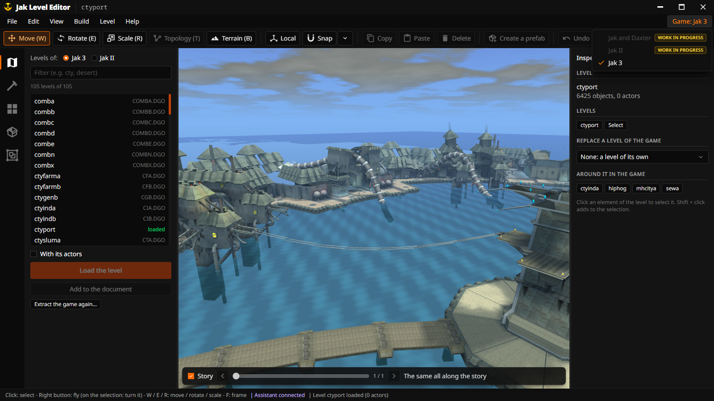

# Jak Level Editor

A level editor for the games of the Jak and Daxter series, for
[OpenGOAL](https://github.com/open-goal/jak-project): the project that rebuilds the PlayStation 2
games so that they run natively on PC, from your own discs. It edits **Jak 3** today, and is made to
take Jak and Daxter and Jak II later (see [Games](#games)). The editor reads the levels from **your
own copy of the game**, shows them as the game draws them, and lets you
change them or build new ones: move a wall, add a bridge, put houses of Haven City in the desert,
make a door open only once a crate is broken, then export the result for the game.

## What it does

- **Opens the game's levels** (105 places of Jak 3), one or several side by side, at any moment of
  the story, and shows them with the game's own rendering: its light at every hour, its fog, its
  sky and its weather.
- **Changes them**: select, move, turn, scale, copy, delete and group anything, from a single crate
  to a whole district; every change can be undone.
- **Places what the game has**: its objects (doors, crates, elevators, jump pads), its visual
  effects, its models and decor parts, and whole buildings as prefabs, Jak II's Haven City among
  them.
- **Builds new pieces**: floors, walls, doorways, stairs and roofs, natural ground with a terrain
  brush, your own prefabs.
- **Checks the result**: finds the holes through which the player would see the void, makes the
  nav meshes creatures walk on.
- **Sets what objects do**: a door that opens once a crate is broken, an elevator, decor Jak bounces
  on.
- **Exports a level for the game**: the files to copy into a jak-project (OpenGOAL's sources), with
  a README giving the exact lines.
- **Lets an AI assistant build for you** (Claude Code, or any program that speaks MCP): you describe
  the level in your own words, it builds it in your window.
- Speaks **English and French**.

## Games

| Game | Today |
|---|---|
| **Jak 3** | edited and exported: everything on this page |
| **Jak II** | its levels and buildings are brought into Jak 3's levels as decor; editing Jak II's own levels: *Work in progress* |
| **Jak and Daxter** | its disc is recognized; extracting and editing its levels: *Work in progress* |

The editor shows it as it is: its **Game** menu (at the right of the menu bar) names the game you
edit, and lists the others marked *Work in progress*.

## How it works, in short

- **Nothing of the game is in this repository.** Everything comes from your disc: the editor
  extracts it once, with its own extractor (ogle-extract, made from OpenGOAL's decompiler).
- **It needs nothing else to run**: not OpenGOAL, not the game. It does not run the game either:
  the export gives the files to add to OpenGOAL's sources.
- **On its own or inside the OpenGOAL Launcher**: it is made like the
  [OpenGOAL Launcher](https://github.com/open-goal/launcher), an engine in Rust and an interface in
  Svelte in a Tauri window, so the same editor runs as its own program or opens from the launcher's
  *Level Editor* button.

[How it is built](docs/architecture.md) explains it from the start, with examples.

## Get it

- **Download it**: each [release](https://github.com/whozghiar/open-goal-level-builder/releases)
  has installers for Windows (`.exe`, `.msi`) and Linux (`.deb`, `.AppImage`), and a portable zip.
  Then follow [Install](docs/user-guide.md#2-install) in the user guide: you need your copy of
  Jak 3 (the disc image or its folder) and about 4 GB of disk.
- **Build it yourself**: Rust, Node.js 22, and CMake for the extractor;
  [Build it yourself](docs/architecture.md#10-build-it-yourself-and-test-it) goes step by step.

It runs on Windows 10/11 and Linux, 64-bit; there is no macOS version.

## Documentation

| Page | What it tells |
|---|---|
| [User guide](docs/user-guide.md) | how to use the editor, step by step, and every feature it has (**F1** in the editor shows the same tutorials) |
| [MCP tutorial](docs/mcp.md) | how to build with an AI assistant: setting it up, what to ask, every tool |
| [How it is built](docs/architecture.md) | the architecture, explained for newcomers, then the technical reference |
| [Workflows](docs/workflows.md) | the GitHub Actions: lint, build, release |
| [Releasing](RELEASING.md) | how to make a release |
| [Screenshots](docs/captures/README.md) | how the documentation's pictures are made |

## License

ISC (see [`LICENSE`](LICENSE)), the license of OpenGOAL. This editor is built on the work of the
[OpenGOAL](https://github.com/open-goal/jak-project) team: its extractor is made of the data readers
of OpenGOAL's decompiler (`extractor/opengoal/`, ISC license), its game rendering draws with the
game's own shader (TFragment), its game data is generated from OpenGOAL's decompiled code. It is an
independent project, not affiliated with the OpenGOAL team nor endorsed by it. Third-party code
keeps its own license (`third-party/README.md`). Jak 3 belongs to Sony Interactive Entertainment and
was developed by Naughty Dog: no data of the game is in this repository; the screenshots show levels
extracted from a copy of the game.
