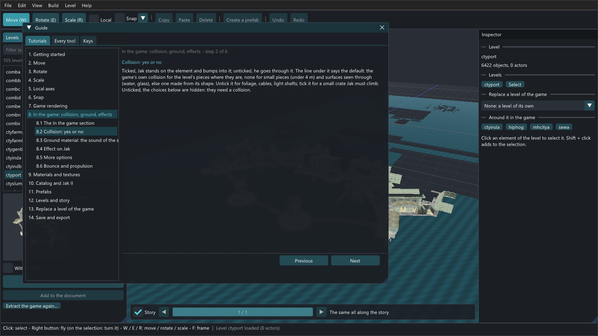
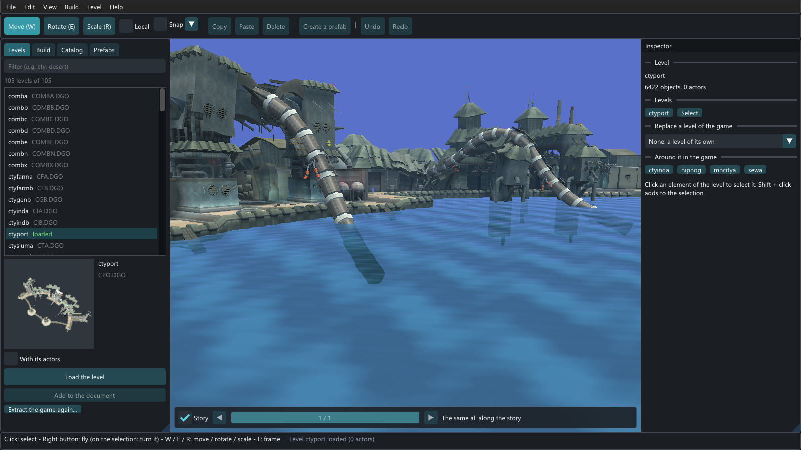

# OpenGOAL Level Editor

A simple level editor for the levels of **Jak 3** in
[OpenGOAL](https://github.com/open-goal/jak-project). It extracts the levels from **your own copy
of the game**, loads one, and lets you select its elements to move, rotate, stretch, copy or delete
them, and save groups of elements as prefabs to place again anywhere.

A level opens with its decor, its objects (crates, doors, platforms...), its water and ocean, and
without its creatures; the levels around it in the game can be added to it, each at its place, to
work on the junction between two levels or to build a new one next to the game's. A story bar
shows each level as the game shows it at any point of the story: Haven City's Metal Head tower
before and after it is blasted, the forest before and after its statue falls... A catalog holds
every object of the game and the decor of each level, to put in a level or to build a new one, and
an AI assistant (Claude Code...) can do the building for you through the editor's MCP server. The
editor also generates the nav meshes the creatures of the game walk on, sets **what each object
does** (when a door opens, when a board vent throws Jak up, when an elevator leaves, whether an
object is there at all, and every parameter its code reads), and **exports the level for the
game**: the files of OpenGOAL's level builder for Jak 3, with the level's own code generated for
those behaviors.

Building goes beyond the game's own pieces. The **Build** panel makes walls (with a door or a
window), floors, roofs and stairs, and gives them the textures of the games' levels; **prefabs of
the game** (buildings, houses, bridges, platforms, vents, tanks) are made from your levels, ready
to place; **Jak II** has its place in the catalog (its objects' models, its structures, its
materials and prefabs), brought into Jak 3 levels, checked and converted; what you place takes **the
light of the level around it**; a piece of decor can **collide** or not, sound like stone or metal
under Jak's feet, hurt him, **bounce** him up or **launch** him away; and a level can **replace a
level of the game** at its place (a `ctyindbis` made from `ctyindb`, which the game loads instead
of it). The guide's **tutorials**, each named, show every tool with its animation (F1).

The **game rendering** (View > Game rendering, G), on from the start, draws the level with **the
game's own renderer** (OpenGOAL's), lit as the game lights it at the hour you choose, fogged as the
game fogs it: what the level will look like in the game once exported. Edits show at once. The
**ocean** moves, its waves catching the sun, and the **particle effects** of the levels (steam,
sparks, smoke, fire, lights) run in the view and in the catalog, launched and moved by the game's
own rules.

- No game data comes with the editor: everything is read from the user's disc.
- It needs nothing but this repository and your disc: it does not use jak-project to build, to
  extract or to run. The repository holds the editor and `ogle-extract`, the extractor it runs,
  and the extracted levels go to `library/` in the repository (ignored by git).
- The interface is translated with JSON files (`lang/`): English and French for now.
- It is built on the work of the OpenGOAL team (its extractor comes from OpenGOAL's decompiler,
  its game data from their decompiled code), with which it is not affiliated: see
  [License](#13-license).


**[A guided tour, with screenshots](docs/captures/README.md)** shows how the editor works, step by
step: from your disc to a level built by hand or by an assistant.

## Contents

1. [Requirements](#1-requirements)
2. [Building](#2-building)
3. [Extracting your game's levels](#3-extracting-your-games-levels)
4. [Using the editor](#4-using-the-editor)
5. [Building levels with an assistant (MCP)](#5-building-levels-with-an-assistant-mcp)
6. [Shortcuts](#6-shortcuts)
7. [Languages](#7-languages)
8. [Files](#8-files)
9. [Command line](#9-command-line)
10. [What was tested](#10-what-was-tested)
11. [Known limitations](#11-known-limitations)
12. [Repository layout](#12-repository-layout)
13. [License](#13-license)

## 1. Requirements

**To use the editor**

- Windows 10/11 or Linux, 64-bit, with an OpenGL 3.3 graphics card.
- Your PS2 copy of Jak 3: the disc image (`.iso`), or the folder of a disc already extracted.
  `iso_data/` in the editor's own folder is there for it (put yours in `iso_data/jak3`, or however
  you like): it is ignored by git, and where **File > Extract game assets...** looks first.
- Disk space for all the levels of the game: 3.7 GB (272 levels); and about 5 GB of free memory
  while they are extracted.
- Optionally your copy of Jak II, for its structures (see [Structures of Jak II](#structures-of-jak-ii)).

**To build it**

- CMake 3.20 or newer, Ninja, a C++20 compiler (tested with Clang 19 on Windows).
- git or network access on the first `cmake`: SDL3 is downloaded when it is not installed.

## 2. Building

```bash
cmake -S . -B build -G Ninja -DCMAKE_BUILD_TYPE=Release
cmake --build build
./build/bin/open-goal-level-editor --selftest   # internal tests: "OK (0 failures)"
./build/bin/open-goal-level-editor              # starts the editor
```

`build/bin/` then holds:

| File | What it is |
|---|---|
| `open-goal-level-editor` | the editor |
| `ogle-extract` | the level extractor, run by the editor (or alone, see [3](#from-the-command-line)) |
| `ogle-extract-data/` | the game's tables the extractor reads (types, disc files, level names) |
| `data/` | what the editor knows of the game (actor roles, water, oceans, story: see [8](#game-data)) |
| `lang/` | the translations of the interface |

Keep them together if you move the editor.

| CMake option | Default | Effect |
|---|---|---|
| `OGLE_BUILD_EXTRACTOR` | `ON` | builds `ogle-extract` |
| `OGLE_SDL3_SOURCE_DIR` | empty | builds SDL3 from this folder instead of downloading it |

SDL3 comes from an installed SDL3 package when CMake finds one, else from `OGLE_SDL3_SOURCE_DIR`,
else it is downloaded (tag `release-3.4.10`); the first build takes a few minutes. Dear ImGui,
glad, tinygltf, nlohmann json, stb and Recast (the nav mesh generator) are in `third-party/`.

## 3. Extracting your game's levels

### From the editor

1. **File > Extract game assets...** (or the button of the Levels panel on the first start).
2. **Your Jak 3 disc**: choose your `.iso` file (**.iso file...**) or the folder of your disc
   (**Folder...**). The editor reads the disc and shows its game, version and serial (for
   example *Jak 3 - ntsc_v1 - SCUS-97330*); it tells you if the disc is another game. A disc of
   **Jak II** is extracted too, to `library/jak2/`, for its structures.
   The disc can be anywhere: nothing has to be copied to a particular folder, but both dialogs
   open on `iso_data/` in the editor's own folder by default, ready if that is where you put yours.
3. **Where to write the levels**: by default `library/` in the editor's own folder (the
   repository it was built from; `library/` next to the executable when it is moved elsewhere).
   `library/` is ignored by git; the levels go to its subfolder `jak3/`.
4. **Extract all the levels**: the progress bar shows each level written; **Cancel** stops.
   When it is done, the Levels panel shows the game's levels.


An `.iso` is read in place: the extractor copies only the files it reads (the `DGO` and `CGO`
folders, about 400 MB of a 4 GB disc) to a work folder of the destination, and deletes it when
done. The extractor reads nothing but your disc and its own tables (`ogle-extract-data/`), and
writes nothing outside the destination.

Measured with Jak 3 NTSC (SCUS-97330) from the folder of the disc, on a 16-core processor and an
SSD: the 272 levels are extracted in 1 minute 10 to 1 minute 20 seconds and take 3.7 GB.

### What is written

```text
library/jak3/library.json                              the game, its version, the levels extracted
library/jak3/common/models/*.glb                       models every level uses (collectables, Jak...)
library/jak3/common/sprites/<page>/<texture>.png       the textures of the particles (index.json: by
                                                       number)
library/jak3/<level>/decor/<level>-background.glb      the level: decor (one node per element),
                                                       collision and actors
library/jak3/<level>/models/<model>-lodN.glb           the models of its actors (crates, doors...)
library/jak3/<level>/level.json                        what the folder holds (DGO, actors, models,
                                                       regions)
library/jak3/prefabs/*.glb                             your prefabs
library/jak3/prefabs/game/*.glb                        the game's prefabs, made from these levels
library/jak2/...                                       Jak II's levels, the same way (when extracted)
```

These files come from your copy of the game: keep them on your computer, do not share them.

### From the command line

```text
ogle-extract <game.iso | disc folder> <output folder> [--levels CIA,CIB] [--textures]
ogle-extract --detect <game.iso | folder>   # game, version and serial (json)
ogle-extract --list <game.iso | folder>     # the levels of the disc (json)
```

Without `--levels`, every level is extracted; `--textures` also writes each level's textures as
PNG files. The details (options, messages read by the editor, origin of the code) are in
[`extractor/README.md`](extractor/README.md).

## 4. Using the editor

```text
+----------------------------------------------------------------------+
| File Edit View Build Level Help                                      |
| [Move W] [Rotate E] [Scale R] [Local] [Snap v] | [Copy] [Paste] [Delete] | [Create a prefab] | [Undo] [Redo] |
+----------------+-----------------------------------+-----------------+
| Levels|Build   |                                   | Inspector       |
| |Catalog       |              3D view              | (the selection  |
| |Prefabs       |                                   |  or the level)  |
|                | [Story] < ======o========= >      |                 |
+----------------+-----------------------------------+-----------------+
| hints                   |  last message                              |
+----------------------------------------------------------------------+
```

The menus follow the work: **File** (extract, new, open, save, import a model), **Edit**, **View**,
**Build** (the shapes, the materials of the games), **Level** (add a level next to it, select it whole,
replace a level of the game, nav meshes, export for the game) and **Help**. The left panel has the
same steps: **Levels** to open, **Build** to make, **Catalog** and **Prefabs** to place.

### The guide

**Help > Tutorials** (F1) opens the guide, by itself the first time the editor starts:

- **Tutorials**: 14 tutorials, each named, listed on the left with their named steps (click one to
  go there): **Getting started** (eleven steps from your disc to the game: extract, open a level,
  look around, select, move and turn, build, place the game's objects, prefabs, make the decor act,
  replace a level, save and play), then one per tool or task: **Move**, **Rotate** (the rings, and
  the right button turning a piece every way), **Scale**, **Local axes**, **Snap**, **Game
  rendering** (the hour, the fog, the lamps, what it draws), **In the game: collision, ground,
  effects** (what each field of the inspector's section does and what changes with it), **Materials
  and textures**, **Catalog and Jak II**, **Prefabs**, **Levels and story**, **Replace a level of the
  game** and **Save and export**. Each step has its animation when the tool has one, and a button
  that shows where it is (the panel, the window, the inspector's section); the last step of a
  tutorial leads to the next.
- **Every tool**: the animation of each tool, what it does, its keys and a concrete example (*lift
  a platform by 2 m so that Jak needs a double jump*, *a ctyindbis made from ctyindb replaces
  ctyindb*...).
- **Keys**: the camera, the story and the editing keys.

Hovering a tool shows the same as a tooltip: the toolbar's tools, the panels' tabs, the catalog's
kinds, the Build panel, the prefabs, the decor's behaviors, the replacement of a level. The
animations are small scenes of the editor's own shapes, drawn as they play (nothing of the game).




### Loading a level

In the **Levels** panel, choose a level of the list (the filter finds `cty` for the Haven City
districts, `des` for the desert, a DGO name, etc.). A picture of the
level appears under the list: **Load the level** (or double-click it). The level comes with its
decor, its actors (each one drawn with its model when the extracted files have one) and its
collision (kept, not shown). With **With its actors** unchecked, it comes without any actor: its
decor alone (the same for **Add to the document**).

The list only has the game's levels: the parts of a disc that are only actors (the actors a
mission adds to a level, cutscenes) and the copies of a level found in another DGO are left out.
When a level opens:

- **Creatures are left out**: enemies, characters, animals, mechs, the characters of the
  cutscenes. So are the logic actors that the game does not draw (cameras, triggers, managers).
  The objects stay: crates, doors, platforms, props, turrets..., and the particle effects (see
  [Effects](#effects)).
- **Water** (pools, fountains, falls) is drawn translucent, its texture flowing, **dark eco** dark
  purple, **lava** with its own texture: the water actors get the model of their "look". The
  **ocean** is drawn at its height where its map covers (Haven City's port and slums, the desert,
  Spargus...): the 96 m cells of the game's mid ocean, and by the shores, where the game draws its
  near ocean instead (the port's basins), its water square by square (3 m). It moves: waves of a few
  lengths and directions, each as fast as deep water waves of its length go, the sky reflected at a
  grazing angle, the sun (or the moon, in the game rendering at night) glinting on them. For the
  levels the game draws it with (the desert, Spargus' palace and arena...), the **far ocean** to
  the horizon, behind everything as the game draws it. The ocean is the one of any level shown that
  has one, the level opened first (View > Ocean hides it).
- The levels the game shows with it come too (**Shown with this level** in the inspector, for
  example the parts of the desert with `desert`: uncheck one to hide it), and so do the actors the
  missions add to it (the **mission layers**), shown by the story bar when their mission is under
  way.

### The story

Some levels change along the game. The bar at the bottom of the view shows the level at a point
of the story:

- The slider goes through the **states of the level**: the start of the game, then each step of
  the missions that changes it, in the order of the game; the steps that change nothing there are
  skipped. Haven City's walls (`ctywide`) have four states among the 410 steps of the story (the
  dark eco missions of the city change them, then the Metal Head tower is blasted after
  `tower-destroy-resolution`), the forest (`foresta`) five (its broken statue is there from
  `wascity-defend-resolution` to `precursor-tour-resolution`). The text says the last task node
  done.
- The arrows go to the previous and next state.
- With several levels in the document, the list next to **Story** chooses the level the slider
  moves: each level is at its own point of the story.
- **Story** unchecked shows every state at once.

What changes: the actors (the game keeps an actor while its kill mask and the level's task mask,
set by the missions of that level, share no bit), the decor prototypes some missions show or hide,
the actors whose type appears or disappears with a mission, the mission layers. Nothing is removed
from the document: hidden elements are only not drawn, and a saved project keeps every state.


### Several levels side by side

The levels of a game share its world: each extracted level keeps the game's coordinates, so levels
that are side by side in the game meet in the editor too, with nothing to align. With a level open
(or a new one), choose another in the Levels panel and click **Add to the document**: it is loaded
at its place, with the levels the game shows with it and the layers of its missions, and it can be
undone. What for:

- **The junction between two levels**: open `ctyinda`, add `ctyindb`, and the streets of the
  industrial zone run from one level into the other; both are edited like one.
- **A new level next to the game's**: **File > New level**, then add the levels of the zone it
  will join: build at their side, at the right place in the game's world.

The inspector (nothing selected) lists the document's **levels**: show or hide each level added,
click its name to frame it, **Junction** frames where it meets the level opened (the strip where
their boxes overlap), **Remove** takes it out of the document. **Around it in the game** lists the
levels the game displays together with those of the document (read from the game's continue
points, the places where it starts the player): click one to add it. A saved project keeps its
levels, each under its group.

**Select** (next to each level of the inspector), or **Edit > Select its level** (Ctrl+L) with an
element of a level selected, selects the **whole level**: the gizmo stands in its middle, and
moving or turning it moves the level with everything it holds (decor, collision, actors). For the
level opened, its root elements are selected (without the levels added nor the nav meshes).

Each level added is shown along the story as when the player is there: its own task mask, the
layers its missions lend it, and its own point of the story (the list of the story bar).


### Moving around

| Action | Input |
|---|---|
| Fly | right button held + WASD (ZQSD on AZERTY); Q / E (A / E on AZERTY): down / up (held on the selection, the right button turns it instead) |
| Speed | Shift: faster, Ctrl: slower; the wheel while flying changes the speed |
| Forward, pan, turn around | wheel; middle button; Alt + left button |
| Frame | F: the selection; Home: the level |

### The game rendering

**View > Game rendering** (G), on from the start, draws the level as the game draws it. OpenGOAL's own renderer of the
game's background (`TFragment` and its shaders, vendored in `extractor/opengoal`) draws the decor as
the level builder makes it of the export (the triangles of every piece in the game's units, a draw
per material with the game's draw modes: alpha test, blending, fog), with the game's camera:

- **Hour**: the time of the day. The game lights every vertex of a level by mixing 8 palettes baked
  by its artists (the ambient light, the sun from 4 directions, the level's own lights) with weights
  its mood code sets from the hour (`update-mood-exterior`, clear weather): dawn, noon, dusk and the
  moonlit night as in the game. The sky behind is the mood's sky color at that hour.
- **The game's fog**, from 32 m to the horizon.
- **The level's lights**: the lamps lit at night, the lights always on and the flickering ones, as
  the city's levels drive them (palettes 5 to 7).


The editor's things stay over it, at the game's depth: the selection, the gizmo, the actors' models
(drawn by the editor, lit and fogged as the game's model renderer does: the hour's ambient light and
the sun from up to 3 of its directions, by their normals), the markers, the nav meshes, the ocean
(its waves lit by the hour's sun or moon, reflecting the hour's sky, in the game's fog). An edit
shows at once: the level is made in chunks (the pieces sharing a palette in a cell of 128 m), and
the chunks an edit touched are made again (a few milliseconds). A palette larger than a tree of the
renderer takes (8,192 colors: the decor instances of a whole desert) gives each chunk the colors
it uses. What you place takes the light of
the level around it (see [The light of what you place](#the-light-of-what-you-place)); the pieces
made in the editor that have none yet (a shape far from any lit decor) are lit like the level's
geometry from their color, as the export lights them.

The game rendering needs OpenGL 4.1 (the game's shaders); without it the menu says why and the
editor draws as usual. It draws the background (the decor) only: the sky is its color, the ocean,
the actors' models (lit as the game lights them) and the particle effects are the editor's. **G**
switches to the editor's own view, where every light of the level is on at once (each surface
takes the brightest of its palettes): handy to see dark corners.



### Effects

The particle effects of the levels (the actors naming a particle group by their art-name:
`part-spawner` and its kind) run in the view: **View > Effects**. Their particles are made as the
game makes them, from its definitions (`data/jak3/particles.json`, read in the game's code by
`tools/gen_particles.py`) and by its rules (`sparticle-launcher.gc`, `sparticle.gc`): a group
launches the particles of its parts all the time, in bursts every period or once; each particle
starts from its launcher's values (position, velocity, size, rotation, color, how they change, its
life: a value and a random range each) and moves 60 times a second (its velocities per tick of the
game, 300 a second; its friction and acceleration per frame); a launcher can hand a particle over
to another at a time of its life (steam that fades out). They are drawn with the game's textures
of particles, which the extraction writes to `library/jak3/common/sprites/`, facing the camera;
the glows (lights, neon signs) are added to what is behind them. Some parts launch only at some
hours of the day: the game rendering's hour chooses.


In the **Catalog**, the effects show their particles a moment after they start, and run live in
their tooltip.

### Selecting and editing

- **Click** an element to select it: each decor element is its own object (a click on a pipe
  selects that pipe, not every copy of it). **Shift or Ctrl + click** adds to the selection;
  **dragging** in an empty spot selects everything in the rectangle. **Click again at the same
  place** to select what is behind or under the selection, one element after the other.
- The level's shell is split in pieces: a wall, a staircase or a bridge is selected on its own.
  Only the ground is locked, so that clicks go to what stands on it: the pieces 60 m across or more
  whose surface mostly faces up. A door, a tall facade or a long wall stays selectable (they were
  locked before, being large too). **View > Select the ground** unlocks it, for clicks and boxes.
  Glows and light shafts do not take the clicks meant for what is behind them.
- **Move (W)** and **Rotate (E)**: drag an arrow, a square or a ring of the gizmo. While dragging,
  the value is written next to the cursor (the distance, the angle), **Shift** makes the move ten
  times finer and **Ctrl** snaps (or stops snapping, with **Snap** on). **Snap** moves by 0.5 m
  in world space (the gizmo's pivot lands on the grid, so modular walls meet), turns by 15 degrees
  and scales by 0.1; the arrow next to it changes these steps (0.1 to 4 m and 5 to 90 degrees in
  a click, or any value).
  **Local** moves and turns along the selection's own axes (a catwalk set across slides along its
  own length). The handles seen edge-on are hidden (they could not be dragged precisely), and a ring
  seen edge-on turns with the cursor along it. The inspector gives the exact position and rotation.
- **Free rotation**: hold the **right button on the selection** (or on what you are placing) and
  move the mouse: it turns on every axis, left-right around the vertical and up-down around the
  camera's horizontal (Shift finer, by the snap's steps of angle with Snap). Pressed elsewhere, the
  right button looks around as usual.
- **Scale (R)**: drag the square at the end of an axis to stretch the selection along it (a
  catwalk of the industrial zone made longer, a wall made higher), or the square in the middle to
  make it bigger or smaller. The axes are the element's own, and each selected element scales
  around its origin. **Snap** scales by steps of 0.1. The inspector's **Scale** field gives the
  exact values: with **Keep the proportions** checked, changing one changes the three.
  Decor (pieces, prototypes, models) keeps its scale in the game; most objects do not (the game
  gives its actors their own size), and the inspector says so.
- **Copy** (Ctrl+C) then **Paste** (Ctrl+V) puts copies where the originals were, selected: move
  them with the gizmo, they take the light of where they go. **Duplicate** (Ctrl+D) does both at
  once.
- **Delete** (Del) removes the selection. **Undo** (Ctrl+Z) and **Redo** (Ctrl+Y) go back and forth.
- **Large selections** stay smooth: with 1,000 elements selected among 19,874 (`ctyinda`,
  `ctyindb` and `ctywide`), a frame takes 13 ms (120 ms before this version), moving them 14 ms
  (171 ms), duplicating them 27 ms (1.35 s); a whole level selected, 13 ms a frame (87 ms).


### The light of what you place

Jak 3's decor carries its light: each vertex has the 8 palettes the game mixes by the hour (the
ambient light, the sun from 4 directions, the lamps), baked by its artists for that very place. A
piece brought from elsewhere (the catalog's decor, a prefab, a model, a structure of Jak II, a copy
moved away) kept the light of where it came from: darker, brighter or bluer than its new
neighbors. So what you place, paste then move, or move after placing it takes **the light of the
level around it**: each of its vertices takes the palettes of the level's lit vertices near it that
face the same way (the nearer and the more alike, the more; searched up to 16 m), and the piece gets
palettes of its own (the game rendering draws it with them, the export writes them, the project
keeps them). The level's own pieces keep the game's light when they are moved a little;
**Light it like here** (the inspector's Material section) does it for the selection, those
pieces too. A piece too far from any lit decor (a new level's first walls) keeps its own.

### Prefabs

1. Select the elements that go together (a building and its props, a group of crates...).
2. **Create a prefab** (toolbar, inspector or Edit menu), give it a name: it is saved in
   `library/jak3/prefabs/` and appears in the **Prefabs** panel, with a picture.
3. Click a prefab, then click in the view to place copies where the cursor points (R or
   Ctrl + wheel turns it, Esc stops), or drag it into the view to place one. A prefab sits on the
   surface it is placed on.

Right-click a prefab to delete it.

**The game's prefabs**, at the top of the panel, are ready-made assemblies of the games' decor,
taken as the game put them, shown by **game** (Jak 3, or Jak II when it is extracted), **level** and
**category**: 58 of Jak 3 from 28 of its levels (19 industrial structures: tanks, scaffolding, a
conveyor, pipes, a smokestack, braziers; 15 buildings: Haven's blocks, the Metal Heads' buildings
and tower, a marauder watchtower, a temple shrine, a Precursor dome; 8 houses; 5 vents and fans; 4
bridges; 4 platforms; 3 generators), and 26 of Jak II from 18 of its levels (12 buildings: Haven's,
the market's archway and awning, the palace's statue, Dead Town's ruins, the mountain temple's arch
and door; 4 industrial structures; 3 vents; 3 generators; 2 houses; 2 bridges). They
are described by recipes (`data/jak3/prefabs.json` and `data/jak2/prefabs.json`: a level, an
element of its decor and how much around it to take; names only) and made from your extracted
levels the first time the panel shows them (each level read once, on a worker thread), into
`library/jak3/prefabs/game/` (Jak II's in `game/jak2/`, their textures named `jak2-<name>`). They are
placed like your own, take the light of the level around them, and their pieces can then be changed
one by one.


### The catalog

The **Catalog** panel lists what else can be put in a level, placed like prefabs. At its top, the
**game**: Jak 3, or Jak II when its disc was extracted too (see [Structures of Jak II](#structures-of-jak-ii)).
For Jak 3:

- **Objects** (541): what makes up a place, by family, with a filter: the props that only stand
  there (41: flags, windmills, a parked hellcat...), the doors and airlocks (44), water, dark eco
  and lava (5, with the type of that level's water: its ripples and color), and the **particle
  effects** of the levels (451: one per particle group their actors use, the lights, neon signs,
  steam, sparks, drips..., each shown by its particles, live in its tooltip).
- **Interactive** (206): the objects that do something: crates (15), platforms and elevators (56),
  moving parts (14), buttons (7), hazards (4), breakables (8), turrets (4), door-like objects (8),
  and others (90). Their behavior is set in the inspector.

  Never offered: the living (enemies, characters, animals, riders), the collectibles (precursor
  orbs, gems, health, eco, ammo) and the technical types (logic, cameras, managers). The
  families come from the game's code (`tools/gen_game_data.py`, with `tools/object_categories.json`
  for the choices the code does not make). A new object takes the data of an object of its type
  found in the game's levels (the data of a crate, the particle group of an effect...), without
  what ties that one to its level (its name, its story, the actors and paths it refers to). One
  entry per model for the objects that choose theirs by name; the few the game draws without a
  model are markers in the editor.
- **Models**: every other model of the game but the characters and the collectibles (parts of
  objects, debris, props), placed as decor: the game draws them, they do nothing. The museums' (the
  game's art gallery, showing its characters and props again out of their levels) are left out.
  **All levels**, or one level: the models it has.
- **Decor**: the decor of the levels, to reuse in another: their prototypes (a pillar, an arch, a
  catwalk, a lamp post) and the pieces of their shell (a wall, a bridge). **All levels** shows the
  31,077 parts of every level, each prototype once, and searches them by name (`catwalk` finds the
  10 catwalks of the industrial zone and the factory); choosing a level shows its whole decor. A
  part sits on the point it is placed at, and takes the light of the level around it.
- **Materials**: every texture the decor of the levels draws, by level or all, searched by name: a
  click gives it to everything selected (see [Building: shapes and materials](#building-shapes-and-materials)).

For Jak II: its **Objects** (535 models: placed as decor, without their behavior, which is Jak
II's code; its living things left out, the enemies, characters and bosses of
`data/jak2/creatures.json`), its **Decor** (its structures) and its **Materials**, each by level.

The first time a library is shown, the editor reads what the catalog needs of every level (their
decor and the data of their actors, not their geometry) in the background, a few seconds, and
keeps it in its preferences folder: the next times the catalog is complete at once.

Click an element, then click in the view to place copies (R or Ctrl + wheel turns it, Esc stops),
or drag it into the view.


### A new level

**File > New level** (Ctrl+N) starts an empty level: build
it from the decor and objects of the catalog and from your prefabs. There is no ground at first:
elements placed in the void go to height 0.


### Building: shapes and materials

To build what the game's decor has not, the **Build** panel (or the Build menu) makes new shapes,
in the spirit of a building mode: a block, a floor, a wall, a **wall with a door**, a **wall with a
window**, a pillar, a ramp, stairs, a **roof** (two slopes), a **hip roof** (four slopes) or a
cylinder. Click one (its picture), then click in the view to place it, again and again (R or
Ctrl + wheel turns it, Esc stops). Walls start at 4 m by 4 m, the grid of modular building: with
**Snap to the grid** (0.5 m), walls placed side by side meet edge to edge. The inspector sets a
shape's **Size** in meters, its opening (the door's or the window's width and height), its steps or
sides, and **Texture every**: how many meters one repeat of its texture covers, so that a larger
wall repeats its texture instead of stretching it (a shape stretched with the scale tool: **Make
the scale its size**). New shapes have a grey grid whose cells are one repeat of the texture.

Under the shapes, **Materials** holds every texture the decor of the games' levels draws: the
**game** (Jak 3, or Jak II when it is extracted), a **level** (the textures its decor uses) or every
level (the most shared first: city walls, metal floors, Spargus' sandstone, wood, the sewers, the
mines...), or **This document** (the textures of the levels opened and the images added), and a
search by name. Select shapes or pieces of decor (a prefab, a whole group), then click a texture:
they all take it, at once, undone at once. The textures come from the extracted levels (the
library's index counts which pieces draw which texture; their images are read from the levels'
files alone, without their geometry), so they need no level open; Jak II's are named `jak2-<name>`
in the document, apart from Jak 3's of the same name. **Catalog > Materials** is the same.


The **Material** section of the inspector lists the materials of the element selected (a shape, a
model, a decor part), each with **Image...** (an image of your own: PNG, JPG, TGA, BMP) and **Game
textures...**, a window choosing among the games' textures as above (the game, a level, a name):
it changes the elements selected that draw that material, not the other copies in the level; the
image is saved in the project and in the level exported for the game. A material's color is the
game's light (the 8 palettes of each vertex): it is not set by hand; **Light it like here** gives
the selection the light of the level around it. For a shape too complex for these, model it
elsewhere (Blender...) and bring it in with **File > Import a model (.glb)**: it is placed like a
model of the catalog, with its own textures.

### Structures of Jak II

Jak II's levels hold structures Jak 3 has not: the buildings and the palace of Haven City as it
was, its pillars, its cables... Extract your Jak II disc as you did Jak 3's (**File > Extract game
assets...**: it goes to `library/jak2/`), then choose **Jak II** at the top of the **Catalog**: its
**Objects** (their models, placed as decor), its **Decor** (its structures, listed and searched like
Jak 3's, the low-detail scenery a level draws far away, its `-lowres` parts, left out) and its
**Materials**, each by level, placed the same way; the **Prefabs** panel has Jak II's prefabs too.

The two games' files are alike (the same extractor writes both: meters, the same axes, vertex
colors, materials and collision), so a structure keeps its geometry as it is. What could break is
checked and converted when it is placed, and the inspector's **From Jak II** section says it for
each:

| Check | What is done |
|---|---|
| Names | its textures are renamed `jak2-<name>` unless the document has the same image under that name: the two games share most texture names with slightly different pixels, and one name for two images would make the level builder (and texture packs) mix them |
| Mesh | its triangles, indices and texture coordinates checked; vertex colors where the game has them |
| Lighting | its vertex colors (the brightest of its level's light palettes) against those of the document's Jak 3 decor: more than a quarter brighter or darker is said, and **Match the lighting** scales them (undone like any change); placed near lit decor, it takes the light of the level around it instead |
| Materials | the alpha and blend modes the export writes for Jak 3 (blended: cut out) |
| Textures | 8-bit RGBA, power-of-two sizes up to 256, as the game's |
| Metadata | no actor, no story, no collision of its own: the level builder makes its collision from its shape |

A structure placed keeps where it comes from in its extras (`og_import`: the game, the level, the
part and its checks), in the project and in prefabs.

### Nav meshes

The enemies and citizens of Jak 3 walk on **nav meshes**: flat polygons over the ground
of a level, on which the game finds their way. **Level > Nav meshes** makes them from the level's
walkable surfaces:

1. Set **the creature**: its radius (how far it keeps from the walls), its height (the room it
   needs above the floor), the highest step it climbs and the steepest slope it walks.
   **Precision** holds the voxel size, the longest edge, the outline tolerance and the smallest
   walkable island kept.
2. **Generate for the whole level**, or **Generate around the selection** (only there): the nav
   meshes of that region are replaced. With **Only the ground under the selection** checked, only
   the pieces of walkable ground that the selected elements stand on are kept (select something in
   a street): the roofs, ledges and closed rooms where no creature goes are left out.
3. The new nav meshes are selected and drawn over the level, one color per mesh, their borders
   brighter (**View > Nav meshes** hides them). The inspector gives a mesh's polygons, corners and
   walkable area, and says whether it suits the game; **Generate this area again** makes it again
   with the window's parameters.

The walkable surfaces are those of the decor shown, without the water, dark eco, glows and light
shafts, nor the objects (their models move, open or break). Recast (from recastnavigation) builds
the polygons; the editor then fits them to what the game reads: convex polygons of 3 or 4 corners
facing up, neighbors sharing their edges exactly, at most 255 polygons per mesh (a larger piece of
ground is cut in several meshes, and the small pieces a cut leaves join a neighbor), each mesh in
one piece. Each mesh gets the route table the game follows (the first step of the shortest way
from every polygon to every other) and the polygon grid it uses to find the polygon under a point.
A nav mesh is an element of the document: it can be deleted, undone and redone, and it is saved
with the project.

**Export the nav meshes...** writes them as the game's levels hold them, an `entity-nav-mesh` per
mesh (polygons, route table, polygon grid, tags), in a `nav_data` file (`.json`) for a custom
level builder; **First id** is the entity id of the first one, the next ones follow.


For the 448 x 448 m district of [the next part](#5-building-levels-with-an-assistant-mcp), keeping
the ground connected to a few street points: 8 nav meshes, 1,413 polygons and 96,955 m2; 153 pieces
of ground away from the streets (the insides of the blocks, the facades' ledges, the tops of props)
were left out.

### Behaviors and parameters

In the game, an object is an **actor**: a type, whose code is the game's (a door, a board vent, an
elevator, a crate), and the data of this one object (its *res lumps*), which that code reads when
the object starts: how far a door opens from, how high a vent throws Jak, what a crate holds. Some
of what objects do is written in that data as small scripts of the game (`on-notice`,
`open-test`...): a door of the game opens only when its script says that the levels behind it are
loaded. OpenGOAL's level builder cannot write those scripts, so the editor writes what an object
does as **code of the level** instead (`<name>-obs.gc`, see [Exporting for the game](#exporting-for-the-game)):
for each object whose behavior is set, a type of the level deriving the game's own type, with the
choice in its methods or states. Nothing has to be written by hand.

With an actor selected, the inspector shows its **Behavior**:

| Object | Settings |
|---|---|
| Doors and airlocks (`com-airlock` and its 23 subtypes: `cty-door`, `hip-door-a`, `wascity-airlock`...) | **The door opens**: when Jak comes near (the game's doors), never (locked), always, or when Jak comes near once a condition holds; the **opening distance** in meters |
| Bouncers (the board vents of the city, the jump pads of the sewers, the awnings of Spargus, `vol-bouncer`, `tpl-bouncer`) | **Throws Jak up**: always, never or once a condition holds; the **height** in meters (the board vents work on the jetboard only, as in the game) |
| Elevators | **Leaves once Jak rides it**: always, never or once a condition holds; its **speed** in m/s |
| Crates | the **crate** (wood, iron, steel, metal, blue, dark eco) |
| Every object | **The object is there**: always, never (left out of the export) or once a condition holds, checked when the level loads |

A **condition** is one of: after a step of the story (a task node: *after
`arena-fight-1-resolution`*), once an object of the document is activated (a floor switch pressed),
once an object is gone (a crate broken, a pickup taken, an enemy killed). A door can so open once
its switch is pressed, a vent work once a crate is broken, an elevator leave after a mission.


Under it, **Parameters** lists every res lump the code of the object's type reads (read from the
game's decompiled code: 371 types have some), with its kind: numbers (distances in meters), lists
of numbers (`sync`: the period and phase of a moving platform), option bits by their names
(`options` of an airlock: `front`, `block-flut`, `back`), enums (a pickup type), symbols, another
actor (a link, chosen by name: `next-actor`, `alt-actor`, `state-actor`...) and what a crate or a
pickup holds (`eco-info`: the pickup and how many). A value set here replaces the game's; **x** goes
back to the game's value. The paths are shown, and follow the object when it moves (the export moves
them by as much); the game's scripts are shown, and left out.

Every change is undone and redone like the others, and kept in the project.

### What the decor does

The decor is not an actor, but the game can still do something with it. With a piece of decor
selected (a part of a level, a model, a shape, a structure of Jak II), the inspector's **In the
game** section sets, for every piece selected:

- **Collision**: ticked, Jak stands on it and bumps into it; unticked, he walks through it
  (cables, light shafts, foliage). The line under it says what it is by default, as the export
  does: the game's own collision for a level's piece still in place, none for the small pieces
  (under 4 m: pipes, lamps, decals) and the surfaces seen through (water, glass), else one made from
  its shape by the level builder. **More options**: **Invisible in the game** (not drawn, solid: an
  invisible wall), the **kind of surface** (ground, wall, obstacle; by default its slope decides)
  and its flags (Jak cannot hang from its edges, the camera, the creatures or the line of sight go
  through it).
- **Ground material (the sound of the steps)**: what Jak walks on, as the game's surfaces have it.
  Mostly the sound of his steps, rolls and landings and the dust they raise (stone, metal, wood,
  grass, dirt, sand, snow, straw...; `sound-name-with-material` in the game); a few change how he
  moves: **Ice** (he slides on it), **Gravel** (he slides down its slopes), **Quicksand** (half his
  speed), **Tube** (he cannot walk on it), **Bottom of water** (he is in water); **Stop shots**: the
  guns' shots stop on it. The list says each.
- **Effect on Jak**: nothing; **hurts him** (he loses health and is pushed back) or **burns him**,
  either one throwing him up in the air or not; **endless fall** (the void under a level) or
  **kills him at once**: he starts again at the last continue point.

  The export writes the collision, the material and the effect as the level builder's own fields:
  no code. The guide's tutorial **In the game** goes through them.
- **Bounce**: Jak landing on its top is thrown up so many meters, on foot, in a dive and on the
  jetboard. The export writes a bouncer of the game without a model of its own (as the board vents
  of the Industrial Zone are) on top of the piece, as the level's code.
- **Propulsion**: Jak stepping on its top is thrown along an arc to a point so many meters away,
  so high, turned so many degrees from the piece's facing, in so many seconds: the game's own
  directed launch (the Metal Head puffers'), written as the level's code (the jetboard ignores it,
  as in the game).

Breaking, squashing, dipping or swaying need a model of its own that the game draws as an actor;
the decor the level builder makes cannot do them. [`docs/behaviors.md`](docs/behaviors.md) is the
study of the game's code behind these choices: the builder's collision fields and what Jak 3 does
with them, every bouncer, launcher, breakable and deformable object of the game, how each works,
and how a later version could make a piece breakable (an actor of its own, made with OpenGOAL's
actor builder).

### Saving

**File > Save** (Ctrl+S) writes the level as a project, only when you ask: the first time (and
with **Save as...**), name it; it goes in a folder of its own in the library's projects,
`library/projects/<name>/`:

| File | What it is |
|---|---|
| `<name>.glb` | the project: a standard `.glb` file that Blender also opens (see [Files](#project-glb)) |
| `<name>-nav.json` | its nav meshes for the game (`nav_data`), when it has some |

**File > Open project** (Ctrl+O) opens one again, **File > Recent projects** too. Nothing is saved
behind your back: no automatic copy, no backup folder.

### Exporting for the game

**Level > Export for the game...** writes what the view shows (the levels and elements hidden, or
not there at the point of the story shown, are left out) as a **custom level of OpenGOAL**: the
files its level builder (`goalc/build_level`) takes for Jak 3.

- **Name** (the level's name in the game, 3 to 10 lower case letters, digits or `-`, not a level of
  the game), **Nickname** (3 letters: its DGO file), **ISO name** (8 letters at most), **First
  actor id** (above the game's own actors' ids: 90,000 by default).
- **With the actors**, and the collision: **The game's collision** (the default: see below) or
  **Made from the decor** (all of it from the decor's shape, with automatic walls: far denser
  than the game's, Jak can fall through the floor where the decor is detailed).
- **Start**: where the player starts, a continue point of the level opened by default (moved with
  it).
- **Replaces**: a level of the game this one replaces (see
  [Replacing a level of the game](#replacing-a-level-of-the-game)); none by default.
- **Written in**: the project's export folder, `library/export/<project>/` by default (the project's
  name, else the level's). It is laid out like the jak-project checkout it is copied into, with a
  `README.md` at its top that says how to bring the level into the game:

  ```text
  library/export/<project>/
    README.md                                   how to bring it into the game, what the export changed
    custom_assets/jak3/levels/<name>/           the level (the files below)
    goal_src/jak3/levels/<name>/<name>-obs.gc   the behaviors' code, when there are some
  ```


| File | What it is |
|---|---|
| `<name>.glb` | the decor in the game's space, lit as the game lights it (the 8 palettes of each vertex: see below), one node per element with the builder's extras: `set_collision` + `ignore` on the decor covered by the game's collision (and on the see-through surfaces: water, glass), none on the rest (the builder makes their collision); the game's collision, one node per surface (`set_collision`, `set_invisible`, `collide_material`, `collide_event`, `collide_mode`, `noedge`, `nocamera`, `noentity`, `nolineofsight`) with the game's normals |
| `<name>.jsonc` | the level for the builder: its names, `gltf_file`, `base_id`, `base_region_id`, the art groups of the actors' models, the actors (`trans`, `etype`, `game_task`, `quat`, `bsphere`, `lump`: their data typed as the builder reads it), and for a level replacing one of the game's, that level's regions (`region_trees`) |
| `<name>-obs.gc` | the level's code: the behaviors set in the editor, one type per object whose behavior differs from the game's (written only when there is one) |
| `<name>.gd` | its DGO: the code of the game its objects need (a type defined in a level's code: the board vents in `ctyinda-obs.o`, with the files before it in that level's DGO), the level's code, the art groups and the level |
| `<name>-nav.json` | the document's nav meshes (`nav_data`) |
| `level-info.gc` | the level's definition for `goal_src/jak3/engine/level/level-info.gc`, made from the test-zone's, with its start |
| `README.md` (at the top of the export) | what the folder holds, how to add it to the game (the folders to copy, the lines to add, how to build it and go there), what the export changed |

**The collision.** Jak 3 gathers the collision around Jak in a cache of 461 triangles
(`collide-cache-h.gc`), filled from a box of about 6 m around him (his root sphere, 2.2 m in
radius, and 1 m more, `fill-cache-for-shape`); beyond 461, the triangles of the place are dropped and Jak
falls through the floor. The game's own collision is made for it (`ctyindb`'s: 24,000 triangles,
at most 156 around Jak on any floor), the decor's shape is not (`ctyindb`'s decor: 451,000
triangles, more than 461 around Jak on a fifth of its floors). So the export writes:

- the game's collision where the levels' own decor is still in place (exact, light);
- none of it where a piece of that decor was deleted, moved or hidden: the level as extracted
  tells which pieces are still where the game has them, and the collision nearer to a piece taken
  out than to the pieces in place goes with it (a triangle that spans both is cut). A facade taken
  away leaves its passage open in the game too;
- the collision of the pieces placed or moved, made by the builder from their shape (from both
  sides), when they are 4 m across or more (walls, floors, catwalks, stairs, models of your own),
  and of the shapes of the editor whatever their size. The smaller pieces (pipes, lamps, windows,
  decals) have none, as the game gives none to most of its details; give one to those that should
  stop Jak in the inspector (**In the game > Collision**);
- and the report says the places of the floors where Jak would still meet more than 461
  triangles, the densest first.

**The lighting.** The game lights a level's vertices with 8 palettes it mixes by the hour and the
level's lights (see [The game rendering](#the-game-rendering)). The export writes each piece's own as the
game has them (the builder's attributes `_SUNRISE` to `_GREENSUN`), per instance for the decor's
prototypes; the pieces made in the editor get palettes made from their color, in the proportions of
the level's (the ambient light gives almost all of it). Without them the builder copies one color
into the 8 palettes, which the game adds up: such a level is 3 to 4 times too bright. The alpha of
the textures and of the palettes is written as the builder reads it (it halves it). A project made
before the extraction kept the palettes takes them from the extracted levels when it opens.

**Translucent surfaces.** The game blends most surfaces of its levels and writes their depth: they
are walls, exported cut out (`MASK`). The ones it draws without their depth (stains, decals, glass,
water: the extraction marks them `og_translucent`), the additive ones (glows, light shafts) and the
editor's own blended materials go to the builder's translucent tree (`BLEND`, their PS2 blend in
`extras.og_blend`). The game draws that tree with the level builder of the editor's jak-project
branch (`drawable-tree-tfrag-trans`); OpenGOAL's own builder leaves it undrawn.

What the export changes:

- **Collision surfaces**: the level builder takes the fields of the first game's surfaces (Jak and
  Daxter's) and converts them. Jak 3's surfaces are written with them: the materials those fields
  have keep theirs (stone too), the others take the nearest (`hdwood`: wood, `carpet`: straw, the metals: metal...);
  the events beyond them (rails, slides, shocks) and the game's own flags (`noboard`, `nopilot`,
  `nojak`...) are lost, and counted in the report. `nogrind`, on nearly every surface of the game,
  is off on every surface the builder makes: not counted.
- **Actor types**: the types the game does not have are left out (and its placeholders: types the
  game keeps for an older game's entities, which spawn nothing of theirs, such as
  `cty-fruit-stand`). The art groups are the models the game's code gives each type.
- **The story**: an actor's kill mask belongs to its level's story (the new level has its own), so
  every actor is there all along (its **Behavior** says when it is there instead). Its task
  (`game_task`, `task-actor`) is kept; its scripts (`pair` data: `on-notice`, `on-activate`...) are
  left out, since the level builder cannot write them: what the object does is its behavior, in
  the level's code. A door of the game opens on approach by default.
- **Paths** (elevators, platforms, conveyors...) are moved with their actor.
- **Links between actors** by their id become links by name (the builder numbers the actors
  again); a link to an actor that is not in the level is left out. The integers of 8 and 16 bits
  are written on 32 (the builder has no smaller ones), and each actor's visibility box is left
  out.

The report of the window (and the export's `README.md`) says each change and how many elements it
concerns. To add the level to the game (also in `README.md`, with the exact lines):

1. Copy the folders `custom_assets` and `goal_src` of the export into your jak-project checkout:
   they merge with the folders of the same names (the level has folders of its own).
2. In `goal_src/jak3/game.gp`, next to the test-zone's lines: `(build-custom-level "<name>")`,
   `(goal-src "levels/<name>/<name>-obs.gc" "entity-debug" ...)` (the exact line, with the code it
   needs, is in `README.md`) and `(custom-level-cgo "<NICK>.DGO" "<name>/<name>.gd")`.
3. Add the definition of `level-info.gc` to `goal_src/jak3/engine/level/level-info.gc`, with an
   `:index` no other level has.
4. Build the game (start the compiler, `(mi)` in the REPL, start the game) and go there:
   `(start 'play (get-continue-by-name *game-info* "<name>-start"))`. This unloads the other
   levels first; `(bg '<name>-vis)` does not, and crashes when the city is loaded.

**Export in place of a level of the game** (next part) writes the same layout; its `README.md`
gives the one line of `level-info.gc` to change instead of step 3, as `ctyindbis` was made.

### Replacing a level of the game

A level made from one of the game's, say `ctyindbis` made from `ctyindb`, can take its place: the
game then loads it wherever it loaded `ctyindb`, at the same coordinates, with `ctyindb`'s continue
points, music and missions, and the levels around it as they are.

1. **Level > Replace a level of the game...** (or the inspector, nothing selected): choose the level
   it replaces; the level the document comes from is offered first.
2. **Show the original, to compare**: the game's level is added as it is, a see-through blue ghost
   over the document. It is never selected nor exported, and shows where your level must meet the
   levels around it: where your level kept the original's surfaces, they are drawn as they are;
   where it changed them, the original shows in blue around your own.
3. Put your level in its place: **Place it where the original is** moves your whole level (not the
   levels added next to it) so that its middle and its bottom are where the original's are; **Turn
   +90** and **Turn -90** turn it around its middle; **Select** selects it whole, to move or turn it
   with the gizmo (Snap: by steps; Shift: finer).
4. **Where the game starts the player**: each continue point of the level replaced (a new game, a
   mission, a death) is listed, green when your level has ground under it, orange when the player
   would fall; **Go** flies there.
5. **Export in place of ctyindb...**: the export writes the document's own level only (not the
   levels added next to it, which the game loads as they are), its DGO with the code of the level
   replaced (its objects, its particles, what its missions spawn there), and, in `level-info.gc`
   and `README.md`, the one line to change in the game: in `(define ctyindb ...)` of
   `goal_src/jak3/engine/level/level-info.gc`, the game loads `<nickname>.DGO` for the level, so its
   `:nickname` becomes your level's. Put it back to play the game's own `ctyindb` again (its DGO is
   still built). The report says the elements of the levels next to it that were left out and the
   continue points without ground.
6. **The regions**: the export writes the regions of the level replaced (`region_trees`, read from
   its `level.json`): where the game loads and shows the levels around it as Jak or the camera goes
   by (`(want-load 'ctysluma 'ctyindb 'ctywide-kg)`), and its weather and sewer regions. Without
   them the game never loads the levels next to it: the slums next to `ctyindb` stayed unloaded.
   A region of the game made of several faces gets one id per face (the builder takes one).
   The code of the effects that the levels around it already load (`ctywide-part`, for the city's)
   stays out of its DGO.

The MCP tool `replace_level` does the same (`show_original`, `align`, `turn_deg`) and answers
where the game starts the player there; `export_level` takes `replaces`.


## 5. Building levels with an assistant (MCP)

The editor can be driven by an AI assistant such as Claude Code, through the
[Model Context Protocol](https://modelcontextprotocol.io): you describe the level you want, the
assistant opens a level or starts a new one, places decor, objects and prefabs, looks at the result
through the camera and saves the project. Everything happens in the editor window you see, and
every change can be undone (Ctrl+Z).

`open-goal-level-editor --mcp` is the MCP server: it speaks the protocol on stdin and stdout,
forwards each tool call to the editor running on this computer, and starts the editor when none
is running.

**With Claude Code**: the repository has a `.mcp.json` for it. Build the editor, start Claude Code
in the repository's folder and accept the server `open-goal-level-editor`. From another folder,
add it once:

```bash
claude mcp add open-goal-level-editor -- "<repository>/build/bin/open-goal-level-editor.exe" --mcp
```

Then ask, for example: *"Open wascitya, put three crates in front of the palace's gate and show me
a picture"*, or *"Start a new level with a catwalk of the industrial zone three times as long"*.


The demo level of [the tour](docs/captures/README.md#9-let-an-assistant-build-it) was built with
these tools by `tools/build_demo_level.py`, through the editor's remote control; the picture above
is what `capture_view` returned.

A larger example: **Ironworks**, a district in the style of Haven City's industrial zone and as
large (448 x 448 m, 16,606 elements), built in about 140 seconds by
`tools/build_industrial_district.py`, a small MCP client of `--mcp` calling the tools of the table
below. It reuses the zone's modules as the game places them: 15 closed blocks, each made of four of
the zone's facades with everything the game hangs on them (pipes, lamps, windows, stains, red
lights), roofs, the streets closed at the edge by wall buildings, catwalks with the zone's ramp, a
yard with floor vents, bent vent pipes and a pipe bridge, neon signs of the slums, and the
district's nav meshes. Nothing is left open, even where the game's camera never goes (the roofs,
the ends of the streets, under the ground). It needs Jak 3 extracted, from which it reads where
the game placed each piece:

```bash
python tools/build_industrial_district.py --out build/demo/ironworks.glb --views build/demo
```


| Tool | What it does |
|---|---|
| `get_status` | the library and its number of levels, the document (its levels too), the story view (each level's states), the camera, the selection, the time of a frame |
| `list_levels`, `open_level`, `new_level` | the levels of the game (`near`: the ones the game displays with a level); open one (`actors: false`: its decor alone); start an empty one |
| `add_level`, `remove_level`, `get_level_info` | several levels side by side: add one at its place in the game's world (`actors` too; `reference`: the original a level replaces, shown in blue), take it out; a level's neighbors, continue points (positions in meters), role, bounds and root elements in the document |
| `replace_level` | the document replaces a level of the game: which one, its original shown, the document's level placed where it is or turned; answers where the game starts the player there (the ground under each continue point) |
| `list_catalog`, `list_models`, `list_decor`, `list_prefabs` | what can be placed: objects and effects (`group`: `objects` or `interactive`), models, the decor of every level (searched by name) or of one (`game: jak2`: Jak II's structures), prefabs (yours and the game's, made the first time) |
| `place`, `place_many` | puts an object, a model (or a `.glb` file, `path`), a decor part (`game: jak2`: converted for Jak 3), a prefab or a new shape (`shape`: box, floor, wall, doorway, window, pillar, ramp, stairs, roof, roof-hip, cylinder, with its `size`) at a position (meters, Y up), turned (`yaw_deg`, or `rotation_deg` on the three axes) and scaled, dropped to the ground if asked; `place_many` places up to 2,000 at once, undone at once |
| `find_nodes`, `get_node`, `raycast` | what the level holds and where: by name, type, kind (nav meshes too) or distance; an actor's data, behavior and parameters (what its type's code reads, their kind and default); the ground under a point |
| `set_shape`, `set_material`, `list_textures` | a shape's size and texture repeat; a texture for elements (an image file, a texture of the document or of the games' levels, Jak II's as `jak2-<name>`); the textures of the document, or the palette of Jak 3's recurring textures (`palette`) |
| `set_actor` | what an object does: its behavior (`open`, `active`, `leave`, `present`: see [Behaviors and parameters](#behaviors-and-parameters)) and its parameters (tag -> value, null: the game's) |
| `set_decor` | what the game does with pieces of decor: their collision, bounce, propulsion (see [What the decor does](#what-the-decor-does)) |
| `transform_nodes`, `duplicate_nodes`, `delete_nodes`, `select`, `set_visibility` | move, turn, scale or stretch (`scale`, `scale_by`), copy, delete, show to the user (`level`: a whole level, to move it), show or hide (a level's group: the whole level) |
| `set_camera`, `capture_view` | look somewhere, or frame elements, a level or the junction of two levels; a picture of the view, given to the assistant: what the user's view shows (the game rendering at its hour when it is on), `game_hour` another hour, `-1` the editor's own view |
| `set_view` | the game rendering (`game_view`, `hour`, `fog`) and the particle effects (`effects`); `get_status` says the view's state (its chunks, triangles, the time to make them) |
| `set_story` | the story view, each level at its own point: `level`, then `state` (1 to its number of states), `step` or `after_node` |
| `export_level` | the document as a custom level of OpenGOAL for Jak 3 (`name`, `folder`, `replaces`...), in the project's export folder by default: the files written and what changed (`notes`) |
| `generate_navmesh`, `export_navmesh` | nav meshes for the whole level, the selection or a box, with the creature's size; only the ground connected to given points (`from`); written for the game |
| `create_prefab`, `save_project`, `open_project`, `undo`, `redo` | the other actions of the editor (`save_project` `name`: in `library/projects/<name>/`) |

The editor listens on port 47821 of this computer only (127.0.0.1): other computers cannot reach
it. `--remote-port <port>` changes the port (give the same to the editor and to `--mcp`), `0`
turns it off. The status bar shows **Assistant connected** while the MCP server is connected.

## 6. Shortcuts

| Key | Action |
|---|---|
| W, E, R | Move, rotate, scale |
| Click, Shift/Ctrl + click, drag | Select, add to the selection, box selection |
| Click again at the same place | Select what is behind or under the selection |
| Shift, Ctrl (while dragging the gizmo) | Ten times finer; snap, or stop snapping |
| Ctrl+C, Ctrl+V, Ctrl+D, Del | Copy, paste, duplicate, delete |
| Ctrl+L | Select the whole level of the selection |
| Ctrl+Z, Ctrl+Y | Undo, redo |
| F, Home | Frame the selection, frame the level |
| G | The game rendering (the game's renderer), on from the start |
| Right button held on the selection | Turn it on every axis with the mouse (Shift finer) |
| R, Ctrl + wheel, right button held (while placing) | Turn what is being placed (the right button: every axis) |
| Esc | Stop placing, then clear the selection |
| Ctrl+N, Ctrl+O, Ctrl+S, Ctrl+Shift+S | New level, open, save, save as |
| F1 | The guide: the tutorials, every tool, the keys |

## 7. Languages

**View > Language** switches the interface language; the choice is remembered. On the first
start the editor takes the system's language when it has a translation for it, else English.

Each language is a file of `lang/` mapping keys to texts:

```json
{
  "_language": "Français",
  "menu.file": "Fichier",
  "levels.count": "%zu niveaux sur %zu"
}
```

To add a language, copy `lang/en.json` to `lang/<code>.json` (`de.json`, `es.json`...), set
`_language` to the language's name and translate the values. Keep the `%s`, `%zu` and `%d` of
each text, in the same order: `--selftest` checks that every language has every key of English
with the same arguments. A missing key shows its English text.

## 8. Files

### Project (`.glb`)

A regular glTF binary. Each node carries its kind in its extras (`og_kind`: `render`,
`collision`, `actor`, `group`, `navmesh`); instancing is kept (the copies of an element share its
mesh). The levels added to the level opened are groups marked `og_level` (with the level's name),
their companions and mission layers `og_companion` and `og_layer` under them. A nav mesh keeps its
polygons in `og_navmesh` (`verts` relative to the node's position,
`polys`: 3 or 4 corner indices each, `adj`: the polygon across each edge, -1 at a border), and a
fan of triangles as its mesh. An
actor keeps the data of the game (`etype`, `aid`, `game_task`, `bsphere`, `lump`, and the type of
each tag of its lump in `lump_types`), and its model is a `render` child marked `og_actor_visual`. The surface of each collision triangle is kept
(`og_tri_pat_views` in the mesh extras). The level the project comes from is in
`asset.extras.ogle.settings`, with the level of the game it replaces (`replaces`); the original
shown to compare is a group marked `og_level` and `og_reference`. What a piece of decor does is in
its `og_decor`, a shape's kind and size in `og_shape`, and where a structure of Jak II comes from
and its checks in `og_import`. The game's lighting of a piece is in its `og_tod`: `palette`, an
accessor of 8 RGBA bytes per color (shared by the pieces of a tree), and `index`, an accessor per
primitive of the color of each vertex; a piece lit like the level around it has a palette of its own
(`local`: true) and its extras say so (`og_lit_here`: lit again where it is moved). A material drawn
by the game without its depth keeps `og_translucent`.

### Nav meshes for the game (`.json`)

What **Export the nav meshes...** and `export_navmesh` write: the `entity-nav-mesh` objects as they
are in the game's memory, in the data blob format of OpenGOAL's level tools (`words`, `pointers`,
`types`, `symbols`, `roots`), the `nav_data` of a level for a custom level builder. Each has its
entity id, its `nav-mesh` (polygons with their vertices relative to the mesh's origin, the route
table, the polygon grid, the bounds) and its tags (`name`, `nearest-y-threshold`, `nav-max-users`).
The polygon grid follows the game's own rule (a box centered on the mesh's origin, about one cell
per polygon, the polygons whose `pat` has bit 0 kept out): the grids the editor makes for the
game's nav meshes are the ones the game has, byte for byte.

### Level for the game

What **Export for the game...** and `export_level` write: see
[Exporting for the game](#exporting-for-the-game).

### Prefab (`.glb`)

The same format, holding only the prefab's elements, around a pivot at the bottom center of their
bounds.

### Game data

`data/jak3/game-data.json` is what the editor knows of the game beyond the extracted files. It
holds no asset of the game, only names and rules read in OpenGOAL's decompiled code:

| Part | What it is |
|---|---|
| `actors.roles` | the actor types that are creatures or logic actors (the others are objects) |
| `actors.objects`, `actors.models`, `actors.skeletons` | the objects' families, the models each type draws, the skeleton groups the actors choose by name |
| `actors.effects`, `actors.unlisted` | the particle effects (part-spawner and its subtypes), the logic the catalog does not offer |
| `actors.placeholders` | the types the game's type table keeps for an older game's entities, which spawn nothing of theirs (`cty-fruit-stand`...) |
| `actors.water_looks` | the model of each look of the water actors |
| `oceans` | each ocean map: its corner, height, the 96 m cells its mid ocean covers, the water of its near ocean by the shores (`near`: per cell, 32 rows of 32 squares of 3 m, or `full`), the color of its far ocean |
| `levels` | per level: task level, base task mask, ocean and far ocean, layer or not, companion levels, neighbors (the levels the game displays with it) and continue points (name, position in meters, the levels shown there) |
| `story` | the task nodes in the order of the game (task masks, borrowed layers), and the decor prototypes, actor types and ocean heights that depend on them |
| `actors.params` | per object type, the res lumps its code reads (its methods, states and behaviors, its parents', the functions they call, the paths, sync and facts they make): tag -> kind and default |
| `actors.parents` | the parent of each object type, up to `process`: what kind of object it is (a door, a bouncer) |
| `actors.code`, `code_needs` | the code file of each type outside the common code, and the code files before it in the first DGO that has it |
| `enums` | the enums of those parameters (option bits, pickups), by name |

`tools/gen_game_data.py` writes it from a checkout of jak-project (read only):

```bash
python tools/gen_game_data.py <jak-project>/goal_src
```

The roles come from the types' ancestry (`enemy`, `process-taskable`... are creatures) with a few
choices made in the script (turrets are objects). Run it again when the decompiled code changes,
then rebuild (the files are copied next to the executable). Run it on a checkout of the game's own
code: a level branch (a level replacing one of the game's, with its nickname changed) would change
the data of that level.

`data/jak2/creatures.json` lists the actor types of Jak II that are living things, which the
catalog leaves out of Jak II's objects (with the models named after them: `keira` for `keira-npc`,
a boss's pieces). `tools/gen_jak2_creatures.py` writes it from the type table of the extractor
(`extractor/data/jak2/all-types.gc`) by the same ancestry, with the bosses and the characters of
the cutscenes the table does not tell apart named in the script:

```bash
python tools/gen_jak2_creatures.py
```

`data/jak3/prefabs.json` and `data/jak2/prefabs.json` are the recipes of the game's prefabs (see
[Prefabs](#prefabs)): names of levels and decor parts only.

`data/jak3/particles.json` holds the game's particle effects, read in the same code by
`tools/gen_particles.py` (`defpartgroup`, `defpart`): per group, its parts (a launcher and when it
launches); per launcher, its init specs (each field's value, random range and multiplier, in the
game's units); the textures they draw. The script also writes `extractor/data/jak3/sprite-pages.json`,
the texture pages whose textures `ogle-extract` writes for them:

```bash
python tools/gen_particles.py <jak-project>/goal_src
```

### Extracted level

`<level>-background.glb` holds the level's shell (tfrag) in pieces (the large ones, the terrain,
marked `og_terrain`), its decor (one group per prototype whose instances share the mesh), its collision (one node per surface: `collide_pat`, the exact
32-bit value) and its actors (nodes with `kind: "actor"` and the actor's
data, with the type of each tag of its lump in `lump_types`). Materials that the PS2 blends additively (glows, light beams) keep their blend in
`extras.og_blend` (`add`, `add_alpha`, `subtract`, `half`), the ones it draws without their depth
`og_translucent`. Every piece keeps the game's lighting in `og_tod` (the 8 palettes of its tree and
the color of each vertex, per instance of a prototype: see [Project](#project-glb)). `level.json`
lists the actors by type with the data of one of each (the catalog's templates) and the art-names
they choose, and the level's regions (`region_trees`, in the level builder's format, meters).

A library extracted before this version of the editor still opens, but extract the game again to
get the lit interiors, the shell in pieces and the catalog's templates.

## 9. Command line

```text
open-goal-level-editor [project.glb] [--library <folder>] [--lang <code>] [--remote-port <port>]
open-goal-level-editor --screenshot <in> <image.png> [setup] [--size WxH] [--library <folder>]
                       [--lang <code>] [--camera x,y,z,yaw,pitch]
                       [--story off|<step>|<node>] [--select a,b,...] [--add a,b,...]
                       [--game <hour>]
open-goal-level-editor --mcp [--remote-port <port>]
open-goal-level-editor --selftest
```

- `--library` chooses the folder of the extracted game (instead of `library/`), `--lang` the
  language, for one session.
- `--screenshot` runs the whole editor in a hidden window and saves a picture of it (the
  screenshots of [the tour](docs/captures/README.md) were made this way). Setups: `levels`,
  `select`, `scale`, `prefab`, `catalog`, `models`, `decor`, `decor-all` (`<in>` is a level name of
  the library), `project` (`<in>` is a project; `select`, `scale`, `prefab` and `navmesh` take one
  too), `navmesh` (the nav meshes and their window; made for the whole level when there are none),
  `export` (the level exported for the game to a temporary folder: the window and its report),
  `effects` (the particle effects of the Catalog panel; `--select` searches them), `actors` (the
  level `<in>` with its actors: its effects running),
  `extract` (`<in>` is an `.iso` or a disc folder: it is extracted to a temporary folder),
  `guide` (the tutorials, Getting started at its fifth step; `--select <tutorial>[:<step>]` another,
  `ingame:1`), `tools` (its Every tool), `help` (its keys) and
  `build` (the Build panel), over the level `<in>`.
  `--story` shows the level with every state (`off`), at a step, or just after a task node
  (`tower-destroy-resolution`); `--select` names the elements `select`, `scale` and `prefab`
  use (a level added: `select` selects it whole); `--add` adds levels to the one loaded, one after
  the other; `--game` shows the game rendering at that hour of the day (captures show the editor's
  own view otherwise).
- `--mcp` is the MCP server of [5](#5-building-levels-with-an-assistant-mcp); `--remote-port` the
  port of the editor's remote control (47821, `0` turns it off); `--hidden` runs the editor without
  a window and without changing the preferences (tests of the MCP server).
- The command line modes never change the preferences.

The editor uses the library folder of the last extraction while it holds the extracted game, and
`library/` otherwise. The preferences (library folder, disc, language, recent projects), the
thumbnail cache and what the catalog read of the levels (`index/`) are in
`%APPDATA%/OpenGOAL/open-goal-level-editor` on Windows (`~/.local/share/OpenGOAL/open-goal-level-editor`
on Linux).

## 10. What was tested

- `--selftest`: 98 checks (math, rotations read back as angles even at a quarter turn around y, a
  library written like the extractor writes one, opening its level: locked terrain, decor instances,
  actor with its model, collision surfaces; copy and paste with undo; prefab file names, saving,
  pivot, placing twice with shared meshes, the actors of a prefab named apart; project round trip,
  an empty project too, a stretched element's scale kept, the alpha test of a blended material kept;
  the scale gizmo driven like the mouse would (an axis, the center, snapped); a level opened with
  game data: creatures, logic actors and cutscene characters left out, the model of a water actor, a
  companion level and a mission layer, the story at two steps and the steps where the level changes,
  the ocean; the shell in pieces (the terrain locked, a piece around its base); the catalog (objects
  with their model, family and data, water by look), the decor parts of a level, the same parts and
  the art-names of its actors read without loading it, a particle effect per group, the decor of
  every level; an actor copy named like the game names them; a request and its answer over the
  remote control; the game data of Jak 3 (roles, water, the mine's bridge broken by the story, the
  desert's ocean and companions); the translations' keys and arguments; nav meshes: a floor around a
  block in the game's limits, the route table leading everywhere, the levels' blended decor walkable
  but not water and glows, only the ground next to a point kept, a ground of more than 255 polygons
  cut in meshes that suit the game, a mesh kept by its node and by a project, the blob for the game
  read back; several levels: one added at its place with its companion and mission layer under its
  group, shown along the story as when the player is there, each level at its own point of the story
  and the steps where an added level changes, a level opened without its actors, a level appended to
  a document with its textures and materials shared or renumbered, the neighbors and continue points
  of the game data; the export for the game: collision surfaces as the builder takes them and what
  is lost, the data of actors typed as the builder reads it, the game's types (a placeholder left
  out), a small level exported (its files, links by name, a path moved with its actor, its data kept,
  its scripts, kill mask and an object never there left out, the game's collision one node per
  surface, the shell not colliding twice, a placed box colliding by its shape, the behaviors as the
  level's code, its DGO with the code of the game its objects need); the behaviors: the parameters
  of a type, what it derives from, the code it needs; doors, bouncers, elevators and presence as the
  game's code, conditions made safe in a script). Added with this version: the move gizmo driven
  like the mouse (Shift ten times finer, Ctrl snapping the pivot to the grid); the descendants of
  500 selected groups of a 100,000-node scene found in one pass; the ground of a level locked but
  not a facade as wide; a glow in front not taking the click; the export in place of a level of the
  game (its own level only, the replaced level's code in its DGO, the nickname to change, the
  continue points without ground); the decor's collision, bounce and propulsion exported; the
  catalog's categories (no creature, no collectible); the game's prefab recipes; the doors,
  windows and roofs of the shapes; a structure of Jak II brought in (a texture shared, another
  renamed, the lighting matched); the guide's animations, drawn in a hidden window (each draws its
  scene and says what it shows) and the Build panel's icons; the game's collision taken out with
  the pieces of decor deleted or moved, and a place denser than the collide cache said; the game
  view (a document drawn by the game's renderer, a chunk per palette; a piece moved making its
  chunk again, alone; the game's camera placing things where the editor's does); the export's 8
  palettes on every mesh, a piece's own exactly; a level's blended walls cut out and its glass in
  the translucent tree; the particles (a steam vent launching puffs that rise along it and fade
  out, a light of one frame drawn once as a glow); the models lit as the game's model renderer lights
  them (the light group of noon); an element placed on a lit floor taking its light (a palette of its
  own) and one far from any lit decor keeping its own; the collision a piece has by default (the
  game's, none for a small one, its shape); the near ocean of the city's port; the export laid out
  like the jak-project checkout (its README at the top, the level's code in `goal_src`).
- Jak 3 NTSC (SCUS-97330), from the folder of the disc: `ogle-extract` writes the 272 levels in 1
  minute 10 to 1 minute 20 seconds (3.7 GB), and the editor lists 105 of them. Jak II PAL
  (SCES-51608): the outside of its palace (`PALOUT`) extracted with `--levels PALOUT`, four of its
  largest structures placed in `ctyinda` through the remote control, their checks read back. `tools/gen_game_data.py`, run again on jak-project's
  `goal_src/jak3`, writes the same `data/jak3/game-data.json`, byte for byte.
- The export for the game, through `--mcp` against a hidden editor: the slums of Haven City
  (`ctysluma`, 13,193 meshes, 42,494 collision triangles of the game) and Spargus (`wascitya`,
  7,650 meshes, 47,355 collision triangles, 67 actors, 15 art groups). The files read back: the
  `.jsonc` parsed, the `.glb` with its collision nodes and extras.
- The story of the levels through `--mcp`: `ctywide` has 4 states among the 410 steps (the Metal
  Head tower blasted after `tower-destroy-resolution`), `foresta` 5, `desert` 2, `ctysluma`,
  `ctyport` and `wascitya` 1.
- Several levels: `ctyinda` with `ctyindb` and `ctywide` added (19,182 elements), `ctyindb`
  selected whole, through the captures of the tour.
- The nav meshes against the game's: with `OGLE_NAV_REFERENCE` set to each of the 66 files of nav
  meshes of Jak 3's levels decompiled by OpenGOAL (`decompiler_out/jak3/entities/<level>-nav.json`,
  332 meshes), `--selftest` checks that every mesh reads back and that the editor makes the same
  polygon grid, byte for byte: all of them do. The few game meshes the editor's own checks would
  refuse (a polygon facing down, a mesh in two pieces) are said, not counted as failures.
- The district of `tools/build_industrial_district.py`, built through `--mcp` against a hidden
  editor, then opened in the editor: 16,606 elements, the corners of every block closed from the
  streets, the roofs, the street ends and the underside closed; its nav meshes (8 meshes, 1,413
  polygons, the selected one suiting the game).
- The MCP server, driven by test clients through `--mcp` and the remote control against a hidden
  editor: `get_status`, `list_levels`, `open_level`, `new_level`, `list_catalog`, `list_models`,
  `list_decor`, `place`, `place_many`, `get_node`, `find_nodes`, `transform_nodes`, `set_camera`,
  `capture_view`, `set_story`, `generate_navmesh`, `export_level`, `save_project`, `open_project`.
- The screenshots of [the tour](docs/captures/README.md), made with `--screenshot` and the demo
  level built by `tools/build_demo_level.py` through the remote control.
- This version, through the remote control against a hidden editor: a catwalk of `ctyinda` placed
  among `ctyindb`'s (where one was placed by hand and looked bluer than its neighbors): as bright as
  the catwalks around it, in the editor's view and in the game rendering at noon; `ctyport`'s ocean
  captured twice a second apart (its waves moved: only the water's pixels differ, 31 % of the
  picture), covering the port's basins (before, only the mid
  ocean's cells were drawn: black squares where the near ocean is), at noon and at 21 h; `ctyindb`
  exported in place of itself, its folder laid out with its `README.md`; Jak II extracted from its
  disc folder (148 levels, 2.8 GB) and its models, structures and materials in the catalog; the
  guide's tutorials, the inspector's In the game section, the Game textures window and the catalog's
  materials, captured in French; the desert and Spargus in the game rendering (their decor's
  palettes have more than 8,192 colors: an assertion of the renderer stopped those chunks before).
- The interface clicked as a person would, through the remote control against a hidden editor
  (`ui_input`, for the tests only: mouse events given one frame after the other, pictures of the
  whole window): a catwalk turned with the right button held (its rotation changed on the three
  axes, the camera did not move, one undo restored it; the right button elsewhere turned the
  camera); the Game textures window (Jak II chosen, one of its levels, two textures clicked one
  after the other on the same material); the catalog's Jak II objects (one clicked, turned with the
  right button while it was placed, then placed: `jak2-atoll-hatch`, its textures renamed `jak2-`,
  lit like the level around it); the catalog's materials (a texture clicked, given to every
  material of the selected catwalk).
- The game rendering, through the remote control against a hidden editor: `ctywide` with `ctyinda`,
  `ctyindb` and `ctyport` added (27,733 elements, 936,318 triangles in 418 chunks): made in 161 ms,
  a frame in 11 to 12 ms (the editor's own view: 17 ms), an element moved five times, its chunk
  made again in 4 ms each time.
- The viewport, measured through the remote control against a hidden editor, before and after this
  version: `ctyinda` with `ctyindb` and `ctywide` added (19,874 elements), 1,000 elements selected:
  a frame 120 ms then 13 ms, moving them 171 ms then 14 ms, duplicating them 1.35 s then 27 ms, a
  whole level selected 87 ms then 13 ms a frame; a document of 50,810 elements at rest, 29 ms then
  11 ms a frame.
- The catalog through `--mcp`: 541 objects and 206 interactive ones, none of the living nor of the
  collectibles (`skill`, `gem`, `health`, `ammo`, eco...), 218 models; the palette (600 textures by
  theme) given to a small house made of the shapes; the 32 game prefabs made from the levels and
  each looked at (pictures of each, in a few seconds for all). This version: the 58 prefabs of Jak 3
  and the 26 of Jak II all made from the extracted levels (`list_prefabs` with `rebuild`), the 52
  new ones each placed in a new level and looked at (about 110 candidates were tried: the
  fragments, the shapeless and the unreadable ones were left out).
- The collision of a level made from `ctyindb` (its east facade opened, a district with a 285 m
  tower added), as played: exported with the collision made from the decor, 451,162 triangles
  doubled, more than the collide cache holds around Jak on 18.9 % of its floors (the game's own
  collision of `ctyindb`: 0 %). Exported again with the game's collision: 24,568 of its triangles
  kept, 117 taken out with the 49 pieces deleted or moved, 805 pieces colliding by their shape,
  1,764 small ones without collision: 10 places over the cache (482 triangles at most), on the
  tower and the top of the facades. Not played yet.
- The replacement of a level: a `ctyindbis` made from `ctyindb`, replacing it with the original
  shown, exported (`level-info.gc`, its DGO with `ctyindb`'s code, `INSTALL.md`), then built by
  `(mi)` with the level builder of the editor's jak-project branch: its 8 palettes per vertex, 12
  translucent materials in its translucent tree, `ctyindb`'s 9 regions, a DGO of `ctyindb`'s code
  only; the demo of
  [the tour](docs/captures/README.md#17-replace-a-level-of-the-game) built by
  `tools/build_replace_demo.py`.

- The behaviors, end to end: through the remote control, on `ctyinda` with its actors, its board
  vents set (after a step of the story and 30 m high, never, there once another vent is gone) and
  its doors (on approach from 8 m, locked); exported, the generated `oglet-obs.gc` compiled by
  OpenGOAL's compiler (`goalc`) against Jak 3's code in a copy of jak-project, with the
  `goal-src` line of `INSTALL.md` (`elec-gate`, `ctyinda-part`, `ctyinda-obs`); the level built
  by OpenGOAL's level builder from the exported `.jsonc` (its actors and their data accepted:
  before this version, the scripts of the game's doors made it fail). The inspector's Behavior and
  Parameters, and a project keeping them.

Not tested yet: the right button's free rotation and the texture window driven by a mouse (the
tests have none: the code paths are the gizmo's and the inspector's); the behaviors played in the game (and the code of the decor's bounce and
propulsion compiled by OpenGOAL's compiler); a level replacing one of the game's, built and played; the full `.iso` of a disc; the MCP server from Claude Code itself (it was driven by
test clients speaking the same protocol); a level exported by the editor, built by OpenGOAL's
level builder and played in the game (the files follow the builder's code, read for this), and so
nav meshes followed by creatures in the game.

## 11. Known limitations

- **Reflections (envmap) are not drawn**, and the additive blends of the PS2 are approximated:
  water is a translucent surface (its texture flowing at one speed for every water), dark eco a
  dark purple one. **The ocean** is the editor's: waves of its own (not the game's wave frames nor
  its ocean texture), at the ocean map's height and colors, flat (its waves move its light, not its
  surface); the near ocean's water by the shores is drawn by squares of 3 m, as the game's map has
  it.
- **The editor's own view is still**: each surface takes the brightest of its level's light
  layers, and very bright surfaces are softened; **View > Fog** only hazes the low-detail backdrop
  scenery meshes. The game rendering lights and fogs as the game does, at the hour chosen, in clear
  weather; the lamps (palettes 5 to 7) follow the city's levels (lit at night), not each level's own
  mood code.
- **The game rendering** draws the background only: no sky (its color), no ocean of the game (the
  editor's), no envmap reflections; the actors' models and the effects are the editor's (the models
  lit by the game's ambient light and suns, without their envmap shine nor the lights of the
  level's lamps nearby). The level
  builder quantizes a level's colors to 8,192 per tree (a few vertices of a big level lose a part
  of their afternoon sun): the game rendering does not, so it shows the palettes exactly.
- **The catalog's objects** come from the extracted levels and the game's code. A new object
  takes the data of one of its type: check it before building the level for the game.
- **Effects**: what the game's code does for a particle (its `birth-func` and `func`: textures
  chosen among several, motion blur, particles following a joint), the 3D particles (drawn facing
  the camera like the others), the glows' fading behind walls and the animated textures are not
  done; a few effects of the game come from its code rather than from a part-spawner (an
  object's own smoke) and are not shown.
- **Scale**: the game draws decor at any scale, but gives most of its actors (objects) their own
  size whatever the level says; the inspector warns when an object is scaled. Collision is not
  scaled either (see below).
- **The story is a line**: the task nodes in the order of the game. Missions the player can do in
  another order are shown in that order, and what the game changes from its scripts (cutscenes,
  some doors and elevators moving) is not shown. The companion levels are shown at every step,
  even those the game only draws in the cutscenes played there.
- **Actor models are found by file name** (the type's name, `<type>-...` or `...-<type>`); the
  actors without one are drawn as a marker.
- **Collision**: the game's collision of a piece moved goes away with it, and the piece collides
  by its shape where it is (not as the game's simpler collision for it would); the pieces under
  4 m placed or moved collide only when told to; a dense model of your own (thousands of
  triangles in a few meters) can still fill the game's collide cache: the export's report says
  where.
- **Several levels**: each is loaded whole (Haven City is many levels: add the ones you work on); an added level is shown along the story as when the player is in it, not as the game
  mixes the levels it has loaded; one ocean map is drawn (the level opened's, else the first level
  shown with one); the game's load boundaries (where it loads and unloads levels) are not shown.
- **Nav meshes**: the meshes a large piece of ground is cut into are not linked (the game's
  creatures do not go from one to the next); they do not follow the decor when it moves (generate
  them again); the levels' own nav meshes are not read (the extraction does not take them). The
  file for the game is the `nav_data` the level builder reads.
- **Animated models** are shown in their rest pose.
- **Behaviors**: the generated code compiles against Jak 3's code and the level builds, but the
  behaviors have not been played in the game yet. "The object is there" is checked when the level
  loads (an object that should appear once a condition holds appears the next time the level
  loads). A condition on another object names it: an object renamed after being chosen is not
  found. The code of a type defined in another level's code (the board vents of `ctyinda`) goes
  into the level's DGO, and is loaded twice when that level is loaded at the same time.
- **The decor's behaviors**: bounce and propulsion are objects of the level's code placed on the
  piece's top, as wide as the piece (1 to 20 m): a long or slanted piece throws Jak from around its
  middle only. Breaking and bending are not offered (see [`docs/behaviors.md`](docs/behaviors.md)).
- **Replacing a level**: the game is told through one line of its own code (the nickname of the
  level replaced), to change by hand as the export's `README.md` says; the actors and paths of the level
  replaced that the document left out are gone from the game too; its continue points stay where
  the game has them (the inspector says those without ground).
- **Structures of Jak II** have no collision of their own (the builder makes it from their shape)
  and no behavior; Jak II's objects come by their model only (Jak II's code is not in Jak 3).
  Placed far from any lit decor, their lighting is compared and scaled as a whole.
- **The light of what you place** is the level's around it, taken from its nearest lit vertices
  facing the same way: a piece in a place the level never lit (a new room inside a wall, far out)
  gets the light of the nearest decor, which may not be what the game's artists would have baked
  (the game bakes shadows and occlusion; the editor copies the neighbors' light). The level's own
  pieces keep the game's light when moved, unless **Light it like here** is asked.
- **The game's prefabs** are taken around an element of a level: one may hold a piece of its
  neighbors, or miss a piece the game placed farther.
- **The guide's animations** use the editor's own shapes, not the game's: they show the gesture,
  not the result in a real level.
- **The export for the game**: a level made with the editor (`ctyindbis`, with the collision made
  from the decor) was built and played: Jak fell through some of its floors, which the collision
  of the export now avoids (see [Exporting for the game](#exporting-for-the-game)); exported so,
  it has not been played yet. What it does not do: the code of the objects that live in a level's
  own files (particle effects, a level's logic) is not added to the DGO (`README.md` says where to
  find it); the positions inside the actors' data (paths, targets) stay the game's when an actor or
  a level is moved; the builder cannot write all of Jak 3's own
  surfaces (see [Exporting for the game](#exporting-for-the-game)); the scripts kept (`pair` data)
  need a level builder that reads them; the level's definition keeps the test-zone's `:index`, to
  change; the cameras and ambient sounds of the levels are not exported, nor the regions of a level
  of its own (a level replacing one of the game's takes that level's).

## 12. Repository layout

```text
src/core/      math, log, preferences, translations, undo history
src/scene/     the document, picking (BVH), the story view, the particle effects (particles), the
               light of what is placed (relight)
src/io/        glTF import and export, the library of extracted levels, prefabs and the game's
               prefabs (prefab_recipes), game data, the catalog, loading threads, the nav meshes for
               the game (nav_export), the export of a level for the game (game_export), the decor's
               behaviors (decor_behaviors), the structures of Jak II (jak2_import)
src/render/    camera, OpenGL renderer, thumbnails, offscreen captures, the palette of materials
               (texture_palette), the guide's animations (tool_demo)
src/game_view/ the game rendering: the document made into the game's background data and drawn by the
               game's renderer (game_view), the game's time of day (game_mood)
src/tools/     the gizmo, the nav mesh generator (navmesh: Recast, then the game's limits)
src/app/       window and main loop, document actions, interface panels (panels, the guide and the
               Build panel: guide_panel, behaviors, surfaces), extraction window, the remote control
               and MCP server (remote*, mcp.cpp), tests
lang/          translations of the interface (en.json, fr.json)
data/          what the editor knows of the game (jak3/game-data.json, made by tools/gen_game_data.py;
               jak3/particles.json, by tools/gen_particles.py; jak3/prefabs.json and jak2/prefabs.json,
               the recipes of the games' prefabs; jak2/creatures.json, by tools/gen_jak2_creatures.py)
tools/         gen_game_data.py, gen_particles.py, gen_jak2_creatures.py: write data/ from OpenGOAL's
               decompiled code and the extractor's type table (with object_categories.json, the
               catalog's choices); build_demo_level.py and build_replace_demo.py: build the tour's
               demo level and its replacement of ctyindb through the editor's remote control;
               build_industrial_district.py: builds the tour's district through the MCP server
library/       the levels extracted from your game (created by the extraction, ignored by git);
               library/projects/<name>/ holds a project saved, library/export/<project>/ its export
               for the game
iso_data/      put your own disc images or disc folders here for the extraction to read (ignored
               by git, only a .gitignore of its own is kept)
extractor/     ogle-extract: main.cpp, the games' tables (data/jak3/, data/jak2/) and the data readers of OpenGOAL's
               decompiler it is built from (opengoal/, ISC license); opengoal/game/graphics: the
               game's background renderer and its shaders, built into the editor for the game rendering
third-party/   Dear ImGui, glad, tinygltf, nlohmann json, stb, Recast
docs/          behaviors.md: the study of what the decor can do in the game; captures/: the guided
               tour and its screenshots, and how to make them again
.mcp.json      the MCP server, for Claude Code started in this folder
```

Neither OpenGOAL's game runtime, nor its compiler, nor its REPL are in the repository: only the
editor, the extractor it needs, and the part of the game's renderer the game rendering draws with.

## 13. License

ISC (see [`LICENSE`](LICENSE)), the license of OpenGOAL.

This editor is built on the work of the [OpenGOAL](https://github.com/open-goal/jak-project) team:
its extractor is made of the data readers of OpenGOAL's decompiler and its game rendering of the
game's renderer (`extractor/opengoal/`, OpenGOAL code under the ISC license:
`extractor/opengoal/LICENSE`), its game data is generated from
OpenGOAL's decompiled game code, and what it knows of the game's formats comes from their research.
It is an independent project: it is not affiliated with the OpenGOAL team, nor endorsed by it, and
it reuses their license, the ISC license.

Third-party code keeps its own license, listed in `third-party/README.md`. Jak 3 belongs to Sony
Interactive Entertainment and was developed by Naughty Dog: no data of the game is in the
repository; the screenshots of `docs/captures/` show levels of Jak 3 extracted from a copy of the
game.
