# Jak Level Editor

A level editor for **Jak 3**, for [OpenGOAL](https://github.com/open-goal/jak-project): the project
that rebuilds the PlayStation 2 game so that it runs natively on PC, from your own disc. The editor
reads the levels from **your own copy of the game**, shows them as the game draws them,
and lets you change them or build new ones: move a wall, add a bridge, put houses of Haven City in
the desert, make a door open only once a crate is broken, then export the result as a level you can
play in the game.

You do not need to have used a level editor before. This guide explains each idea the first time it
appears, with an example, and shows each tool in a picture.

> The pictures of this guide show the previous interface of the editor (C++ and Dear ImGui, when it
> was called *OpenGOAL Level Editor*); they will be taken again. The menus, tools and keys are the same.

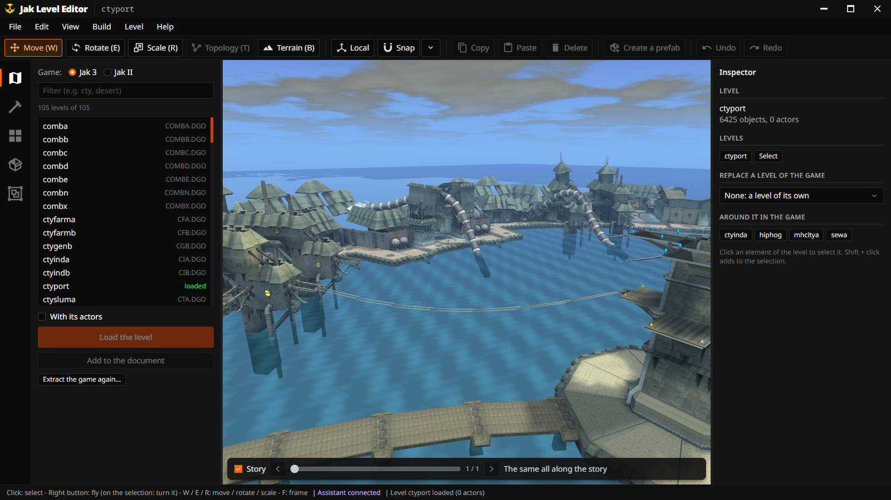

- **Nothing of the game is in this repository.** Everything comes from your disc: you extract it once.
- **It needs nothing else**: not OpenGOAL, not the game, to build or to run. To *play* what you
  exported you need the editor's **jak-project** ([whozghiar/jak-project](https://github.com/whozghiar/jak-project),
  OpenGOAL with the level builder's fixes): built on your computer, or installed by the OpenGOAL
  Launcher (its game for the editor); **Play** then installs
  it and starts the game in it (see [15](#15-playing-it-in-the-game-export)).
- **On its own or in the OpenGOAL Launcher**: it is made like the
  [OpenGOAL Launcher](https://github.com/open-goal/launcher) (an engine in Rust, an interface in
  Svelte, in a Tauri window), so the same editor runs as its own program or opens from the
  launcher's *Level Editor* button ([how](docs/rust-architecture.md#6-in-the-launcher)).
- **An AI assistant can build for you** (Claude Code, or any program that speaks MCP, the protocol
  that lets an AI assistant use the editor's tools): see [the guide for AI agents](docs/mcp-agent-guide.md).
- The interface is in **English and French** (View > Language).

## Contents

1. [The ideas in five minutes](#1-the-ideas-in-five-minutes)
2. [Install](#2-install)
3. [First steps](#3-first-steps)
4. [Selecting and moving things](#4-selecting-and-moving-things)
5. [Groups](#5-groups)
6. [The catalog: everything you can place](#6-the-catalog-everything-you-can-place)
7. [Prefabs](#7-prefabs)
8. [Building your own pieces](#8-building-your-own-pieces)
9. [Holes in the decor](#9-holes-in-the-decor)
10. [Seeing it as the game does: sky, hour, weather](#10-seeing-it-as-the-game-does-sky-hour-weather)
11. [Levels side by side, and the story](#11-levels-side-by-side-and-the-story)
12. [What objects do](#12-what-objects-do)
13. [Where creatures walk: nav meshes](#13-where-creatures-walk-nav-meshes)
14. [Saving](#14-saving)
15. [Playing it in the game: export](#15-playing-it-in-the-game-export)
16. [Building with an AI assistant](#16-building-with-an-ai-assistant)
17. [Keys and mouse](#17-keys-and-mouse)
18. [Files and folders](#18-files-and-folders)
19. [More](#19-more)

## 1. The ideas in five minutes

**A level** is a part of the game's world that the game loads as one piece: a district of Haven
City (`ctyinda`, the industrial zone), the slums (`ctysluma`), Spargus (`wascitya`), a part of the
desert... The disc holds 272 level files, among them the 105 places you can open (the others are
cutscenes and additions that missions bring to a place). They all live in **one world**: each level
is at its place, so two levels side by side in the game also meet in the editor. The name next to
each level in the list (`CIA.DGO`) is the file of the disc it comes from: you can ignore it.

The **document** is what the editor has open: one level, maybe other levels added next to it, or a
new empty level of your own.

A level is made of **elements**. There are two main kinds:

| | What it is | Examples | What it does in the game |
|---|---|---|---|
| **Decor** | something drawn: the level's scenery | a wall, a roof, a pipe, a lamp post, the ground | nothing by itself: Jak walks on it, bumps into it |
| **Objects** (the game and the inspector call them *actors*) | something with its own code | a door, a crate, an elevator, a steam vent, a jump pad | they move, open, break, throw Jak up |

The creatures (enemies, characters, animals) are left out: the editor builds places, not
missions. (In the inspector, a piece of decor is labelled *Object* and an object of the game
*Actor*.)

**Collision** is the invisible shape Jak stands on and bumps into. It usually follows the decor:
without it, Jak would fall through the floor or walk through walls.

**The light** of a level is painted into its decor by the game's artists: every corner of every
piece carries its colors for the sun from four directions, the ambient light and the lamps. The
game mixes them according to the **hour of the day** and the **weather**. The editor's **game
rendering** draws the level exactly so: what you see is what the game will show.

**A prefab** is a set of elements saved together to be placed again anywhere, like a stamp: a
house, a fountain, a market stall. The editor also makes **the game's prefabs**: whole buildings,
towers and bridges taken from the game's levels.

**A facade** is how most buildings of the game are made: only a front, the side the player sees,
with nothing behind. In the game the player never gets behind. In a level of your own he might: put
facades where their back can never be seen (against a wall, at the edge of the level, back to back
with another facade), and walk around them in the view to check.

**The void** is what is behind everything: nothing. A gap between two pieces lets the player see
it, a visual bug. The editor **finds those holes** ([9](#9-holes-in-the-decor)).

**Exporting** writes your level in the files OpenGOAL's level builder reads: you copy them into
jak-project, build, and play ([15](#15-playing-it-in-the-game-export)). In the game, the
**continue points** are the places where it puts Jak when he arrives in a level or starts again
after a fall.

## 2. Install

### What you need

- Windows 10/11 or Linux, 64-bit, a graphics card with WebGL2 (any card of the last ten years).
- On Windows, **WebView2**, the web view the interface is drawn in: part of Windows 11, and of
  Windows 10 once Edge is up to date (else the
  [Evergreen runtime](https://developer.microsoft.com/microsoft-edge/webview2/)).
- **Your copy of Jak 3** for the PlayStation 2: the disc image (`.iso`) or the folder of the disc.
  Put it in `iso_data/` of this folder if you like (git ignores it), or anywhere.
- About 4 GB of disk for the extracted levels, 5 GB of free memory while they are extracted.
- Optional: your copy of **Jak II**, for its buildings (Haven City as it was, the palace).

### Download it

Each [release](https://github.com/whozghiar/open-goal-level-builder/releases) has, for Windows
(`windows-x64`) and Linux (`linux-x64`):

- an **installer**: `..._x64-setup.exe` (Windows, for your user alone, no administrator rights) or
  the `.msi` (for all users); the `.deb` or the `.AppImage` on Linux;
- a **portable** zip, `jak-level-editor-portable-<platform>.zip`: unzip it anywhere and run
  `jak-level-editor` (`.exe` on Windows); nothing is installed;
- `ogle-extract-<platform>.zip`, the extractor alone (the OpenGOAL Launcher downloads it);
- `jak-level-editor-mcp-<platform>.zip`, the MCP server for an AI assistant (optional, see
  [16](#16-building-with-an-ai-assistant)): put it next to the editor's program.

The installers and the portable zip hold ogle-extract. A release is made from a tag `vX.Y.Z`:
GitHub builds the editor on Windows and Linux and makes a draft release with these files, published
by hand ([RELEASING.md](RELEASING.md)). There is no macOS version.

### Build it

To build it yourself (to work on it, or a version not released yet), you need:

- [Rust](https://rustup.rs), stable (1.89 or later). On Windows, rustup offers to install the
  Visual Studio C++ build tools Rust links with: accept.
- [Node.js](https://nodejs.org) 22. Yarn, the interface's package manager, comes through `npx`:
  nothing more to install.
- For **ogle-extract**, the extractor (C++, from OpenGOAL's decompiler): CMake 3.20+, Ninja and a
  C++20 compiler (tested with Clang 19 on Windows).
- On Linux, the system packages of a Tauri application:
  [Tauri's prerequisites](https://v2.tauri.app/start/prerequisites/) (webkit2gtk 4.1 and others).

On **Windows**, step by step:

1. Install the tools once: Rust with [rustup](https://rustup.rs), Node.js 22, and for the extractor
   with [Scoop](https://scoop.sh) in a PowerShell window `scoop install git cmake ninja llvm python`
   (or with `winget`: `Kitware.CMake`, `Ninja-build.Ninja`, `LLVM.LLVM`, `Git.Git`).
2. Get this repository (`git clone ...`, or the ZIP of the repository's page) and open a terminal
   in its folder.
3. Build the extractor, then the editor. The last line builds the editor and starts it (the first
   time takes a few minutes).

```bash
cmake -S . -B build -G Ninja -DCMAKE_BUILD_TYPE=Release   # ogle-extract, once
cmake --build build                                        # build/bin/ogle-extract and its tables
npx yarn install                                           # the interface's packages, once
npx yarn tauri dev                                         # build the editor and start it
```

`npx yarn tauri dev` is for working on the editor (the interface reloads when its files change).
To make the program itself and its installers:

```bash
npx yarn tauri build
```

It writes `target/release/jak-level-editor.exe` (`jak-level-editor` on Linux): next time,
double-click it. The installers are in `target/release/bundle/` (`.msi`, `.deb`, `.AppImage`).
The editor finds `ogle-extract` next to itself, in its resources, or in `build/bin/` of this
folder: keep the extractor built there (or see the [reference](docs/reference.md#2-the-extraction)
to put it in the installers, as the releases do).

The tests:

```bash
cargo test -p jak-level-editor-core           # the engine's own tests
npx svelte-check --tsconfig ./tsconfig.json   # the interface's types
```

The engine's tests need no game data (those that read the extracted levels skip themselves when
`library/jak3/library.json` is missing) and check, among others: the scene, glTF round trips,
prefabs and groups, the export for the game, the translations, the game view, the holes finder,
the weathers, the terrain brush, the nav meshes.

### Your library

The first time, the editor asks where to keep your **library**: the folder that holds the extracted
game (`jak3/`, `jak2/`), your projects (`projects/`), your levels exported for the game (`exports/`)
and your prefabs (`prefabricated/`). It offers `Documents/Jak Level Editor` (in the OpenGOAL
Launcher: `jak-level-editor/` of its installation folder; the editor built and started from this
folder: `library/` here, which git ignores); **Choose another folder...** takes any other.
**File > Settings...** shows it and changes it later: the editor then uses the new folder, and
neither moves nor deletes anything in the old one (extract the game again there, or copy the old
folder's content by hand). The same window has the language and where ogle-extract was found.

### Extract your game

Then it asks for your game: **File > Extract game assets...**

1. **Your Jak 3 disc**: choose the `.iso` (**.iso file...**) or the folder (**Folder...**). The editor
   tells which game and version it is (for example *Jak 3 - ntsc_v1 - SCUS-97330*). In the OpenGOAL
   Launcher, the disc it already extracted is chosen for you.
2. **Where to write the levels**: your library.
3. **Extract all the levels**: about a minute and a half for the 272 levels of Jak 3.

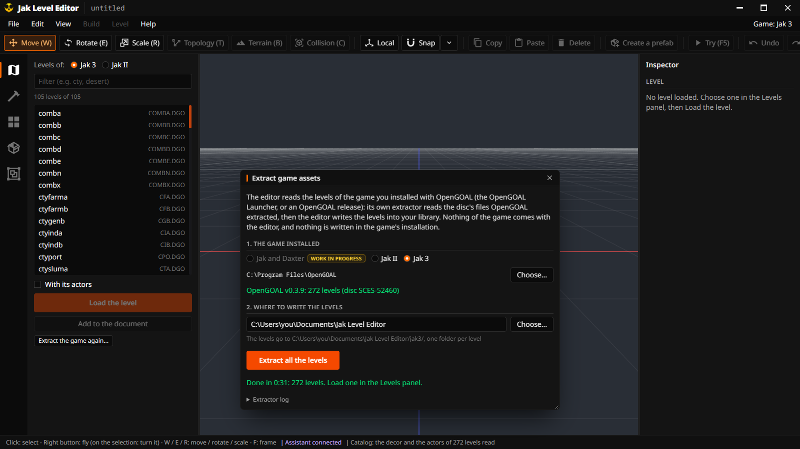

A disc of Jak II is extracted the same way (to `library/jak2/`). The extracted files come from your
game: keep them on your computer, do not share them.

## 3. First steps

### The window

```text
+-----------------------------------------------------------------------------+
| File  Edit  View  Build  Level  Help                                        |
| [Move] [Rotate] [Scale] [Topology] [Terrain] [Local] [Snap] | [Copy] ...   |
+------------------+--------------------------------------+-------------------+
| Levels | Build | |                                      | Inspector         |
| Catalog |        |              the 3D view             | (what is selected,|
| Prefabs | Groups |                                      |  or the level)    |
|                  | [Story] < ======o======== >          |                   |
+------------------+--------------------------------------+-------------------+
| what the mouse does here            |  the last message                      |
+-----------------------------------------------------------------------------+
```

- The **left panel** has the steps of the work: **Levels** to open one, **Build** to make shapes,
  **Catalog** and **Prefabs** to place things, **Groups** to find the groups you made.
- The **inspector** (right) shows what is selected and lets you change it precisely; with nothing
  selected, it shows the level.
- The **status bar** says what the mouse does where it is, and the last thing that happened.

### The guide

**F1** (Help > Tutorials) opens the guide: named tutorials, from *Getting started* (from your disc to
the game, step by step) to one per tool, each with a short animation. Hovering any tool also shows
what it does, its keys and an example.

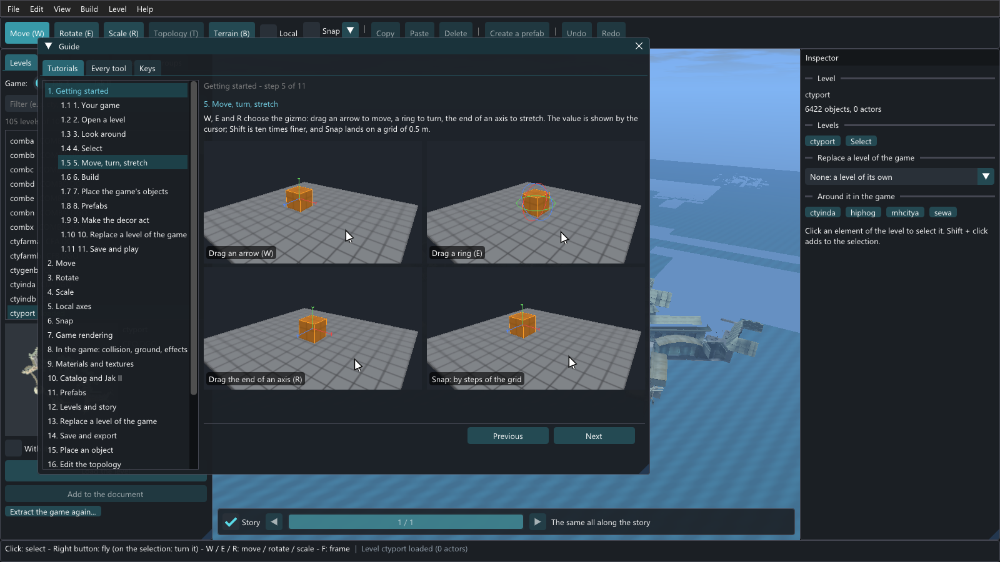

### Open a level

In **Levels**, choose a level (type `cty` for Haven City's districts, `des` for the desert), then
**Load the level** (or double-click it). **With its actors** brings its objects too (doors, crates);
unchecked, you get its decor alone.

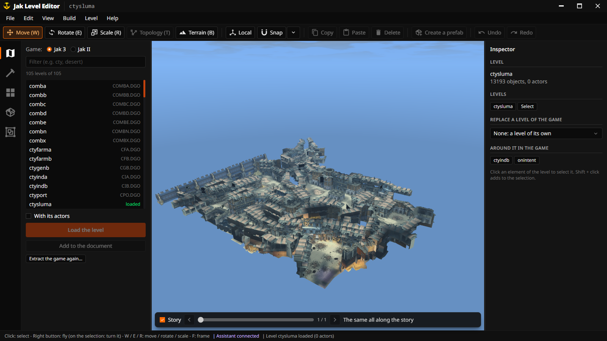

What comes with a level: its decor, its objects, its water (pools, fountains, dark eco, lava drawn
as such), the ocean where the level has one, and the levels the game always shows with it. The
ocean stops where the levels around stand in the game (behind the port, Haven City's ground): no
water where the game has none.

### Move around

| To | Do |
|---|---|
| Fly | hold the **right button**, then **W A S D** (Z Q S D on an AZERTY keyboard) to go forward, left, back, right, and **Q / E** (A / E on AZERTY) or **C / Space** down and up. These keys fly only while the right button is held: without it, W, E and R choose the move, rotate and scale tools |
| Go faster / slower | **Shift** / **Ctrl** while flying; the **wheel** while flying sets the speed |
| Move forward | the **wheel** |
| Slide the view | hold the **middle button** |
| Turn around a point | **Alt + left button** |
| Frame | **F**: the selection; **Home**: the whole level |

### A new level

**File > New level** (Ctrl+N) starts an empty level, with no ground at first. Build it from the
catalog, the prefabs and the shapes: a floor first (a **Ground** shape, or the terrain brush), then
the rest on it.

## 4. Selecting and moving things

### Select

- **Click** an element to select it. Each piece of decor is its own element: clicking a pipe
  selects that pipe, not every copy of it.
- **Before you click, the cursor tells you** what it points at: the element is outlined, and after a
  moment a label gives its name and, when it is part of one, its prefab or group with how many
  elements it has.
- **Shift + click** or **Ctrl + click** adds an element to the selection (or takes it out).
- **Click again at the same place** to reach what is behind or under: the second click selects
  the next element under the cursor.
- The **ground** is locked, so that clicks go to what stands on it (View > Select the ground
  unlocks it). Only the ground: the walls the game made one with it, roofs, ceilings, bridges,
  debris and water surfaces are selected like the rest (how the editor tells them apart:
  [reference](docs/reference.md#ground-and-decor)).

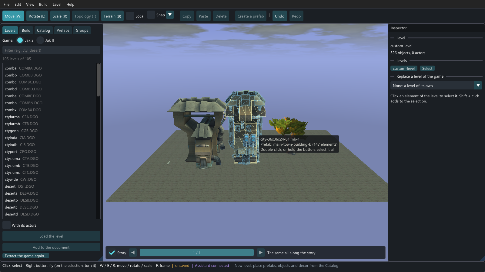

### Select many at once

- **Drag a box** from an empty spot: what it would select is **outlined while you drag**, and the
  label next to the cursor counts it. **Shift** while dragging adds it to the selection, **Ctrl**
  takes it out.
- **Double-click** an element, or **hold the left button still on it** (a ring fills around the
  cursor): its **whole prefab or group** is selected. An element in no group gives its **assembly**:
  the whole structure it is part of (a house with its facades, roof and windows).
- **Ctrl+G** selects the assembly, **Ctrl+L** the whole level. Do not mix them up with
  **Ctrl+Shift+G** (make a group, [5](#5-groups)) and **G** alone (the game rendering on or off).

| A box being drawn: 156 elements, outlined | The button held on a prefab: in a moment, all of it |
|---|---|
| 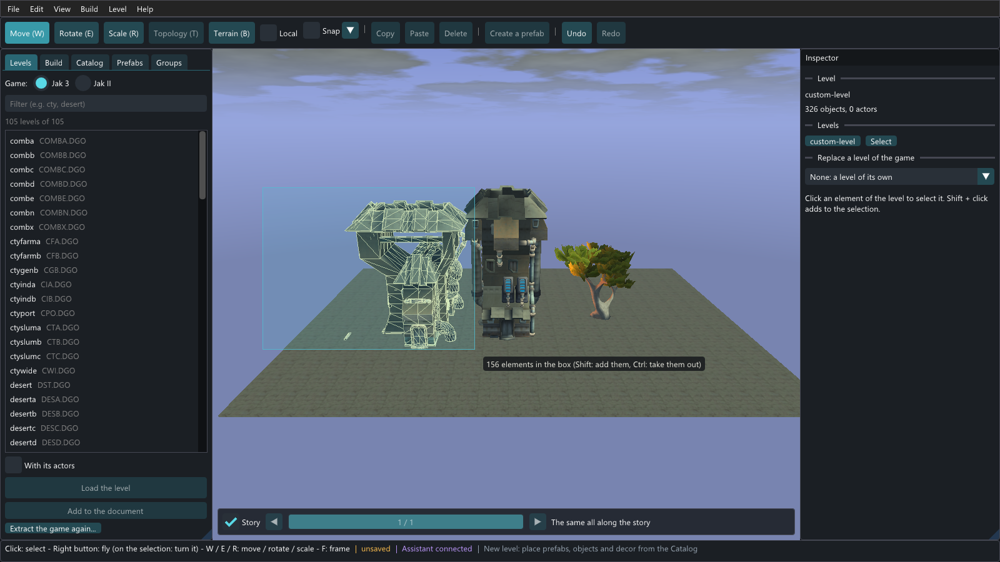 | 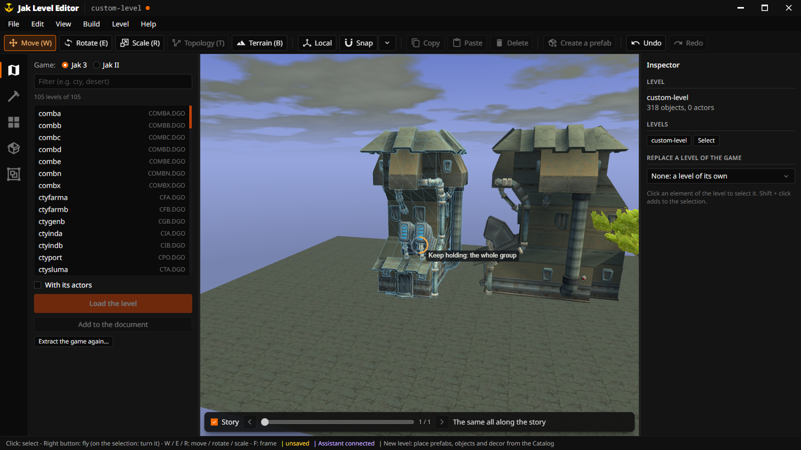 |

Example: you placed a house made of 155 pieces; click it once and you get one window frame;
double-click it, and you have the whole house, ready to move.

### Move, turn, stretch

The **gizmo** is the handle that appears on the selection: **red** is the X axis, **green** the
vertical (up), **blue** the Z axis. Drag an arrow to move along that axis, a small square between
two arrows to slide on the ground (or another flat direction), a ring to turn around an axis; with
Scale, the square at the end of an axis stretches along it.

- **W** move, **E** rotate, **R** scale. While dragging, the value is written next to the cursor;
  **Shift** is ten times finer, **Ctrl** snaps. A move, along any arrow or square (or the selection
  dragged itself), leaves the selection **see-through where it was**, with the way from there (red
  along X, blue along Z, green up) and how far it went: **Moved x +2.50 y +0.00 z +1.50 m**.
- **Snap** (toolbar) moves by 0.5 m, turns by 15 degrees, scales by 0.1: walls placed side by side
  meet exactly. The arrow next to it changes the steps.
- **Local** moves along the element's own axes (a catwalk set diagonally slides along its length).
- **Drag the selection itself**: press on an element of the selection (not on the gizmo) and move
  the mouse: left and right slide it across the view, up and down raise or lower it (**Ctrl**:
  forward and back instead), Shift finer. A click on an element of a selection of several keeps
  them all selected; click it again to take it alone.
- **Hold the right button on the selection** and move the mouse to turn it on every axis.
- The inspector gives the exact position, rotation and scale.

| Moving a selected prefab with the mouse | A bridge stretched along its length with the scale gizmo |
|---|---|
| 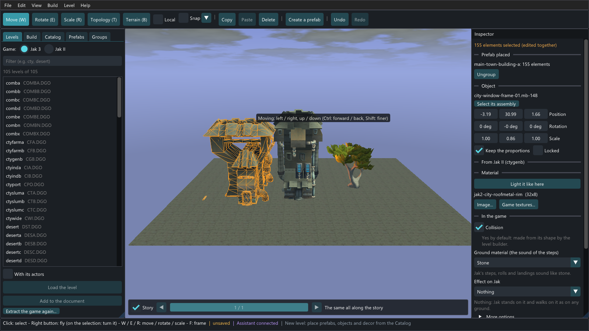 | 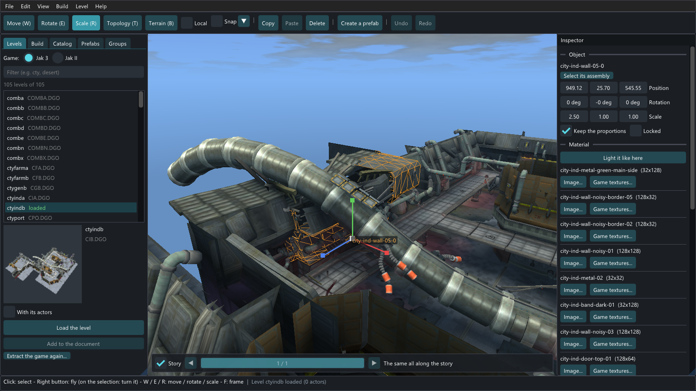 |

Example: a platform that Jak cannot quite reach: select it, **W**, drag its green arrow up by 2 m,
and the player needs a double jump.

### Copy, delete, undo

**Ctrl+C / Ctrl+V** copy and paste (the copies appear where the originals were, selected: move
them), **Ctrl+D** duplicates, **Del** deletes, **Ctrl+Z / Ctrl+Y** undo and redo. Everything can be
undone.

## 5. Groups

A **group** keeps elements together under a name. Every prefab you place is one (named after the
prefab); you can make your own.

- **Make one**: select the elements, then **Ctrl+Shift+G** (Edit > Group the selection...), and
  name it.
- **Use it**: a double click (or the button held) on any of its elements selects it all; it moves,
  turns and copies as one. Copying a group makes a new group.
- **The Groups panel** lists them ([P] a prefab placed, [G] a group of yours): click to select,
  double-click to frame, right-click to rename or **Ungroup**.
- The inspector shows the group of the selection, with **Select it all** and **Ungroup**.

| The Groups panel, a group selected | Naming a new group |
|---|---|
| 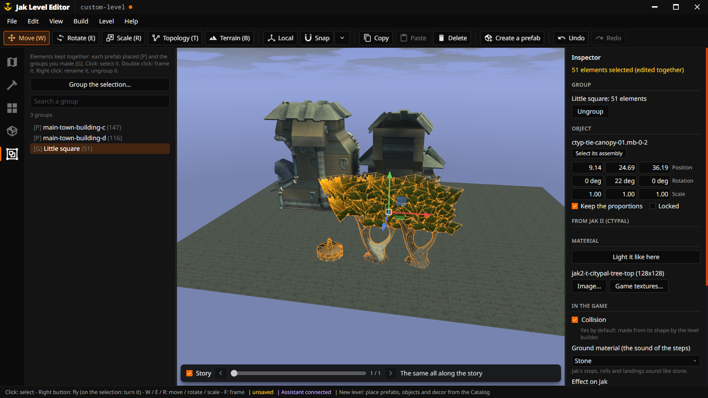 | 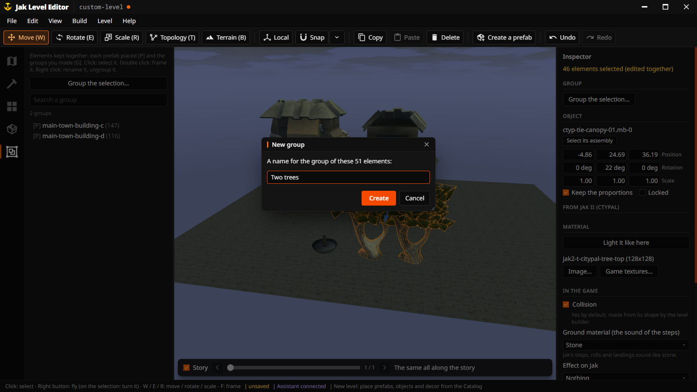 |

Example: a little square made of a fountain and two trees, grouped as "Little square", copied to
the other end of the street in two clicks.

## 6. The catalog: everything you can place

The **Catalog** panel lists what you can put in a level. Click an entry, then click in the view to
place it (or drag it into the view). Hovering an entry shows what it is.

- **Objects**: what makes up a place: props that just stand there (flags, windmills, a parked
  hellcat), doors and airlocks, water, dark eco and lava.
- **Interactive**: the objects that do something: crates, platforms and elevators, jump pads and
  board vents, buttons, breakable walls and fences, hazards. Their behavior is set in the
  inspector ([12](#12-what-objects-do)), and its **Preview** shows them moving in place (a door
  opening, a fence breaking).
- **Effects**: the game's **visual effects** in a category of their own, sorted by kind: **fire and
  flames**, **smoke, steam and dust**, **lights and glows**, **sparks and electricity**, **water**
  (drips, splashes, falls), and the others (explosions, trails). Each runs in the view as the game
  makes it.
- **Models**: the other 3D models of the game, the ones that are not part of a level's scenery
  (a broken piece of a robot, a barrel, a sign), placed as decor: they do nothing.
- **Decor**: the pieces of the levels' scenery itself (a pillar, an arch, a catwalk of the
  industrial zone), searched by name across every level, or by level.
- **Materials**: every texture of the levels: select shapes or pieces, click a texture, they take
  it.

| Interactive objects | The visual effects and their kinds |
|---|---|
| 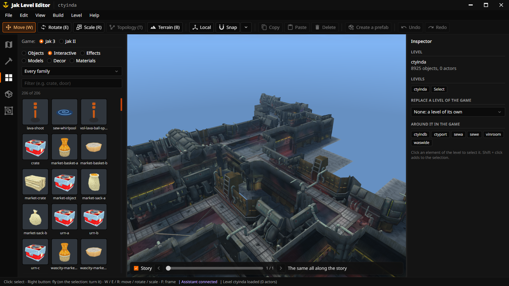 | 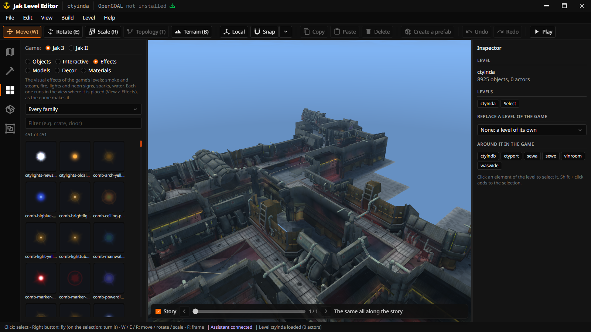 |

| The decor of every level searched for "catwalk" | Materials |
|---|---|
| 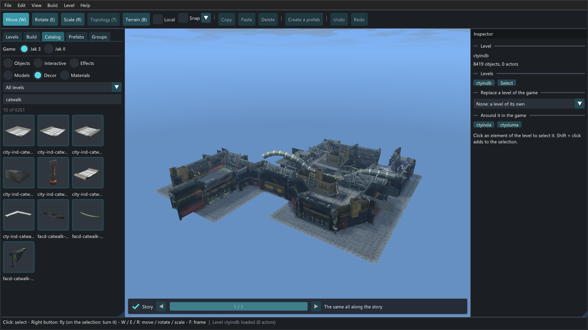 | 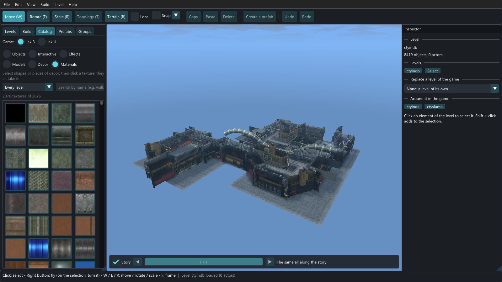 |

Placing: a click puts it where the cursor points, on what is under it. **Keep the left button
down** and move the mouse to move it before it lands: left and right across the view, up and down
to raise or lower it (**Ctrl**: forward and back), Shift finer; it lands when you let go. Once
placed it **stays selected**, the gizmo on it (all of a prefab), so you can adjust it at once; hold
**Shift** when you let go to go on placing copies. **R** or **Ctrl + wheel** turns it, the right
button held turns it every way, **Esc** stops.

Example: steam over a vent of your industrial yard: Catalog > Effects > *Smoke, steam and dust*,
click `ctyindb-steam-drift`, click on the vent.

Never offered: the creatures, the collectibles (orbs, gems, ammo) and the technical objects
(cameras, triggers).

## 7. Prefabs

### Place one

The **Prefabs** panel has **the game's prefabs** (top) and **yours** (bottom). Click one, then click
in the view; it sits on the surface it is placed on.

**The game's prefabs** are whole structures found in the game's levels, by game, level and
category: houses and buildings of the slums, Spargus and Haven, towers, temple gates and walls,
bridges, platforms, machines of the factories, palms and rocks of the desert, statues, and Jak II's
(Haven City's buildings, its palace) when Jak II is extracted. They are made from your levels the
first time you show them.

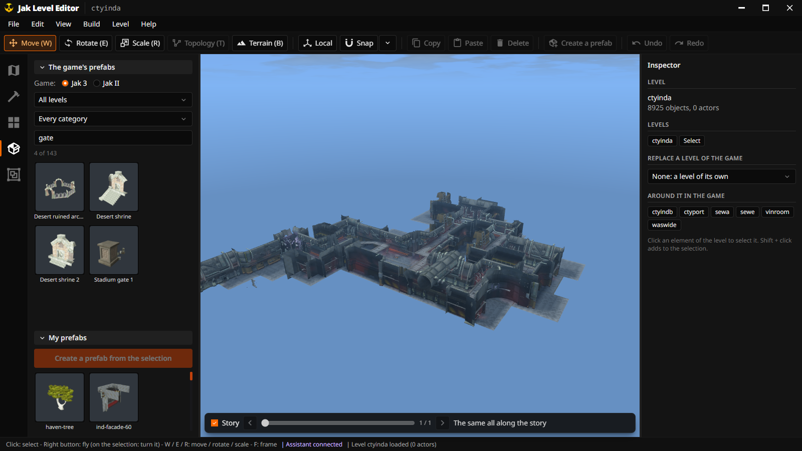

### Make one

1. Select what goes together. For a building of the game, click one of its walls and press
   **Ctrl+G**: its whole assembly is selected.
2. **Create a prefab** (toolbar, inspector or Edit menu) and name it.
3. **Leave out the pieces smaller than 0.5 m** is checked: a prefab is a structure, and loose
   bolts, debris, stains and tiny props would only clutter it. When some would be left out, the
   window says how many. The objects of the game (a door, a crate) are always kept.

It is saved in `library/prefabricated/` and appears under **My prefabs**.

| A tower of Spargus selected whole by its assembly (Ctrl+G) | Making it a prefab: the small pieces left out |
|---|---|
| 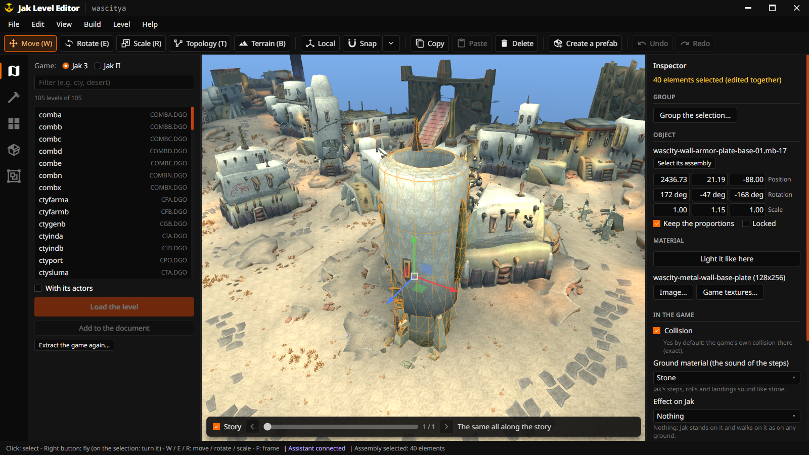 | 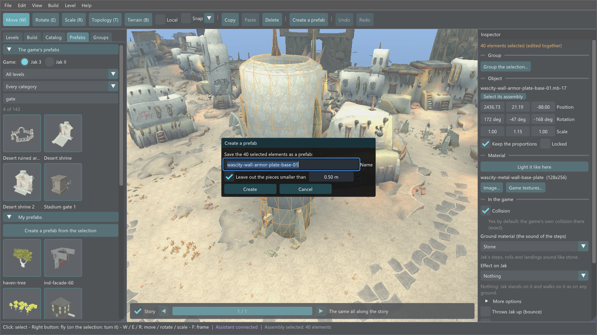 |

A building of the game is often a facade: place its prefab where its back cannot be seen
([the ideas](#1-the-ideas-in-five-minutes)).

## 8. Building your own pieces

### Shapes

The **Build** panel makes what the game does not have: a block, a floor, a wall, a **wall with a
door**, a **wall with a window**, a pillar, a ramp, stairs, roofs, a cylinder, a **ground** (a floor
whose top goes up and down). Click one, then click in the view. In the inspector: its **size** in
meters, how often its texture repeats (**Texture every**: a larger wall repeats its texture instead
of stretching it), **Bend** (a wall bent 90 degrees is a quarter of a round tower, stairs bent 180 a
spiral staircase) and rounded **Corners**.

**In the style of a level**: choose a level, and **Place a floor** or **Place a wall** gives a
floor or a wall that looks like it (its textures, their size, its light, how uneven its ground is).

| The Build panel | A yard in the style of the port: its cobbles, a bent wall, a round pillar, a spiral staircase |
|---|---|
| 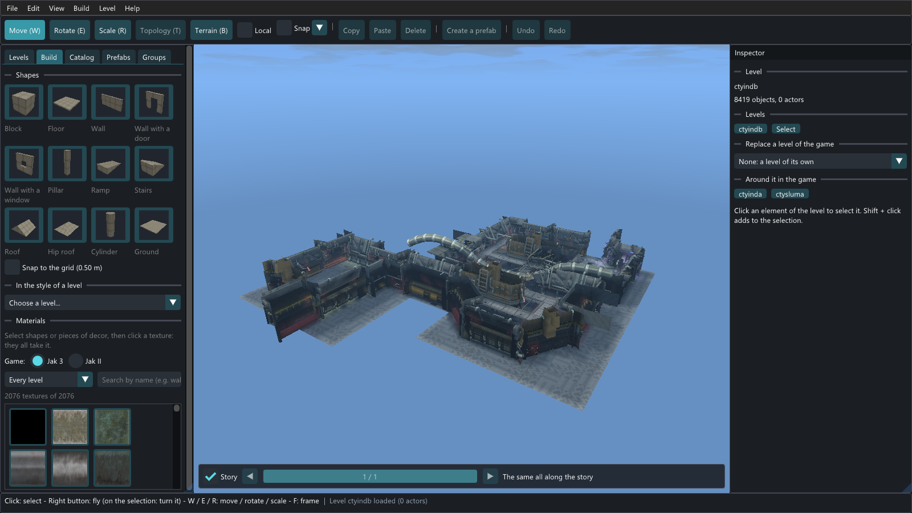 | 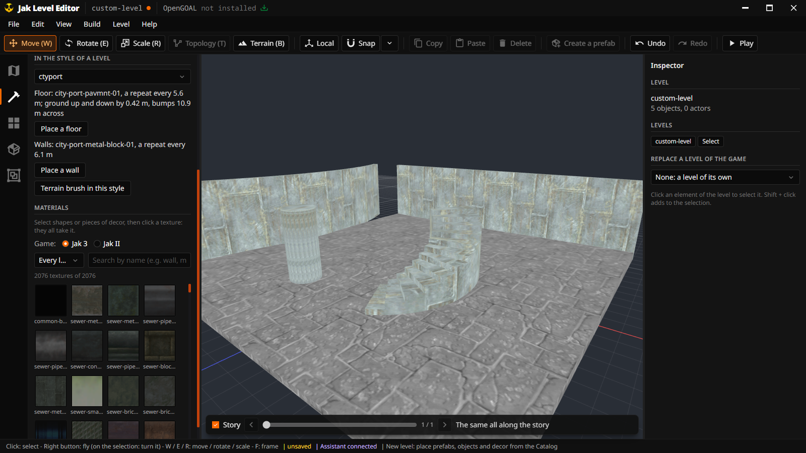 |

### The terrain brush

**Terrain (B)** draws natural ground freehand, in its own small window: a square follows the mouse,
and what it would do shows see-through under it before you click. Hold the left button to **paint**
ground, raise **walls** or **erase** ground and walls: the whole stroke shows see-through while you
hold the button, and is done when you let go (**Esc** while holding: nothing done). **Smooth** and
**flatten** change the ground as you go. Hold the **right button** and move the mouse **up** to
raise the ground there, **down** to dig it: the new shape and its height show until you let go
(moved sideways, the right button looks around as usual). **Generate hills** makes hilly ground at
once. The brush changes the terrain under the square; the ground takes the textures of a level's
style automatically (the desert's sand and rock, the slums' cobbles).

**Free brush** or **Magnet brush** (**M**): both follow the cursor. The free brush lays its ground at the
height where the stroke starts; the magnet brush keeps the level of the ground already laid beside
the square: the terrain you are painting (made larger at its level), else the top of the decor
next to it (a platform, a quay: 2 cm under it; not small props), named next to the square. The
preview shows the ground at that level before you click and while you hold the button. The right
button never lays ground while erasing: it raises or digs what is there.

| The terrain brush in the style of the desert: hills, a riverbed dug, a walled yard, a hill raised | The right button held and the mouse moved up: the hill it raises, before it is let go |
|---|---|
| 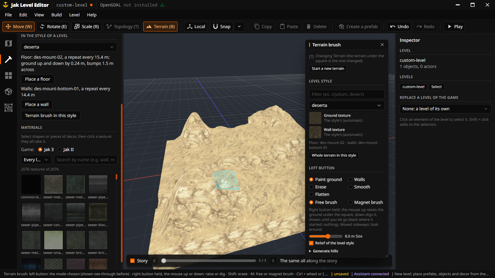 | 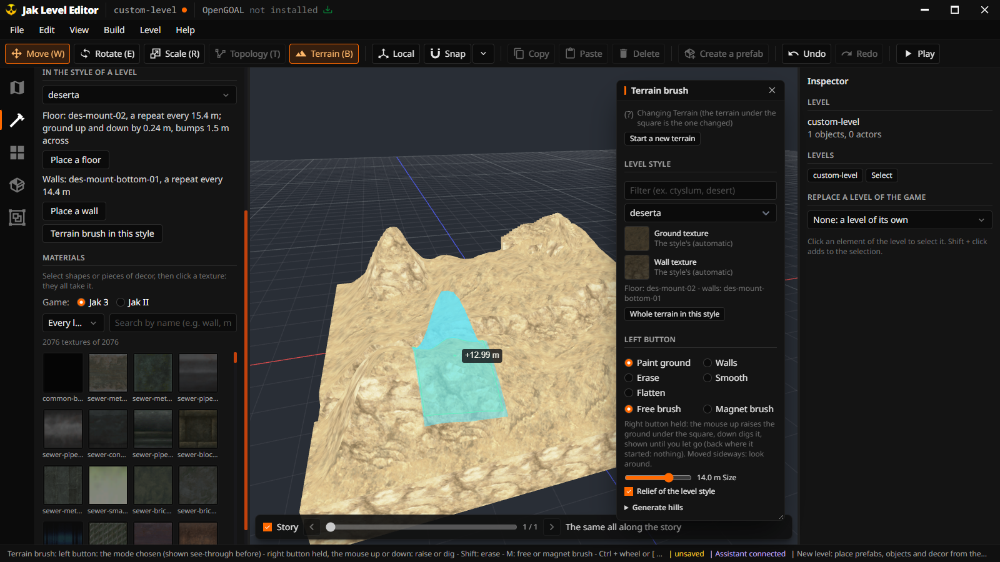 |

| The magnet brush next to a terrain laid 3 m up: the square at its level | Held from there: the terrain made larger at its level, shown before it is let go |
|---|---|
| 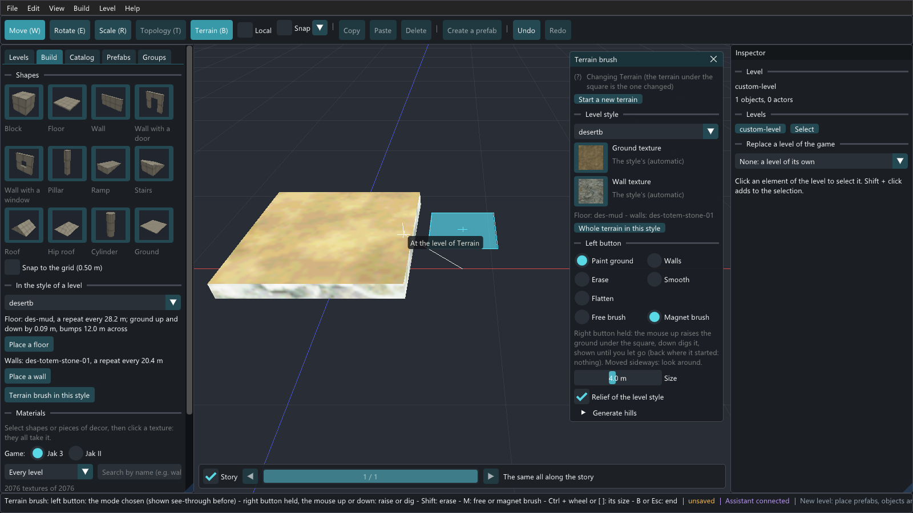 | 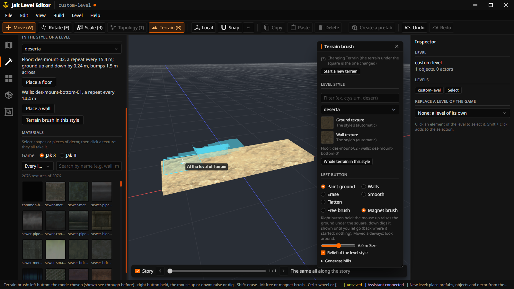 |

### The shape of one piece: topology

**Topology (T)** shows the shape of one element as the game stores it: its **points** (the corners
of its triangles) and its **faces** (the triangles). Move points with the gizmo; pick faces and
**Extrude** them (pull them out, with walls joining them to the rest: a step out of a floor),
**Subdivide** (cut each in four, to shape it more finely), **Flip** (turn them over), **Delete**.

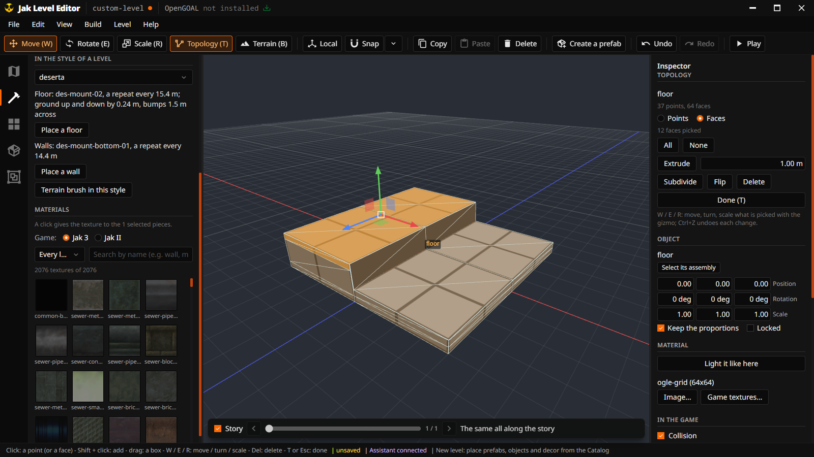

### See what an object does: the preview

The inspector's **Preview** plays an object's animation where it stands (a door opening), its
movement (an elevator), or shows it **breaking** (a fence of the factory thrown apart).

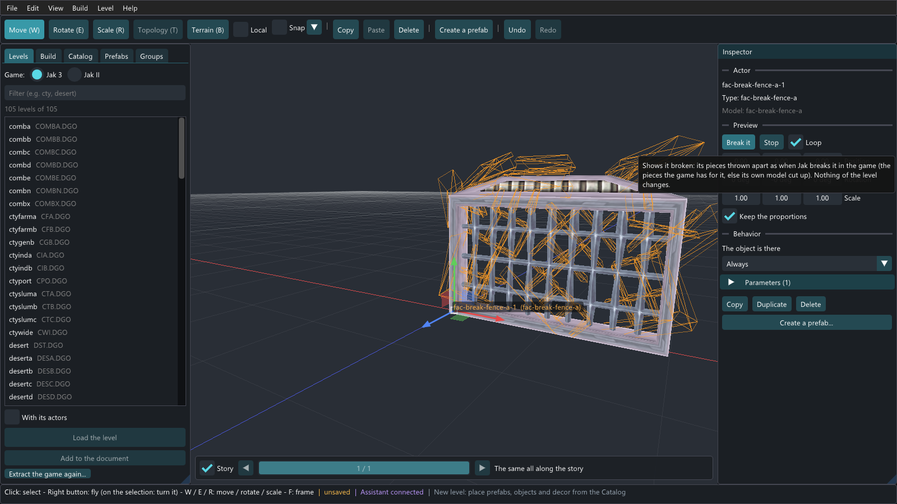

### Jak II's buildings

With Jak II extracted, choose **Jak II** at the top of the Catalog or the Levels panel: its models,
its decor (Haven City as it was), its prefabs, or a whole level of Jak II opened as a level of Jak 3
(with its collision). What could go wrong is checked when it comes in (textures renamed
`jak2-<name>`, light compared with the level's: **Match the lighting** in the inspector).

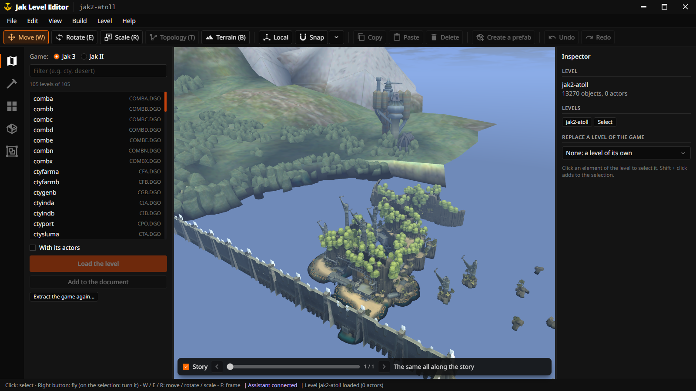

### The light of what you place

What you place, paste or move **takes the light of the level around it**: each of its corners
borrows the light of the level's nearby surfaces facing the same way. A piece from a dark cave
placed in a sunny street does not stay dark. **Light it like here** (inspector) does it again.

## 9. Holes in the decor

**Why.** Behind the decor there is nothing. A floor that stops 30 cm short of a wall, two slabs not
quite touching, a wall that misses the corner: through each gap the player sees the void, the
screen's background. It is the most common visual bug of a level made by hand.

**Find them.** **Level > Find holes in the decor...** looks from the ground every few meters, at the
height of Jak's eyes, all around and downward (the whole level, or around the selection), and lists
what it found, drawn in the view:

- **red**: a **gap** between pieces, to fill;
- **orange**: an **open edge**, where the ground ends in the void: close it (a wall, a railing,
  buildings) unless the player can never get near it.

Click a line of the list: the camera goes where the player would see it from.

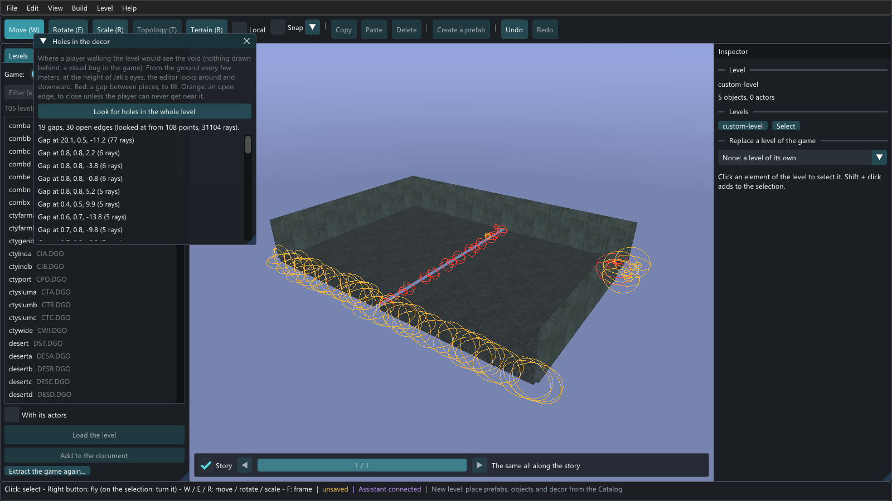

**Fix them**: stretch a piece over the gap (scale), move it to overlap its neighbor by a few
centimeters, or place a floor or a wall over it, then look again.

## 10. Seeing it as the game does: sky, hour, weather

**The game rendering** (View > Game rendering, **G**), on from the start, draws the level with the
game's own renderer: its light at the hour and in the weather you choose, its fog, its sky. **G**
switches to the editor's own view, where every light is on (handy in dark corners).

**View > Sky, hour and weather...** opens a small window of its own:

- **The sky**: half a turn around where the camera looks (the whole turn makes you lose your
  bearings), with its horizon and the four directions: the sun or the moon, the clouds, the stars.
- **The hour**: a slider, and **Dawn**, **Noon**, **Dusk**, **Night**. **Time passes** lets it run.
- **The weather**, as the game has them: clear sky, a few clouds (the game's start), haze, smog,
  overcast, overcast and foggy, rain, storm, storm with rain, storm and foggy; or your own with the
  **Clouds**, **Fog / rain** and **Rain** sliders. **Lightning in a storm** flashes the sky and the
  level.
- **What it changes**: the sun dims and the light greys under clouds, the fog closes in with haze
  or rain, the lamps of the level light up at night, some effects only show at some hours, and all
  of them fade in the fog far away. The window sums it up (*the sun is up, its light 0.92; the fog
  closes in at 1000 m; the lamps are off*).

| Noon, clear sky | Dusk, a few clouds: the lamps on |
|---|---|
| 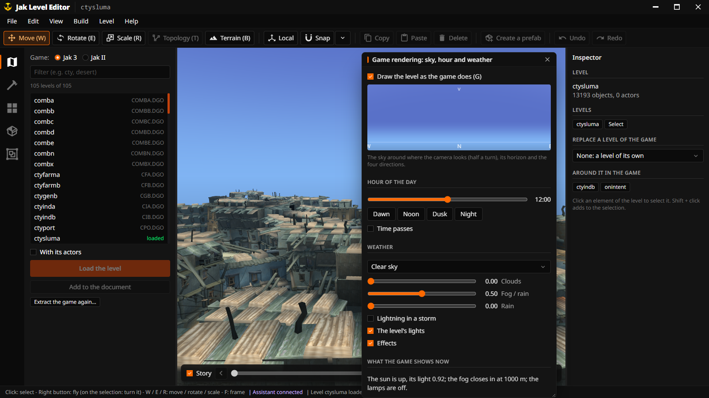 | 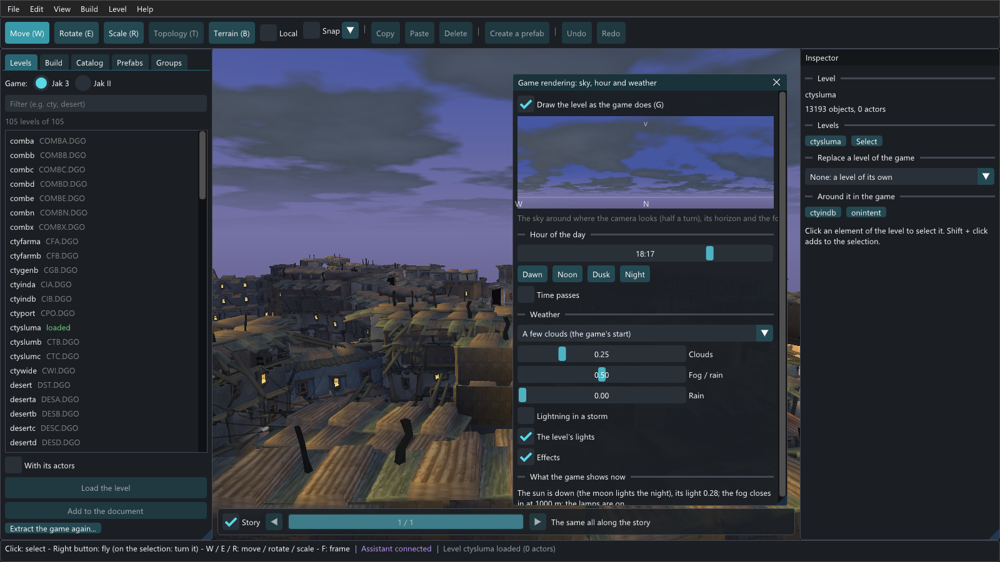 |

| Storm with rain | Night: the stars, the lamps of the houses lit |
|---|---|
| 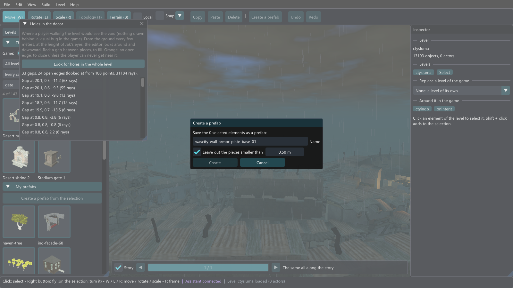 | 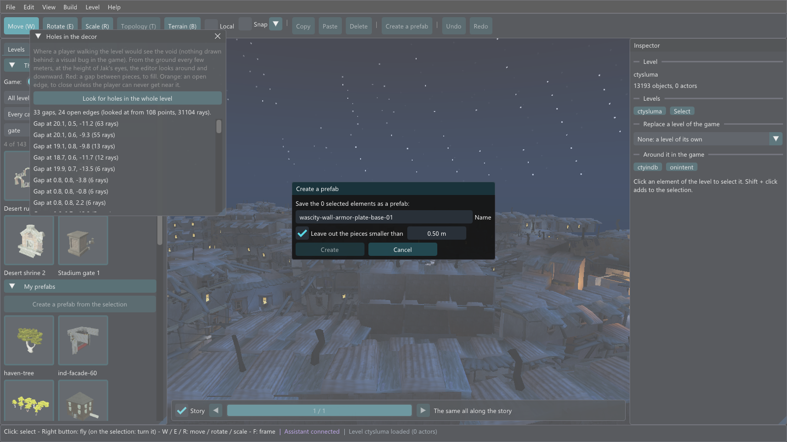 |

The **effects** (steam, sparks, smoke, fire, lights) run in the view (View > Effects), and the
**ocean** moves, its waves catching the sun.

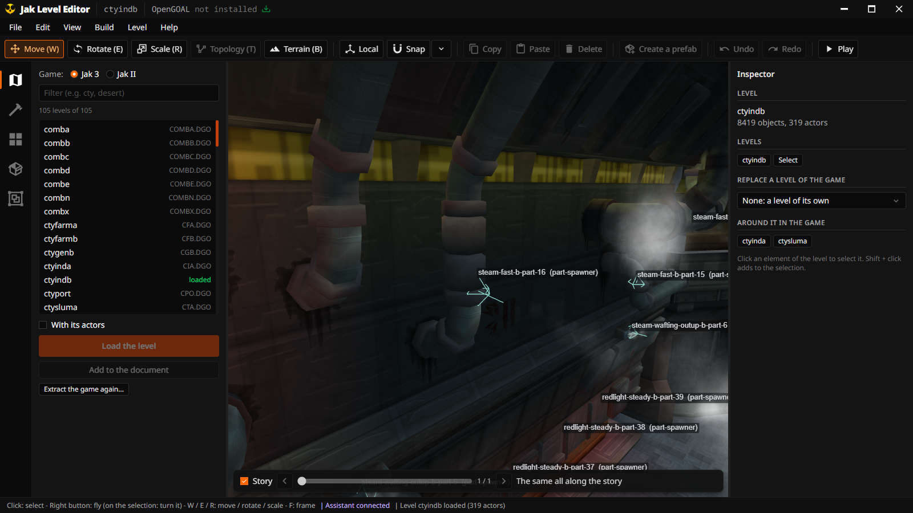

## 11. Levels side by side, and the story

**Several levels.** With a level open, choose another in Levels and **Add to the document**: it
comes at its place in the world. To work on the junction between two levels, or to build a new
level next to the game's. The inspector lists them (show, hide, frame, remove; **Junction** frames
the place where two levels meet) and the levels **around it in the game** (click one to add it).
**Select** next to a level selects it whole, to move it.

| The industrial zone with the next district and the city walls added | A level selected whole |
|---|---|
| 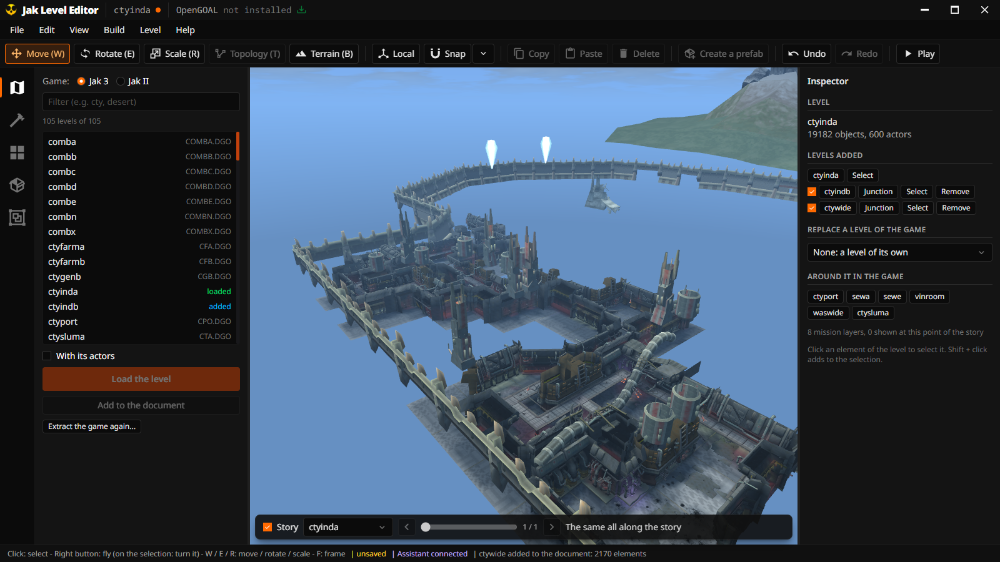 | 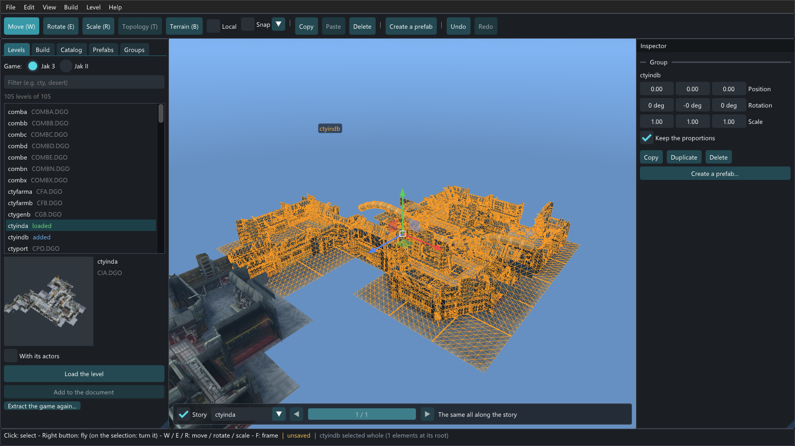 |

**The story.** Some levels change during the game: Haven City's Metal Head tower is blasted, the
forest's statue falls. The bar under the view shows the level at a point of the story: drag its
slider, or click its arrows to go to the previous or next change; the text next to it names the
last step of the story done (the game's own name for it, such as `tower-destroy-resolution`: the
tower's destruction). **Story** unchecked shows every state at once.

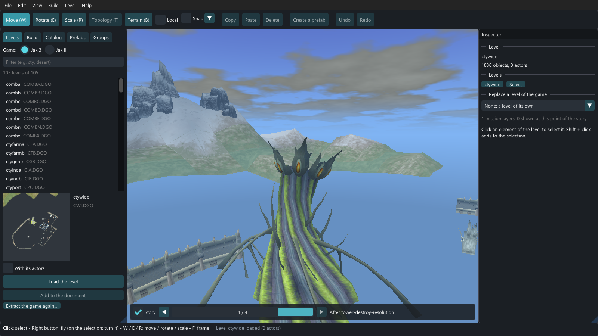

## 12. What objects do

Select an object: the inspector's **Behavior** says what it does, and you can change it.

| Object | You choose |
|---|---|
| Doors and airlocks | when it opens: when Jak comes near, never (locked), always, or when Jak comes near **once a condition holds**; from how far |
| Jump pads, board vents | when they throw Jak up, how high |
| Elevators | when they leave, how fast |
| Crates | which crate (wood, iron, steel...) |
| Every object | whether it is there at all (always, never, once a condition holds) |

A **condition** is: after a step of the story, once a switch is pressed, or once an object is gone
(a crate broken, an enemy killed). **Parameters** lists every setting the object's code reads, with
its default.

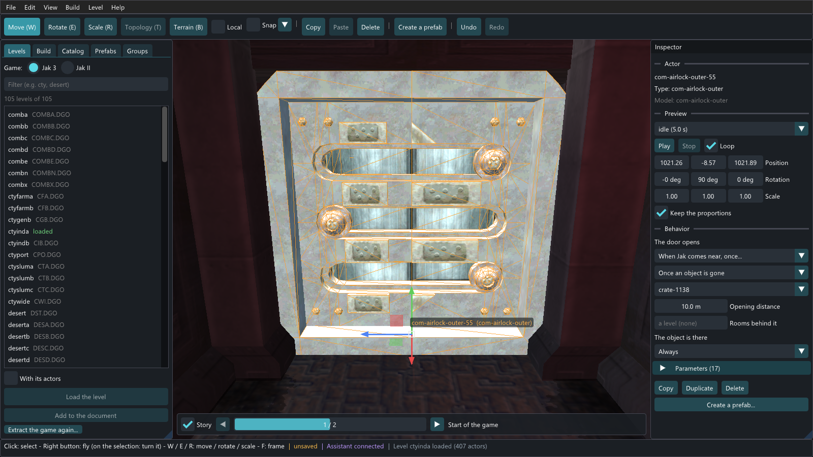

Example: a door that opens only once the crate in front of it is broken, so the player has to find
a way to break it first.

**The decor** can do things too (inspector, **In the game**): collide or not, sound like stone or
metal under Jak's feet, hurt or burn him, **bounce** him up, **launch** him along an arc.
[`docs/behaviors.md`](docs/behaviors.md) explains what the game allows.

## 13. Where creatures walk: nav meshes

The game's creatures walk on **nav meshes**: flat shapes laid over the ground that tell them where
they can go. The editor leaves creatures out, so you only need them if you add creatures to your
level later (in jak-project); you can skip this part otherwise. **Level > Nav meshes**
makes them from the level's walkable surfaces, for a creature of the size you set, for the whole
level or around the selection; they are drawn over the level, one color each, and saved with the
project and the export.

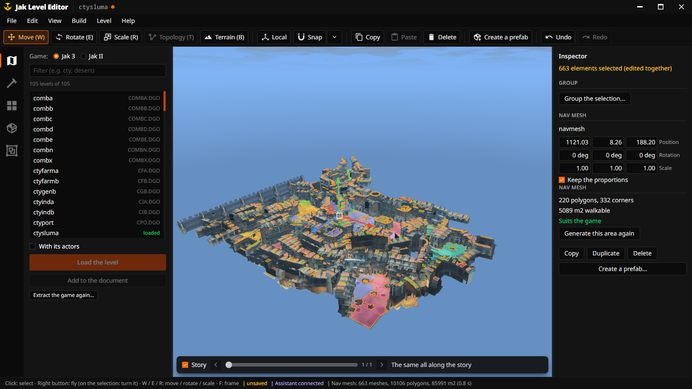

## 14. Saving

**File > Save** (Ctrl+S) saves your work as a **project**, only when you ask, in its own folder:
`library/projects/<name>/<name>.glb` (a standard 3D file Blender opens too) and its nav meshes.
**File > Open project** (Ctrl+O) and **Recent projects** open it again. Nothing is saved behind
your back.

## 15. Playing it in the game: export

**Level > Export for the game...** writes the level as a **custom level of OpenGOAL**, in
`library/exports/<project>/`, laid out like jak-project, with a `README.md` that gives the exact lines
to add and how to build and go there.

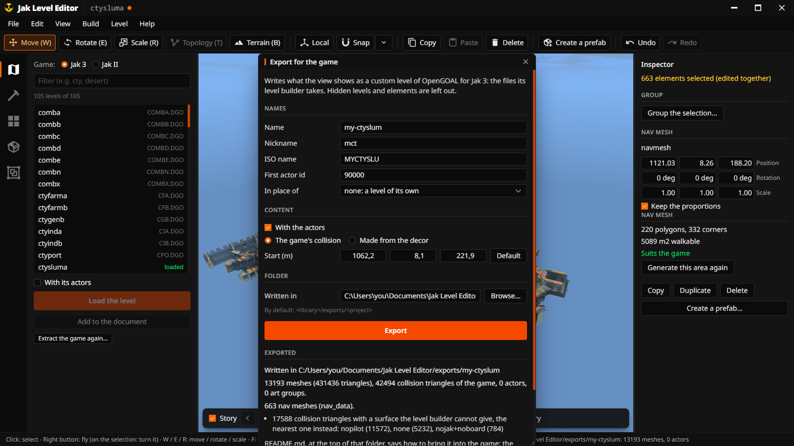

Its window, field by field:

- **Name**: your level's name in the game, 3 to 10 lower-case letters, digits or `-` (`my-ctyslum`).
- **Nickname**: 3 letters, the name of its file (`mct`). **ISO name**: the same in capitals, 8 at
  most. **First actor id**: the number its objects start from (leave it).
- **In place of**: a level of the game it replaces (below), or none.
- **With the actors** (its objects), and the **collision**: **The game's collision** (the default:
  the game's own collision where its decor is still in place, a collision made from the shape of
  what you placed or moved) or **Made from the decor** (everything from the shape: heavier).
- **Start**: where the player starts (a continue point of the level by default).
- **Folder**: where it is written.
- The **behaviors** you set are written as the level's own code.
- The **report** says what changed and where the collision might be too dense for the game.

**Replace a level of the game**: a level made from one of the game's (say `ctyindb`) can take its
place, so that the game loads yours wherever it loaded the original, with its continue points,
music and missions. **Level > Replace a level of the game...**: choose it, **show the original** (a
blue ghost to compare), **Place it where the original is**, check where the game starts the player
(green: ground under it), and **Export in place of ...**.

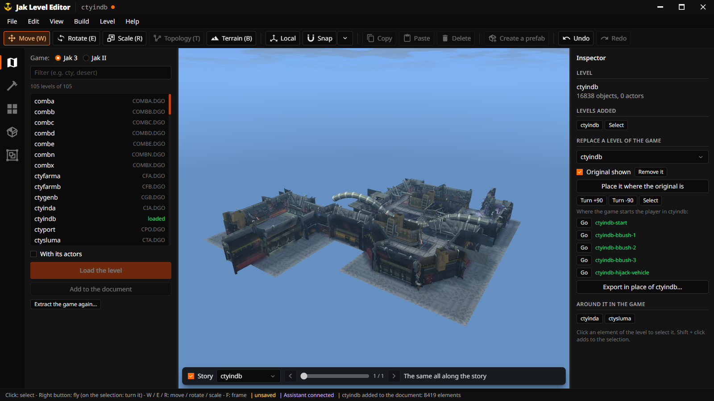

**Play** (the toolbar's button, **Level > Play in the game**) does the rest for you when the editor
has a game to play in, chosen in **File > Settings > Game**:

- a **jak-project checkout** of your own, built, with your Jak 3 extracted in it (used as it is:
  the editor's levels need the level builder's fixes of
  [whozghiar/jak-project](https://github.com/whozghiar/jak-project));
- or the **OpenGOAL Launcher's game for the editor** (`<install>/features/jak3/level_edited/`, made
  with the launcher's active OpenGOAL version when it is a release of whozghiar/jak-project,
  `v0.3.X-whozghiar.N`), found by itself.

It exports the level into `library/exports/<project>/`, installs it in that game (its files, and
its lines in `game.gp` and `level-info.gc` between `;; jak-level-editor: begin <name>` and `end`
lines; each file edited is backed up once as `<file>.jle-backup`), builds the game (a few minutes)
and starts it in your level. The Play window shows each step and the compiler's lines; **Remove**
takes the level out of that game again and builds it: its files are as they were. In the OpenGOAL
Launcher, the launcher does it in its own window. The export's `jle-level.json` is what Play reads:
the same as its README, for a program.

Without a game to play in, the Play button is not there. To play it by hand (the export's
`README.md` gives the exact lines for your level):

1. Get **jak-project** (OpenGOAL's source code) and build it, as its own
   [README](https://github.com/open-goal/jak-project#readme) explains, with your Jak 3 extracted in
   it. You get `goalc` (the compiler of the game's language) and `gk` (the game).
2. Copy the export's two folders, `custom_assets` and `goal_src`, into the jak-project folder (they
   merge with the folders of the same names).
3. Add the lines the export's `README.md` gives to `goal_src/jak3/game.gp` and
   `goal_src/jak3/engine/level/level-info.gc` (for a replacement: one word to change instead).
4. Start `goalc`, type `(mi)` and wait for *Successfully built all*; start `gk`; in `goalc`, type
   `(lt)` then `(start 'play (get-continue-by-name *game-info* "my-ctyslum-start"))`: Jak appears in
   your level.

## 16. Building with an AI assistant

An AI assistant can build in the editor for you, through its **MCP server**
(`jak-level-editor-mcp`; MCP is the protocol that lets an assistant use a program's tools):
you describe the level, it opens it, places the decor and the prefabs, checks the holes, looks at the
result and shows it to you, in your window, every change undoable. The server starts the editor
when none is running.

- **Build it** with the editor: `npx vite build`, then
  `cargo build --release -p jak-level-editor -p jak-level-editor-mcp` (both land in
  `target/release/`).
- **Claude Code**: start it in this folder (it reads `.mcp.json`) and accept the server
  `jak-level-editor`.
- Then ask, for example: *"Open the slums, build a little square with a fountain and two trees in
  front of the tower, and show me a picture at dusk"*.

**[The guide for AI agents](docs/mcp-agent-guide.md)** explains the tools and the rules an agent
follows (no holes, no crumbs in prefabs, facades only seen from the front, look before reporting),
with recipes.

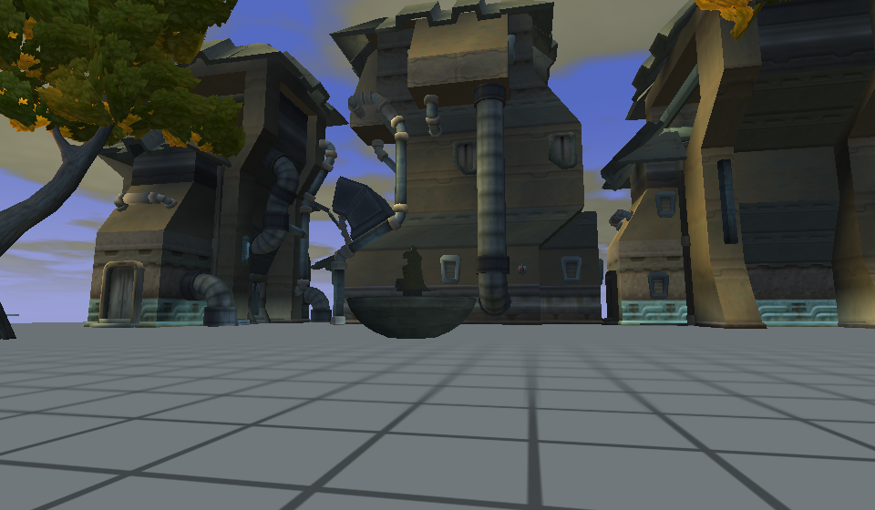

## 17. Keys and mouse

| Key | Action |
|---|---|
| W, E, R | Move, rotate, scale |
| T, B | Topology tool, terrain brush (again or Esc: done) |
| Click, Shift / Ctrl + click | Select, add to (or take out of) the selection |
| Double click, left button held still | Select the whole prefab or group (else the assembly) |
| Drag from an empty spot | Box selection (Shift: add, Ctrl: take out) |
| Drag from a selected element | Move the selection (Ctrl: forward / back, Shift: finer) |
| Click again at the same place | The next element under the cursor |
| Right button held on the selection | Turn it every way |
| Ctrl+G, Ctrl+L | Select the assembly, the whole level |
| Ctrl+Shift+G | Group the selection |
| Ctrl+C, Ctrl+V, Ctrl+D, Del | Copy, paste, duplicate, delete |
| Ctrl+Z, Ctrl+Y | Undo, redo |
| F, Home | Frame the selection, the level |
| G | Game rendering on / off |
| While placing: left button held, R / Ctrl + wheel, Shift on release | Move it before it lands; turn it; keep placing copies |
| Esc | Stop placing, then clear the selection |
| Ctrl+N, Ctrl+O, Ctrl+S, Ctrl+Shift+S | New level, open, save, save as |
| F1 | The guide |

## 18. Files and folders

```text
library/                 the library: everything made from your game (git ignores it; installed,
                         the folder chosen at the first start, see File > Settings)
  jak3/                  the extracted levels of Jak 3 (jak2/: Jak II's)
  prefabricated/         the prefabs: yours, and the game's in prefabricated/game/
  projects/<name>/       your saved projects
  exports/<project>/     the levels exported for the game (older exports: export/<project>/)
iso_data/                put your disc images here if you like (git ignores them)
data/                    what the editor knows of the game: names and rules, no asset
lang/                    the interface texts (en.json, fr.json)
crates/                  the engine (core/), the engine in a Tauri app (tauri-plugin/), the MCP server (mcp/)
ui/                      the interface: menus, panels, windows, the 3D view (Svelte, WebGL2)
src/, src-tauri/         the editor as a program of its own: its page and its Tauri app
extractor/               ogle-extract, the extractor (C++)
docs/                    this documentation's other pages and its screenshots
tools/                   scripts that regenerate data/ and the screenshots
.claude/skills/          skills for Claude Code working on this repository
```

Only `library/prefabricated/.gitkeep` of `library/` is in git: prefabs, projects and exports hold
the game's data and stay on your computer.

Your preferences (the library, the disc, the language, the recent projects), the pictures of the
panels and what the catalog read of the levels are kept in `%APPDATA%/OpenGOAL/jak-level-editor`
on Windows (`~/.local/share/OpenGOAL/jak-level-editor` on Linux). The first time, the editor takes
the preferences of its previous version (`OpenGOAL/open-goal-level-editor`).

## 19. More

- [Technical reference](docs/reference.md): the command line, the file formats, the game data, the
  details of the export and the known limitations.
- [Architecture](docs/rust-architecture.md): the engine, the interface, their protocol, and how the
  launcher embeds the editor.
- [What the decor can do in the game](docs/behaviors.md): a study of the game's code.
- [The guide for AI agents](docs/mcp-agent-guide.md).
- [How the screenshots are made](docs/captures/README.md).

### License

ISC (see [`LICENSE`](LICENSE)), the license of OpenGOAL. This editor is built on the work of the
[OpenGOAL](https://github.com/open-goal/jak-project) team: its extractor is made of the data readers
of OpenGOAL's decompiler (`extractor/opengoal/`, ISC license), its game rendering draws with the
game's own shader (TFragment), its game data is generated from OpenGOAL's decompiled code. It is an independent project,
not affiliated with the OpenGOAL team nor endorsed by it. Third-party code keeps its own license
(`third-party/README.md`). Jak 3 belongs to Sony Interactive Entertainment and was developed by
Naughty Dog: no data of the game is in this repository; the screenshots show levels extracted from a
copy of the game.
