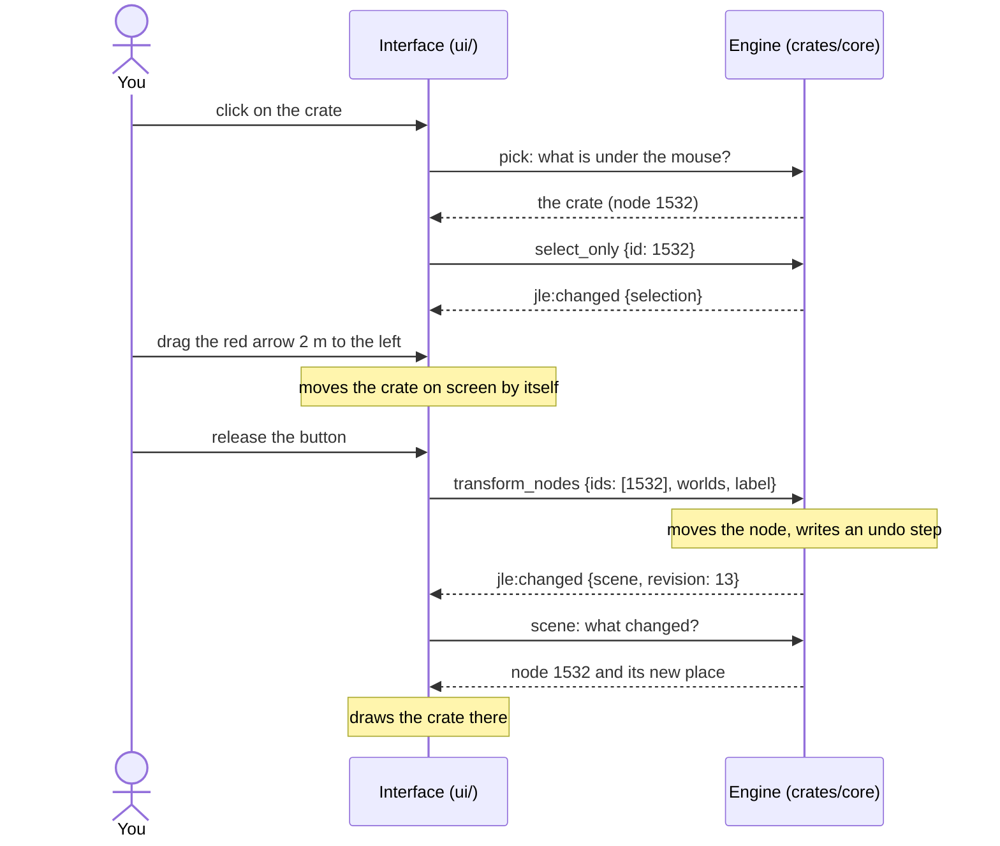
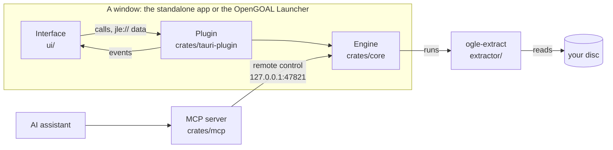

# Jak Level Editor: how it is built

This page explains how the editor works on the inside, for someone who has never opened its code: a
young developer, a curious player, someone who has never written a program nor used a 3D tool.

- **[Part 1, the ideas](#part-1-the-ideas)** tells how the editor is made with examples you can
  picture: a crate moved, a level read from the disc, an assistant building a street. You do not
  need to read code to follow it; when a file is named, it is to show you where the idea lives.
- **[Part 2, the technical reference](#part-2-the-technical-reference)** gives the details you need
  once you change the code: the formats, the paths, the command line, the limits.

How to use the editor is the [user guide](user-guide.md); how an AI assistant uses it is the
[MCP tutorial](mcp.md); the checks GitHub runs on the code are [workflows.md](workflows.md).

## Contents

- [Part 1, the ideas](#part-1-the-ideas)
  1. [The editor in one example](#1-the-editor-in-one-example)
  2. [Words you will meet](#2-words-you-will-meet)
  3. [The map of the repository](#3-the-map-of-the-repository)
  4. [The engine: the document and its history](#4-the-engine-the-document-and-its-history)
  5. [The interface: what you see and touch](#5-the-interface-what-you-see-and-touch)
  6. [How the two talk](#6-how-the-two-talk)
  7. [On its own, or inside the OpenGOAL Launcher](#7-on-its-own-or-inside-the-opengoal-launcher)
  8. [Long work, and the assistant's remote control](#8-long-work-and-the-assistants-remote-control)
  9. [From your disc to the game](#9-from-your-disc-to-the-game)
  10. [Build it yourself, and test it](#10-build-it-yourself-and-test-it)
- [Part 2, the technical reference](#part-2-the-technical-reference)
  11. [Layout](#11-layout)
  12. [Who does what](#12-who-does-what)
  13. [The engine's API](#13-the-engines-api)
  14. [The `jle://` protocol](#14-the-jle-protocol-binary-data-for-the-viewport)
  15. [Threads](#15-threads)
  16. [What the host gives the editor](#16-what-the-host-gives-the-editor)
  17. [In the launcher](#17-in-the-launcher)
  18. [Conventions](#18-conventions)
  19. [Command line](#19-command-line)
  20. [The extraction](#20-the-extraction)
  21. [Files](#21-files)
  22. [Game data](#22-game-data)
  23. [The game rendering](#23-the-game-rendering)
  24. [The export for the game](#24-the-export-for-the-game)
  25. [The remote control and the MCP server](#25-the-remote-control-and-the-mcp-server)
  26. [Known limitations](#26-known-limitations)

# Part 1, the ideas

## 1. The editor in one example

The editor is made of two halves that talk to each other:

- **The engine** knows the level: every wall, crate and tree, where it is, what it looks like, what
  it does. It decides what happens when you change something, and remembers how to undo it. It
  never draws anything. It is written in **Rust**.
- **The interface** is what you see and touch: the menus, the panels, the 3D view. It draws what
  the engine tells it and passes on what you do. It is a web page (**Svelte** and **TypeScript**)
  shown in a desktop window.

They exchange two kinds of messages: **calls**, the interface asking the engine to do or tell
something (`open_level`, `select_only`, `transform_nodes`), and **events**, the engine telling the
interface that something changed (`jle:changed`).

Follow one action from beginning to end. In the industrial zone of Haven City (the level
`ctyinda`), you click a crate, then drag the red arrow of the gizmo to move it 2 meters to the left:



1. **The click.** The interface knows where the camera is and where the mouse points: together
   they make a line going into the screen, a **ray**. It asks the engine, with the call `pick`,
   what this ray meets first. The engine answers "the crate, node 1532", and the interface selects
   it with a second call, `select_only`.
2. **The drag.** While you hold the button, the interface moves the crate on the screen by itself,
   at every frame, without asking the engine: asking 60 times a second would be slow, and you have
   not decided yet.
3. **The release.** Now the move is decided: the interface sends one call, `transform_nodes`, with
   the crate's new place. The engine moves the crate and writes in its **history** how to put it
   back. **Ctrl+Z** undoes the whole move in one step, not the hundreds of small moves of the drag.
4. **The event.** The engine sends the event `jle:changed`, saying what changed (here, the scene).
   Every part of the interface that cares is listening: the 3D view asks what moved (only the crate,
   not the whole level), the inspector shows the crate's new position, the Edit menu now offers
   *Undo Move*.

That is the whole editor, over and over: **the interface asks, the engine decides, the engine says
what changed, the interface draws.** Placing a prefab, painting the terrain, an AI assistant
building a street: they all take that path.

Why split it in two?

- **The engine can be tested without a window.** Its tests (`cargo test -p jak-level-editor-core`,
  more than a hundred) open levels, move things, undo, export, with nothing on screen.
- **The same engine is used from three places**: the editor's own window, the OpenGOAL Launcher, and an
  AI assistant through the MCP server. They all send the same calls.
- **Each half does what its language is good at**: Rust for the heavy work (reading gigabytes of
  levels, casting rays, making nav meshes), the web for windows, buttons and drawing.

## 2. Words you will meet

You do not need to learn these by heart: come back here when a word stops you.

**3D words**

| Word | What it is | Example |
|---|---|---|
| **Vertex** | a point in space: three numbers, x, y (up) and z | a corner of the crate: (120.0, 4.0, -35.5) |
| **Triangle** | three vertices; the only shape a graphics card draws, so everything is made of them | a crate is 12 triangles (2 per face) |
| **Mesh** | the triangles that make the shape of one thing | the crate's 12 triangles |
| **Normal** | the direction a surface faces, used to light it | the top of the crate faces up: (0, 1, 0) |
| **Texture** | a picture wrapped on triangles | the wooden planks of the crate |
| **UV** | where each vertex sits on the texture | the corners of a face on the corners of the picture |
| **Material** | how a surface is drawn: its texture, its color, see-through or not, seen from both sides or not | a fence: the gaps of its texture are cut out |
| **Node** | one thing of the scene: a mesh placed somewhere, a group, an object of the game | the crate is a node; a group of houses is a node whose children are the houses |
| **Matrix** | 16 numbers telling where a node is, how it is turned and how big it is | moving the crate 2 m to the left changes one of them, its x: from 120.0 to 118.0 |
| **Scene, document** | the tree of all the nodes the editor has open | a level and the houses you added to it |
| **Ray** | a half-line from a point, in a direction | from the camera through the mouse |
| **glTF, `.glb`** | a common file format for 3D scenes, as `.jpg` is for pictures | the projects, the prefabs and the extracted levels are `.glb` files; Blender opens them |
| **Shader** | a small program the graphics card runs for every vertex and every pixel | the game rendering uses the game's own shader, translated |

**Game words**

| Word | What it is | Example |
|---|---|---|
| **Level** | a part of the world the game loads as one piece | `ctyinda`, the industrial zone; `wascitya`, Spargus |
| **DGO** | the file of the disc a level comes from | `CIA.DGO` holds `ctyinda` |
| **Background, shell** | the level's ground, walls and buildings, which never move | the streets and houses of the slums |
| **Actor** | an object with code of its own | a door, a crate, an elevator, an enemy |
| **Collision** | the invisible surfaces Jak walks on and bumps into, simpler than what you see | a staircase's collision can be a ramp |
| **Time-of-day palette** | each vertex has 8 colors, one per light of the day; the game mixes them by the hour | at night the palette of the lamps lights the streets |
| **Nav mesh** | the floor plan creatures walk on | the paths of the guards in a yard |
| **Game units** | the game counts 4096 units per meter | 2 m are 8192 units |

**Program words**

| Word | What it is | Example |
|---|---|---|
| **Rust** | the engine's language: fast, and its compiler refuses many mistakes before the program runs | two threads writing the same data at once |
| **TypeScript** | JavaScript with types: the interface's language | `call("opne_level")` is refused before the program runs |
| **Svelte** | writes the interface as components (a button, a panel) that update themselves when their data changes | the Levels panel lists the levels again when the document changes |
| **Tauri** | puts a web page in a desktop window and lets it call Rust code; the OpenGOAL Launcher is made with it too | |
| **WebGL2** | how a web page asks the graphics card to draw triangles | the 3D view |
| **JSON** | a text format for data | `{"name": "ctyinda"}` |
| **API, call** | the list of what a program can be asked; one request | `open_level` with `{"name": "ctyinda"}` |
| **Event** | a message sent to whoever listens | `jle:changed` |
| **Thread** | a line of work running at the same time as others | the extraction runs on a thread while you keep working |
| **Lock** | lets one thread at a time touch something | the document: an assistant's change and yours never mix |
| **Test** | a small program checking that another does what it should | "undo after a move puts the crate back" |
| **CI** | computers that run the checks at every push ([workflows.md](workflows.md)) | the tests, the build, the formatting |
| **MCP** | the protocol that lets an AI assistant use a program's tools ([mcp.md](mcp.md)) | the assistant calls `place` |

## 3. The map of the repository

| Folder | What lives there | You go there to... |
|---|---|---|
| `crates/core/` | **the engine** (Rust): the document, the history, the tools, reading and writing files, the export | change what a tool does, add a call |
| `crates/tauri-plugin/` | the engine inside a Tauri window: it passes the calls and the events, serves the 3D data, starts the remote control | rarely: it only connects |
| `src-tauri/` | **the standalone app**: a window, the plugin, the command line, the icons | change the app's name, icon or version |
| `crates/mcp/` | **the MCP server**: a separate program that passes an assistant's requests to the editor | add a tool for assistants (with `crates/core/src/editor/remote_tools/`) |
| `ui/` | **the interface** (Svelte, TypeScript): `LevelEditor.svelte`, `components/` (menus, panels, inspector, windows), `render/` (the 3D view) | change a panel, a window, how the 3D view draws |
| `src/`, `index.html` | the standalone app's page: it only shows `ui/LevelEditor.svelte` | rarely |
| `lang/` | the interface's texts: `en.json`, `fr.json` | change the text of a button |
| `data/` | what the editor knows of the games, read from OpenGOAL's decompiled code | nothing by hand: `tools/` makes it |
| `extractor/` | **ogle-extract** (C++): reads the levels from the disc | change what is extracted |
| `tools/` | Python scripts: `data/` made again, the documentation's pictures | |
| `docs/` | this documentation and its pictures | |
| `.github/workflows/` | the checks GitHub runs ([workflows.md](workflows.md)) | |
| `.agents/skills/` | the knowledge base for AI agents, [opengoal-modding-kb](https://github.com/whozghiar/opengoal-modding-kb) (a git submodule); the editor's own skills are in its `jak-level-editor-skills/`, and `npx yarn skills:link` links them all into `.claude/skills/` for Claude Code | change a skill of the editor (commit it in the submodule, on `main`) |

Why so many pieces for one editor? The engine knows nothing of windows, and it must not: it also
runs in its tests and inside the launcher. `crates/tauri-plugin` connects it to a Tauri
window, and the standalone app (`src-tauri/`) and the OpenGOAL Launcher both load that same plugin:
the launcher adds it with two lines of Rust, without a copy of the engine's code.



## 4. The engine: the document and its history

**The document is a tree.** Open `ctyinda` and the engine holds a tree of nodes
(`crates/core/src/scene/`): at its top a group for the level; under it the pieces of its shell (the
ground, cut by texture: one piece holds all the cobblestones), its decor (a group per kind of thing:
all its lamp posts), its collision, its actors (the doors, the crates). Your additions sit next to
them: a prefab placed is a group whose children are its pieces.

**Copies share their shape.** The 40 lamp posts of a district are 40 nodes, each with its own
matrix (its place), but one mesh: the shape is stored once. If you reshape one of them, it gets a
copy of its own first, and the 39 others keep theirs (Rust's `Arc::make_mut`, "copy on write").

**Every change is undoable.** A change of the document goes through the history
(`crates/core/src/history.rs`): an entry holds two recipes, how to undo and how to redo, and a
label ("Move", "Delete"). Delete 3 trees and the entry remembers those 3 trees: undo puts them
back. An entry is a recipe, not a copy of the whole level, so it costs little: the history keeps
the last 200. Each change also counts one more **revision**: the interface compares revisions to
know whether it is up to date.

**The tools are the engine's.** Each tool has its file in `crates/core/src/editor/`: placing
(`placement.rs`), the terrain brush (`terrain_tool.rs`), the topology tool (`topology_tool.rs`),
groups, prefabs, the export. The terrain brush, for example: the interface sends the stroke's
points, the engine raises the ground under them and answers with the new ground; the interface only
shows the brush's circle.

**Finding what a ray meets** has to be fast: the interface asks at every move of the mouse what is
under it, to light it up. Testing the ray against every triangle of a level would be far too slow.
So the engine sorts the triangles into boxes, the boxes into bigger boxes, and so on: a **BVH**
(`crates/core/src/scene/bvh.rs`). The ray tests a big box first; if it misses it, everything inside
is skipped at once. A ray cast at the sky above the slums misses the boxes of every house at the
first tests, and no triangle of theirs is ever looked at.

## 5. The interface: what you see and touch

**Components.** `ui/LevelEditor.svelte` is the root: it holds the frame (`components/frame/`: the
title bar, the menus, the bar of icons), the panels (`components/panels/`), the inspector
(`components/inspector/`), the windows (`components/windows/`) and the guide (`components/guide/`).
Each is a Svelte component: a file with its HTML, its code and its style, which redraws itself when
its data changes.

**A copy of what the engine says.** `ui/lib/engine.svelte.ts` keeps what the engine answered to
`get_state`: the document, the selection, the tool, the history's labels, the jobs running. When
`jle:changed` says the state changed, it asks again; every panel showing that state redraws on its
own. The Groups panel never asks "has a group been added?": it shows the list it is given, and Svelte
redraws it when the list changes.

**The texts.** No text is written in the code: `t("menu.file.export_game")` reads
`"Export for the game..."` in `lang/en.json`, or its French in `lang/fr.json`. Changing a word of
the interface means changing those files, not the code.

**The 3D view** (`ui/render/`). `renderer.ts` draws with WebGL2: for every visible node, it gives
the graphics card the node's mesh, its material and its matrix, and asks it to draw. The meshes and
textures are read once from the engine and kept in the graphics card's memory: moving the crate
sends a new matrix (16 numbers), not its triangles again. There are two ways of drawing:

- **the editor's view**: simple light, so that every surface is visible;
- **the game rendering** (`game_view.ts`, the **G** key): the decor drawn with the game's own
  shader, its 8 palettes mixed by the hour and the weather. The engine cuts the level into chunks of
  128 m and makes again only the chunks an edit touched: move the crate, and one chunk is rebuilt,
  not the district.

**What the interface decides alone**: the camera, the gizmo while you drag, the box you draw, the
previews while a button is held. Everything that changes the document goes to the engine as one
call.

## 6. How the two talk

There are three channels.

**1. Calls.** One Tauri command carries every call, a name and its arguments, answered
with JSON:

```ts
await call("open_level", { name: "ctyinda" });
const state = await call("get_state", {});
```

There are about 160 calls, listed in `crates/core/src/editor/api.rs`. Their names are checked:
`ui/lib/api.ts` lists them all, so that a typo (`call("opne_level")`) is refused by TypeScript
before the program even runs, and a test of the engine checks that this list is exactly the
engine's.

**2. Events.** The engine speaks first only through events:

| Event | When | Example |
|---|---|---|
| `jle:changed` | after a call changed something, once, saying what | `{"revision": 13, "scene": true}` after the crate moved |
| `jle:progress` | while a long job runs | the extraction at 40 % |
| `jle:log` | a line of the log | "Level ctyinda loaded (... actors)" |
| `jle:request` | the engine needs the interface | the MCP server wants a picture of the 3D view |

**3. `jle://` addresses.** Meshes and textures are big, and JSON is text: a
vertex's position written `[123.456789, 4.000000, -35.500000]` is about 35 characters, the same
position in binary is 12 bytes. For a level of many thousands of triangles that is several times
more to send and far more to read. So the 3D view reads them like files from a web address that the
plugin answers, `jle://localhost/mesh/42` (`http://jle.localhost/mesh/42` on Windows), and receives
numbers ready for the graphics card. The scene itself comes the same way, and only **what changed
since the last time**: after the crate moved, the answer holds one node (84 bytes: its id, its
mesh, its 16 numbers), not every node of the level.

## 7. On its own, or inside the OpenGOAL Launcher

The same editor lives in two homes. The application that holds it (the **host**) gives it a few
things, and the editor uses what it is given without asking who holds it:

| | On its own (*Jak Level Editor*) | In the OpenGOAL Launcher |
|---|---|---|
| How you open it | its program | the *Level Editor* button of the sidebar (not on macOS for now) |
| The library, at first | `Documents/Jak Level Editor` | `<the launcher's install folder>/jak-level-editor` |
| Its preferences | `%APPDATA%/OpenGOAL/jak-level-editor` | `%APPDATA%/OpenGOAL-Launcher/jak-level-editor` |
| The disc to extract | the one you choose (an `.iso` or a folder) | the one the launcher already extracted |
| ogle-extract | installed with the editor | downloaded the first time it is needed, checked against the SHA-256 GitHub publishes for it |
| Command line | yes ([19](#19-command-line)) | none |

(The folders are Windows'; Linux and macOS have theirs: [16](#16-what-the-host-gives-the-editor).)

The two never step on each other: their preferences and libraries are separate, so you can use
both. Neither runs the game: the export writes the files to copy into a jak-project (OpenGOAL's
sources), with a README giving the exact lines; the user guide's
[export](user-guide.md#15-playing-it-in-the-game-export) goes through it.

How the launcher holds the editor: its repository keeps this one as a **git submodule** (a folder
pinned to one exact version of the editor), adds the plugin with two lines of Rust and shows the
component with one Svelte import ([17](#17-in-the-launcher)). When the editor changes, the launcher
moves its submodule to the new version ([RELEASING.md](../RELEASING.md#5-the-opengoal-launcher)).

## 8. Long work, and the assistant's remote control

**One thing at a time.** The engine sits behind a lock: one thing at a time touches the document.
If an assistant places a house while you move a tree, the two changes happen one after the other,
never mixed, and each is one undo step.

**Long work does not freeze the window.** Extracting a disc takes more than a minute, reading a big
level a few seconds. If the engine did that while holding the lock, the whole window would wait. So
a long job runs on a thread of its own (`Editor::run_job`): it reads what it needs, sends
`jle:progress` for the progress bar while it works, and takes the lock only at the end, to put its
result in the document. Meanwhile you keep working.

**A clock.** Every 50 ms (20 times a second), the plugin calls `Editor::tick`: the hour advancing in
the game rendering, the lightning of a storm.

**The remote control.** When you let an assistant control the editor (**File > Settings >
Assistant (MCP)**), the editor listens on `127.0.0.1:47821`. `127.0.0.1` means *this computer*:
nothing on the network can reach it. It also writes a password, a random **token** of 128 bits,
into `remote.json` in its preferences' folder, and refuses any request without it. Why a password
on your own computer? A web page you visit could send requests to that port; it cannot read your
files, so it cannot know the token. A request is one line of JSON:

```json
{"id": 7, "tool": "place", "args": {"kind": "prefab", "name": "small-fountain", "position": [0, 0, 18]}, "token": "9f2c..."}
```

**The MCP server** (`crates/mcp`) is the assistant's side: a small program the assistant starts,
which reads `remote.json`, starts the editor if none is listening, and passes each tool call on.
The tools run under the same lock as your clicks: you see them happen, and Ctrl+Z undoes them.
[mcp.md](mcp.md) tells what an assistant can do with it.

## 9. From your disc to the game

Follow the industrial zone, `ctyinda`, from the disc to the game:

1. **On the disc**, it is `CIA.DGO`, a file of the `DGO` folder of your Jak 3. Nothing of the game
   is in this repository: everything comes from your copy.
2. **The extraction** (File > Extract game assets): ogle-extract, a C++ program made of the readers
   of OpenGOAL's decompiler, reads the DGO and writes into your library
   `jak3/ctyinda/decor/ctyinda-background.glb` (the shell, the decor, the collision and the actors,
   each piece with its 8 palettes), `jak3/ctyinda/models/` (the actors' models) and
   `jak3/ctyinda/level.json` (what the folder holds). The whole disc, 272 level files, takes a
   minute or two and 3.7 GB.
3. **What the disc does not say plainly** is in `data/`: which kinds of actors are creatures, what
   settings each object's code reads, the order of the story's tasks. Python scripts of `tools/`
   read it from OpenGOAL's decompiled code. It is how the inspector knows that a door can stay
   locked until a task of the story is done.
4. **The export** (Level > Export for the game) writes into `exports/<your project>/` the files
   OpenGOAL's level builder reads: the decor in the game's units (4096 per meter), the level's
   description, the code of the behaviors you set, the nav meshes, and a README with the lines to
   add to a jak-project. You copy them there and build: the level is then in the game.

The export also translates what the game cannot take as it is. An example: Jak's collision. Around
Jak, the game keeps the collision of at most 461 triangles; the decor you see is far denser. So the
game's own collision is kept where the level's decor is untouched, and a piece you placed gets a
simpler collision made from its shape ([24](#24-the-export-for-the-game)).

### One game today, others planned

The editor edits Jak 3, and is made so that Jak and Daxter and Jak II can follow. What depends on
the game, and where it lives:

| What | Where | Today |
|---|---|---|
| Reading the disc | ogle-extract (`extractor/main.cpp`) | it recognizes the three games; it extracts Jak 3, and Jak II for its decor |
| The extracted levels | `library/<game>/` | `jak3/`, `jak2/` |
| What the editor knows of a game | `data/<game>/` | `data/jak3/` (objects, particles, story, prefabs), `data/jak2/` (creatures, prefabs) |
| The game rendering | `crates/core/src/game/`, `ui/render/game_view.ts` | Jak 3's background shader and its hours and weathers |
| The export | `crates/core/src/io/game_export/` | Jak 3's files: `goal_src/jak3/`, `custom_assets/jak3/` |
| The interface | `ui/lib/games.ts` | Jak 3 `ready`; the others in the Game menu, marked *Work in progress* |

Making a game editable fills each line for it: its extraction, its data, its rendering (Jak and
Daxter's background renderer is not Jak 3's), its export (what its level builder reads), then
`ready: true` in `ui/lib/games.ts`, which lets the Game menu choose it.

## 10. Build it yourself, and test it

To build it yourself (to work on it, or a version not released yet), you need:

- [Rust](https://rustup.rs), stable (1.89 or later). On Windows, rustup offers to install the
  Visual Studio C++ build tools Rust links with: accept.
- [Node.js](https://nodejs.org) 22. Yarn, the interface's package manager, comes through `npx`:
  nothing more to install.
- For **ogle-extract**, the extractor (C++, from OpenGOAL's decompiler): CMake 3.20+, Ninja and a
  C++20 compiler (tested with Clang 19 on Windows).
- On Linux, the system packages of a Tauri application:
  [Tauri's prerequisites](https://v2.tauri.app/start/prerequisites/) (webkit2gtk 4.1 and others).

On **Windows**, step by step:

1. Install the tools once: Rust with [rustup](https://rustup.rs), Node.js 22, and for the extractor
   with [Scoop](https://scoop.sh) in a PowerShell window `scoop install git cmake ninja llvm python`
   (or with `winget`: `Kitware.CMake`, `Ninja-build.Ninja`, `LLVM.LLVM`, `Git.Git`).
2. Get this repository (`git clone ...`, or the ZIP of the repository's page) and open a terminal
   in its folder. For an AI agent working on the editor, also `git submodule update --init` (the
   knowledge base and the editor's skills, in `.agents/skills/`), then `npx yarn skills:link`
   (Claude Code's links to them, in `.claude/skills/`).
3. Build the extractor, then the editor. The last line builds the editor and starts it (the first
   time takes a few minutes).

```bash
cmake -S . -B build -G Ninja -DCMAKE_BUILD_TYPE=Release   # ogle-extract, once
cmake --build build                                        # build/bin/ogle-extract and its tables
npx yarn install                                           # the interface's packages, once
npx yarn tauri dev                                         # build the editor and start it
```

`npx yarn tauri dev` is for working on the editor (the interface reloads when its files change).
To make the program itself and its installers:

```bash
npx yarn tauri build
```

It writes `target/release/jak-level-editor.exe` (`jak-level-editor` on Linux): next time,
double-click it. The installers are in `target/release/bundle/` (`.msi`, `.deb`, `.AppImage`).
The editor finds `ogle-extract` next to itself, in its resources, or in `build/bin/` of this
folder: keep the extractor built there (or see [The extraction](#20-the-extraction)
to put it in the installers, as the releases do).

The tests:

```bash
cargo test -p jak-level-editor-core -p jak-level-editor-mcp   # the engine's and the MCP server's tests
npx yarn typecheck                                           # the interface's types (svelte-check)
cargo fmt --all --check                                      # the Rust code's formatting (cargo fmt --all fixes it)
npx yarn check-format                                        # the interface's formatting (npx yarn format fixes it)
```

The engine's tests need no game data (those that read the extracted levels skip themselves when
`library/jak3/library.json` is missing) and check, among others: the scene, glTF round trips,
prefabs and groups, the export for the game, the translations, the game view, the holes finder,
the weathers, the terrain brush, the nav meshes.

GitHub runs the same checks at every push: [workflows.md](workflows.md).

### Your first change

Say you want the menu entry *Export for the game...* to read *Export to OpenGOAL...*:

1. Find the text: it is in `lang/en.json`, under the key `menu.file.export_game`
   (`git grep "Export for the game" lang/` finds it).
2. Change it there, and its French under the same key in `lang/fr.json`.
3. `npx yarn tauri dev`: the editor starts with the new text. No code changed:
   `ui/components/frame/MenuBar.svelte` asks for `t("menu.file.export_game")`, whatever it says.
4. Run the checks above, then commit.

A change of the engine goes the same way. Find the call: `crates/core/src/editor/api.rs` lists them
all, and `"transform_nodes" =>` leads to `Editor::transform_nodes`. Change it, add or adjust a test
next to it (the files `tests.rs`, or `crates/core/tests/`), then `cargo test -p
jak-level-editor-core`.

# Part 2, the technical reference

The details, for when you change the code. The paths are the repository's.

## 11. Layout

```text
Cargo.toml                        the Rust workspace: crates/core, crates/tauri-plugin, crates/mcp, src-tauri
crates/
  core/                           jak-level-editor-core (lib jle_core): the engine, no Tauri
    src/math.rs                   vectors, quaternions, matrices, boxes, rays
    src/history.rs, log.rs,       the undo history, the log, the translations (printf arguments),
      i18n.rs, prefs.rs           the preferences
    src/scene/                    the document: nodes, meshes, materials, the BVH and picking, holes
                                  (gaps), the ground, the terrain, topology, shapes, the story,
                                  assemblies, the light of what is placed (relight), particles,
                                  skeletons, a level's style
    src/io/                       glTF, the library and its index, the catalog, prefabs and the
                                  game's prefab recipes, the game's data, the texture palette,
                                  behaviors, the export for the game and its nav meshes, Jak II's
                                  structures
    src/game/                     the game view's chunks (view.rs), the game's mood: hour, weather,
                                  fog, lights (mood.rs)
    src/navmesh.rs, navmesh/      nav mesh generation (rerecast, a Rust port of Recast; recast.rs:
                                  Recast's own steps where rerecast differs)
    src/editor/                   the application without its interface: the Editor (mod.rs), the
                                  dispatch of `call` (api.rs), get_state (state.rs), levels,
                                  project, selection, groups, placement, the tools (terrain_tool,
                                  topology_tool, preview), inspector, panels, catalog, thumbnails,
                                  export, extraction, effects, ocean, surfaces, behaviors, the
                                  jle:// encoders (protocol.rs), the remote control and its tools
                                  (remote.rs, remote_tools/)
    tests/                        tests of the whole engine
  tauri-plugin/                   tauri-plugin-jak-level-editor: the engine inside a Tauri app (its
                                  command, its events, the jle:// protocol, the remote control, the
                                  command line)
  mcp/                            jak-level-editor-mcp: the MCP server (stdio) for AI assistants
ui/                               the interface module: <LevelEditor/> and everything under it
  LevelEditor.svelte              the root component the standalone app and the launcher mount
  lib/                            rpc.ts (calls to the engine, jleUrl), engine.svelte.ts (its state
                                  and events), i18n.ts, actions, shortcuts, windows
  render/                         the WebGL2 viewport: renderer, camera and controls, the game view,
                                  the sky, particles, the gizmo, labels, overlays, the tools (select,
                                  place, terrain, topology, preview), the panels' pictures; dev/: the
                                  viewport alone on a mock engine (http://localhost:3001/ui/render/dev/
                                  with `npx vite`)
  components/                     frame/ (title bar, menus, toolbar, story bar), panels/, inspector/,
                                  windows/, guide/, common/
src/, index.html, package.json    the standalone app's frontend (mounts ui/LevelEditor.svelte), its
                                  fonts
src-tauri/                        the standalone app (binary jak-level-editor): Tauri + the plugin,
                                  tauri.conf.json, its capability, its icons
extractor/                        ogle-extract (C++, from OpenGOAL's decompiler), built by the root
                                  CMakeLists.txt (nothing else is C++)
data/, lang/                      the game's tables, the interface's texts (en, fr)
tools/                            Python: data/ made again from the game's code, the documentation's
                                  pictures
docs/                             this documentation: user-guide.md, mcp.md, architecture.md (this
                                  page), workflows.md, captures/ (the pictures)
third-party/                      where the third-party code is, and its licenses
.agents/skills/                   the knowledge base for AI agents (submodule opengoal-modding-kb):
                                  the editor's skills in jak-level-editor-skills/; .claude/skills/
                                  holds links to them (npx yarn skills:link), never committed
.mcp.json                         the MCP server, for Claude Code started in this folder
.github/workflows/                lint.yaml, build.yaml, release.yaml (workflows.md)
```

`extractor/` stays a native tool the engine runs (`crates/core/src/editor/extract.rs`), as the
launcher runs OpenGOAL's own extractor, compiler and game: it is OpenGOAL's decompiler, not the
editor. `cmake -S . -B build -G Ninja -DCMAKE_BUILD_TYPE=Release && cmake --build build` writes
`build/bin/ogle-extract(.exe)` and its tables `build/bin/ogle-extract-data/`, where the engine
looks for it (after the program's own folder and its resources; `$JLE_EXTRACTOR` last).

## 12. Who does what

- **The engine (Rust, `jle_core`)** owns the document and everything computed from it: nodes,
  meshes, materials, textures, history, selection, tools, picking (BVH ray casts), the catalog,
  prefabs, levels, story, nav meshes, holes, export, extraction, the remote tools of the MCP
  server. It never draws. It is tested with `cargo test -p jak-level-editor-core`.
- **The interface (Svelte + TypeScript)** shows the engine's state and sends the user's actions.
  Its viewport draws with WebGL2 what the engine gives it (the meshes, their world matrices, the
  materials and textures, the game's palettes), and handles the mouse: the camera, the gizmo,
  the box, the previews while a button is held. What it decides goes to the engine as one call
  (a move: the matrices at the end of the drag, one undo step).

## 13. The engine's API

One Tauri command carries every call, so that the API is the engine's, testable without Tauri:

```ts
invoke("plugin:jak-level-editor|call", { name: "open_level", args: { name: "ctyinda" } })
```

```rust
// crates/core/src/editor/api.rs
impl Editor {
    pub fn call(&mut self, name: &str, args: &serde_json::Value) -> Result<serde_json::Value, String>;
}
```

`call` dispatches on `name` (snake_case, the names of the C++ editor's functions). Errors
are translation keys with their arguments when the interface shows them (`"levels.no_library"`), or
English text. `get_state` answers what the interface shows besides the scene (the document, the
selection, the tool, the history's labels, the jobs, the log's last lines, the view's settings).

The engine tells the interface something changed with **one event**, `jle:changed`, whose
payload says what (`{"revision": 12, "scene": true, "selection": true, "state": true}`; also
`document`, `materials`, `textures`, `gameview`): `call` compares the engine before and after
(the history's revision, the scene, the selection, the state the interface shows) and emits it
once, the queries (`get_state`, `node`, `pick`...) never. Besides it,
`jle:log` (a line of the log), `jle:progress` (a job) and `jle:request` (the engine needs the
interface: a capture of the view for the MCP server, a camera move; the interface answers with
`call("frontend_reply", {id, ...})`).

## 14. The `jle://` protocol (binary data for the viewport)

The plugin serves the viewport's data on a URI scheme (`jle://localhost/<path>` on Linux/macOS,
`http://jle.localhost/<path>` on Windows; `ui/lib/rpc.ts` has `jleUrl(path)`). Little-endian.

| Path | Answer |
|---|---|
| `scene?full=1` | the render state: every node (else only what changed since the last answer, and the ids removed) |
| `mesh/<uid>` | a mesh's primitives: positions, normals, uvs, colors, indices, material |
| `texture/<index>` | a texture of the document: `u32 width, u32 height`, RGBA bytes |
| `materials` | JSON: the document's materials (texture, color, alpha, blend, cutoff, two sides) |
| `thumb/<name>` | a thumbnail the interface drew before (PNG of <preferences>/thumbs), 404 until then |
| `preview/<kind>?...` | what a thumbnail draws: a mesh with its own materials and textures (`JLEP`) |
| `palette?game=&background=&name=` | the image of a texture of the games, as `texture/<index>` |
| `asset?path=` | a file of the library (a model's .glb for a preview, a sprite) |

`scene` (format `JLES` 1): `u32 magic "JLES"`, `u32 version`, `u32 full (1) or delta (0)`,
`u32 count`, then per node `u32 id, u32 parent, u8 kind, u8 flags, u16 reserved, u32 mesh uid
(low 32 bits, 0 none), u32 mesh version, f32 world[16]` (column-major), then `u32 removed`, then
the ids removed. Flags: 1 visible (with its parents, and the story), 2 locked, 4 reference level,
8 under an actor (its model), 16 has game lighting, 32 selected, 64 water. For an actor, the u16
is the low 16 bits of the FNV-1a hash of its etype (the color of its marker).

`mesh/<uid>` (format `JLEM` 1): `u32 magic "JLEM"`, `u32 version`, `u32 prims`, then per primitive
`u32 vertices, u32 indices, i32 material, u32 flags (1 uv, 2 colors, 4 backdrop: fogged by
distance)` followed by its arrays `f32 pos[3n]`, `f32 nrm[3n]`, `f32 uv[2n]` (if any),
`u8 col[4n]` (if any), `u32 idx[m]`.

`materials`: `{"materials": [...], "textures": [{"version": n}, ...]}`, each material `{name,
texture, base_color, alpha: "opaque"|"mask"|"blend", blend: ""|"add"|"add_alpha"|"subtract"|"half",
cutoff, double_sided, translucent, water}`.

### The panels' pictures

The catalog's and the prefabs' pictures are drawn by the interface (`ui/render/thumbnails.ts`, 128
pixels, the C++ framing: a 3/4 view) in a WebGL2 context of its own, from `preview/<kind>`:
`model?path=` (a model or a prefab of the library), `part?path=<a level's background>&node=<the node
whose mesh it is>`, `level?path=<a level's background>` (all of it, from above, its textures
shrunk), `icon?etype=&family=` (an object of the game without a model) or `shape?preset=`. The
effects are drawn from the game's particles (`particle_thumb.ts`). A picture drawn is kept with
`call("thumb_store", {name, png})` (base64), `name` being the FNV-1a 64 of its key in hexadecimal
(`m:<path>@<stamp>`, `p:<path>#<node>@<stamp>`, `b:<path>@<stamp>` a level,
`i1:<etype>#<family>`, `e2:<group>@0`, `s:<preset>`), and asked first as `thumb/<name>`.

`preview/<kind>` (format `JLEP` 1): `u32 magic "JLEP"`, `u32 version`, `u32 json bytes`, the JSON
(padded with spaces to 4 bytes: `{materials, textures: [{version}], bounds: {lo, hi}, draws:
[{mesh, world}]}`, the materials as `materials` gives them, `bounds` what the picture frames,
`draws` where each mesh is drawn), `u32 meshes`, then each `u32 bytes` and the mesh (`JLEM`, its
materials indexing the package's), `u32 textures`, then each texture as `texture/<index>`: `u32
width, u32 height`, RGBA bytes.

`palette?...` waits while the engine reads the texture (a level's file once for all the textures
asked of it); 404 when that level has no such texture.

### Game view

View > Game rendering (G) draws the decor as the game does (`ui/render/game_view.ts`, the game's
TFragment shader): in chunks, the pieces sharing a palette (a tree of an extracted level, or the
new geometry) in a cell of 128 m, made by `jle_core::game::view::GameViewChunks` from the document
and made again only where an edit touched them. The mood (the palettes' weights, the fog, the sky)
comes from the call `game_mood`.

| Path | Answer |
|---|---|
| `gameview` | `GameViewChunks::update(&scene)`, then `encode_chunk_list()`: the chunks |
| `gameview/chunk/<id>` | `encode_chunk(id)`: a chunk's vertices, indices and draws |
| `gameview/palette/<key>` | `encode_palette(key)`: a palette the chunks use |

`gameview` (format `JLGL` 1): `u32 magic "JLGL"`, `u32 version`, `u32 count`, then per chunk (40
bytes) `u32 id, u32 version, u32 palette, u32 triangles, f32 lo[3], f32 hi[3]` (its box, meters).
A chunk's version and a palette's key are new each time it is made (unique for the life of the
program): the interface keeps chunks by (id, version) and palettes by key.

`gameview/chunk/<id>` (format `JLGC` 1): `u32 magic "JLGC"`, `u32 version`, `u32 id, u32 chunk
version, u32 palette, u32 vertices, u32 indices, u32 draws, f32 lo[3], f32 hi[3]` (56 bytes),
then per draw (16 bytes) `u32 first, u32 count` (into the indices), `i32 texture` (the document's,
-1 a white one), `u8 flags` (1 translucent tree, 2 depth write, 4 alpha test, 8 a texture of the
editor's: its alpha halved), `u8 aref` (alpha test: what is under aref / 127 is not drawn), `u8
blend` (0 none, 1 alpha, 2 add alpha, 3 add, 4 subtract, 5 half: the PS2's), `u8 0`; then per
vertex (24 bytes) `f32 x, y, z` (game units: 4096 per meter), `f32 s, t`, `u16 color` (in the
palette), `u16 0`; then `u32 idx[indices]`. The normal tree's draws come first.

`gameview/palette/<key>` (format `JLGP` 1): `u32 magic "JLGP"`, `u32 version`, `u32 colors`, then
32 bytes per color: its 8 palettes' RGBA (128 is 1.0), palette k at k * 4.

## 15. Threads

The plugin keeps the engine in an `Arc<Mutex<Editor>>`. Long work (a level read, the catalog's
index, the game's prefabs, a nav mesh, an export, the extraction) runs on a worker thread that
holds what it reads (`Arc`s of the library) and applies its result under the lock when done, then
emits `jle:progress` while it goes and `jle:changed` when done (`Editor::run_job`). The remote
control (MCP, `crates/core/src/editor/remote.rs`) runs its tools under the same lock: what an
assistant does shows at once and can be undone; a tool that waits (a level loading, a job, a
picture of the view) is asked again every few milliseconds, the lock let go in between. A timer of
the plugin calls `Editor::tick` every 50 ms (the game view's hour passing, a storm's lightning).

The remote control listens on `127.0.0.1` only while the user lets an assistant control the editor
(the preference `remote_control`, File > Settings: `remote_state`, `set_remote_control {on}`) or for
the session the MCP server started the editor for (`--remote-port <port>`); its port is 47821 by
default. When it starts listening it writes `remote.json` (`{"port", "token"}`, a random token of
128 bits) into the preferences' folder, and deletes it when it stops. Every request carries that
token (`{"id", "tool", "args", "token"}`): one without it, or with another, is answered "refused"
and its connection closed, and a line that is not a JSON object (a web page's HTTP request sent to
the port) closes the connection unanswered. The MCP server reads the token from that file
(`$JLE_PREFS_DIR`, else the standalone app's preferences' folder).

## 16. What the host gives the editor

The application that hosts the editor (its own app, the OpenGOAL Launcher) gives it a `Host`
(`crates/core/src/host.rs`, `tauri_plugin_jak_level_editor::Builder::host`). The editor never asks
which application hosts it: it uses what it is given and hides what it is not. It runs no game of
its own: a level is exported, the export's README and the guide's tutorial "Add your level to the
game by hand" tell how to add it to the game.

| Field | Standalone app | OpenGOAL Launcher |
|---|---|---|
| `default_library` | `Documents/Jak Level Editor` | `<install>/jak-level-editor` |
| `extract_source` | none (the user's disc) | `<install>/active/jak3/data/iso_data/jak3`: the disc it already extracted |
| `extractor`, `extractor_provider` | ogle-extract installed with the app | downloaded on demand from the editor's release of its version, checked against GitHub's SHA-256 of it |

**The preferences** (`crates/core/src/prefs.rs`) and the caches next to them (thumbnails, the
catalog's index, `remote.json`) are in `Prefs::dir()`: `$JLE_PREFS_DIR` when set (tests), else the
folder the host gave before they were first read (`Prefs::use_dir`; the plugin's
`Builder::prefs_in_app_config()` gives `<the app's config folder>/jak-level-editor/`: the launcher's
editor keeps its own library), else the standalone app's `%APPDATA%/OpenGOAL/jak-level-editor`
(`~/.local/share/...` on Linux, `~/Library/Application Support/...` on macOS), which reads the C++
editor's preferences the first time.

**The library** (`crates/core/src/editor/library.rs`): until the user chose one (the preference
`library_chosen`; preferences of before it whose library holds an extracted game count as chosen),
the interface shows the first-run assistant (`library_setup`, `choose_library {path}`) offering
`default_library`; File > Settings changes it later (another folder is used as it is: nothing is
moved or deleted). `default_library` falls back to `library/` of the editor's repository only when
the program runs from it (a development build), never to the program's folder. The Extract
window's disc is `extract_source` while the user has chosen none; ogle-extract is `extractor`
first, and when it is missing the window offers `extractor_provider`'s download (`extract_fetch`,
a job: `jle:progress` "extract_fetch").

**The level builder and gk**: OpenGOAL's builder needs fixes for the editor's exports (a level
without regions, nav meshes, flat collision fragments, translucent surfaces, collision on both
sides per mesh, the list of everything visible). They are in the user's fork
`whozghiar/jak-project`, whose tooling releases are tagged `vX.Y.Z-whozghiar.N` (upstream's X.Y.Z,
the fork's build N). The launcher installs and updates those releases (its `TOOLING_REPOSITORY`).

## 17. In the launcher

The launcher keeps the editor as a git submodule in `level-editor/`, and:

```toml
# src-tauri/Cargo.toml
tauri-plugin-jak-level-editor = { path = "../level-editor/crates/tauri-plugin" }
```

```rust
// src-tauri/src/main.rs: the editor's preferences in the launcher's config folder
.plugin(tauri_plugin_jak_level_editor::Builder::new().prefs_in_app_config().build())
```

```svelte
<!-- App.svelte, in the window labelled level-editor -->
<script> import LevelEditor from "$level-editor/LevelEditor.svelte"; </script>
<LevelEditor locale="fr-FR" />
```

with the capability `jak-level-editor:default` (the plugin's one command, `call`) and the alias
`$level-editor` to `level-editor/ui` (vite's `resolve.alias` and tsconfig's `paths`, as this
repository's own). Its sidebar's *Level Editor* button (not on macOS for now) opens the editor in
a window of its own, without a system frame: the editor draws its title bar (`embedded` would leave
it out, for a host whose window has its frame); `locale` is the launcher's language. No command
line: the library and the language are the preferences', and the remote control listens only when
turned on in File > Settings. The editor's translations and tables go in the launcher's resources
under `jak-level-editor/` (`lang/`, `data/`), apart from its own. The launcher gives its `Host` from
`src-tauri/src/commands/features/level_editor.rs`.

The standalone app gives the plugin its command line instead:
`tauri_plugin_jak_level_editor::Builder::new().args(std::env::args()).build()`, which reads
`[project.glb] --library <folder> --lang <code> --remote-port <port> --hidden --open-level <name>`
(`--hidden`: no window, the preferences left unchanged; `--open-level`: a level of the library
opened at the start). The plugin takes the translations and the game's tables from the app's
resources (`lang/`, `data/`: `bundle.resources` of src-tauri/tauri.conf.json; a build copies them
into `target/<profile>/`), else the repository's. ogle-extract is found next to the executable,
in the resources or in the repository's `build/bin/`: to ship it with the app, add
`"../build/bin/ogle-extract.exe": "ogle-extract.exe"` and `"../build/bin/ogle-extract-data/":
"ogle-extract-data/"` to `bundle.resources` once it is built (a missing path there fails
`tauri build`).

## 18. Conventions

- The Rust code follows the C++ editor's file for file (`src/scene/terrain.cpp` ->
  `crates/core/src/scene/terrain.rs`), with the same names in snake_case, the same comments (they
  explain the game) and the same behavior. The comments still name the C++ files they come from:
  read them with `git show <commit>:src/...`, `<commit>` being the one before they were removed
  (`git log -1 --format=%H --diff-filter=D -- src/main.cpp`, then its parent: `<hash>^`).
- Shared data: `Arc<Mesh>` (copy on write with `Arc::make_mut`), meshes' derived data (bounds,
  BVH) computed lazily behind `OnceLock`/`RwLock`.
- JSON: `serde_json::Value` for what the C++ kept in `nlohmann::json` (extras, game data).
- Interface texts: `lang/<code>.json`, the same keys as the C++ editor; printf arguments (`%s`,
  `%d`, `%zu`, `%.1f`) are formatted by `ui/lib/i18n.ts` (interface: `t("key")`) and
  `jle_core::i18n` (log, MCP answers: `tr("key")`). A test checks every key of `en.json` in every
  language, with the same arguments.
- Tests: `cargo test -p jak-level-editor-core` (the C++ `--selftest`'s checks, as `#[cfg(test)]`
  modules and `crates/core/tests/`; those needing the extracted game skip themselves when
  `library/jak3/library.json` is missing), `cargo test -p jak-level-editor-mcp`, and for the
  interface `npx svelte-check --tsconfig ./tsconfig.json` and `npx vite build`.
- The interface's calls: `ui/lib/api.ts` holds `CallName`, the names of `api.rs`'s calls, which
  `call()` takes; the test `the_interfaces_calls_are_the_engines` fails when it is not `api.rs`'s
  (`JLE_WRITE_API=1 cargo test -p jak-level-editor-core the_interfaces_calls` writes it again).
- Formatting: `rustfmt.toml` (2 spaces), prettier for the interface (`npx yarn format`).
- The games: `ui/lib/games.ts` lists the series' games and which are `ready`. What is planned shows
  the class `wip` of `ui/components/common/classes.ts` with the text `wip` (*Work in progress*,
  *Travaux en cours*): the Game menu (the games not ready), the Extract window (a Jak and Daxter
  disc), the Levels panel (Jak II's levels). A game's files go in `data/<game>/` and
  `library/<game>/`.

## 19. Command line

```text
jak-level-editor [project.glb] [--library <folder>] [--lang <code>] [--remote-port <port>] [--hidden]
                 [--open-level <name>]
jak-level-editor-mcp [--remote-port <port>]
```

- `project.glb` is opened at the start; `--open-level` opens a level of the library instead
  (`--open-level ctyinda`).
- `--library` chooses the library folder (instead of the one chosen at the first start, else the
  host's default: `Documents/Jak Level Editor`, `library/` of the repository when the program runs
  from it; no first-run assistant then), `--lang` the language, for one session.
- `--remote-port` starts the editor's remote control on that port for the session (what the MCP
  server does when it starts the editor; without it, the remote control listens on 47821 only when
  File > Settings lets an assistant control the editor; `0`: as the preferences say);
  `--hidden` runs the editor without a window and without touching the preferences (scripts).
- `JLE_PREFS_DIR` (environment) puts the preferences in another folder (tests with fresh ones; for
  the MCP server, the folder of the editor's `remote.json`).
- `jak-level-editor-mcp` is the MCP server ([25](#25-the-remote-control-and-the-mcp-server)).
- Opened from the OpenGOAL Launcher, the editor has no command line: the library and the language
  are the preferences'.
- The C++ editor's other modes have their equivalents: `--selftest` is
  `cargo test -p jak-level-editor-core`, `--mcp` is `jak-level-editor-mcp`, and the pictures of
  `--screenshot` are taken through the remote control and the web view's DevTools
  ([captures](captures/README.md)).
- The preferences, the panels' pictures (`thumbs/`), what the catalog read of the levels
  (`index/`) and, while the remote control listens, its `remote.json` are in
  `%APPDATA%/OpenGOAL/jak-level-editor` on Windows (`~/.local/share/OpenGOAL/jak-level-editor` on
  Linux, `~/Library/Application Support/...` on macOS); the OpenGOAL Launcher's editor keeps its own
  in `<launcher's config folder>/jak-level-editor`. While the standalone app's folder has no
  preferences, the C++ editor's (`OpenGOAL/open-goal-level-editor`) are read, and saved into the
  new folder the next time they change.
- The translations (`lang/`) and the game's tables (`data/`) are read from the application's
  resources (`bundle.resources` of `src-tauri/tauri.conf.json`; a build copies them next to the
  program in `target/<profile>/`: build again after changing them), else from the repository.

## 20. The extraction

```text
ogle-extract <game.iso | disc folder> <output folder> [--levels CIA,CIB] [--textures]
ogle-extract --detect <game.iso | folder>   # game, version and serial (json)
ogle-extract --list <game.iso | folder>     # the levels of the disc (json)
```

An `.iso` is read in place: only the files read (the `DGO` and `CGO` folders, about 400 MB) are
copied to a work folder of the destination, deleted when done. Measured with Jak 3 NTSC
(SCUS-97330) on a 16-core processor and an SSD: 272 levels in 1 minute 10 to 1 minute 30, 3.7 GB.
[`extractor/README.md`](../extractor/README.md) has the details.

ogle-extract is a C++ program of its own, built with CMake from the repository's root (which
builds nothing else):

```bash
cmake -S . -B build -G Ninja -DCMAKE_BUILD_TYPE=Release
cmake --build build      # build/bin/ogle-extract(.exe) and its tables, build/bin/ogle-extract-data/
```

The editor runs the first it finds: the one its host gives (the OpenGOAL Launcher downloads it on
demand: **Download ogle-extract** in the Extract window), next to its own program, in its
resources, in `build/bin/` of the repository it was built from, else the file `$JLE_EXTRACTOR` names; its tables
(`ogle-extract-data/`) next to it. The installers ship it when they are built with
`src-tauri/tauri.release.conf.json`, which adds `build-release/bin/` (ogle-extract and its tables)
to the resources, as the releases do:

```bash
cmake -S . -B build-release -G Ninja -DCMAKE_BUILD_TYPE=Release -DCMAKE_C_COMPILER=clang \
      -DCMAKE_CXX_COMPILER=clang++ -DCMAKE_MSVC_RUNTIME_LIBRARY=MultiThreaded
cmake --build build-release
npx yarn tauri build --config src-tauri/tauri.release.conf.json
```

(`MultiThreaded`: the C runtime inside the program, which then runs on a Windows without the VC++
redistributable; the releases build the editor the same way, `RUSTFLAGS=-C
target-feature=+crt-static`.) Without that file, `tauri build` makes installers without the
extractor (a build for working on the editor).

The releases put it in the installers, in the portable zip, and alone in
`ogle-extract-<platform>.zip`, which the OpenGOAL Launcher downloads:
[workflows.md, Release](workflows.md#release).

## 21. Files

### The library

```text
library/jak3/library.json                          the game, its version, the levels extracted
library/jak3/common/models/*.glb                   the models every level uses
library/jak3/common/sprites/<page>/<texture>.png   the textures of the particles
library/jak3/<level>/decor/<level>-background.glb  a level: decor, collision and actors
library/jak3/<level>/models/<model>-lodN.glb       the models of its actors
library/jak3/<level>/level.json                    what the folder holds (DGO, actors, models, regions)
library/jak2/...                                   Jak II's levels, the same way
library/prefabricated/*.glb                        the user's prefabs
library/prefabricated/game/*.glb                   the game's prefabs (game/jak2/: Jak II's)
library/projects/<name>/                           a saved project
library/exports/<project>/                         a level exported for the game
```

### Project (`.glb`)

A regular glTF binary. Each node carries its kind in its extras (`og_kind`: `render`, `collision`,
`actor`, `group`, `navmesh`); instancing is kept (the copies of an element share its mesh).

| Extra | On | What it is |
|---|---|---|
| `og_level`, `og_companion`, `og_layer`, `og_reference` | groups | a level added, a level shown with it, a mission layer, the original a level replaces |
| `og_group` | root elements | the group they are in: `{id, name, prefab}` (a prefab placed: `prefab` true) |
| `og_navmesh` | nav meshes | `verts` (relative to the node), `polys` (3 or 4 corners), `adj` (the polygon across each edge, -1 a border) |
| `etype`, `aid`, `game_task`, `bsphere`, `lump`, `lump_types` | actors | the game's data of the actor; its model is a `render` child marked `og_actor_visual` |
| `og_behavior` | actors | what it does: `open` (approach, locked, always, when), `when`, `distance`, `loads`, `active`, `leave`, `present` (conditions: `{when: always|never|task|pressed|gone, arg}`) |
| `og_decor` | decor | its collision, ground material, effect on Jak, bounce, launch |
| `og_shape` | shapes | kind, size, texture repeat, steps, bend, corners, bumps |
| `og_import` | Jak II's | the game, level and part it comes from, its checks |
| `og_tod` | decor | the game's lighting: `palette` (8 RGBA per color) and `index` (per primitive, per vertex); `local`: lit like the level around it (`og_lit_here`) |
| `og_translucent`, `og_blend` | materials | drawn without its depth; the PS2 blend (`add`, `add_alpha`, `subtract`, `half`) |

The level the project comes from and the level it replaces are in `asset.extras.ogle.settings`.

### Prefab (`.glb`)

The same format, holding only the prefab's elements, around a pivot at the bottom center of their
bounds. Placed, its roots become a group named after it (the groups it was made of are forgotten).

### Nav meshes for the game (`.json`)

The `entity-nav-mesh` objects as they are in the game's memory, in the data blob format of
OpenGOAL's level tools (`words`, `pointers`, `types`, `symbols`, `roots`): the `nav_data` of a level
for a custom level builder. The polygon grid follows the game's own rule: the grids the editor makes
for the game's nav meshes are the game's, byte for byte.

### Extracted level

`<level>-background.glb` holds the level's shell (tfrag) in pieces (the large ones, the terrain,
marked `og_terrain`, with `og_measure`), its decor (a group per prototype whose instances share the
mesh), its collision (a node per surface: `collide_pat`) and its actors. Every piece keeps the
game's lighting in `og_tod`. `level.json` lists the actors by type with the data of one of each
(the catalog's templates) and the level's regions (`region_trees`).

### Ground and decor

When a level opens, its ground is locked (clicks and boxes go to what stands on it; **Select the
ground** reaches it). The shell's pieces are cut by texture, so a piece named `city-port-grnd-cobl`
holds every triangle of that cobblestone, the walls built with it included. A piece marked
`og_terrain` is ground when:

1. it is large and flat: 60 m across at least, half of its surface flat (`ground_piece`);
2. its texture is not a structure's: `roof`, `bridge`, `pillar`, `palace`, `tower-side`, `monitor`,
   `beam`, `pipe`, `brace` are never ground;
3. its texture is natural ground (`sand`, `grass`, `rock`, `dirt`, `mud`, `snow`, `beach`, `mount`,
   `dune`, `cliff`, `lava`, `ground`), or nothing lies under it: down rays from 64 points of its flat
   surfaces, whichever way their triangles face, meet another piece (not a backdrop) more than 1 m
   below for less than half of them. A roof, a ceiling, a bridge, a slab of debris lying on the
   ground, a water surface over its bed have something under them;
4. it is not a long narrow piece (under 12 m wide, 8 times as long) standing more than 10 m over the
   level's ground (the floor under a quarter of the ground's area): a wall's top, a walkway.

A ground keeping walls more than 3 m above its floor (40 % of what stands there upright) has them
moved to a piece of their own, `<name>-walls`, selected like the rest. Projects saved before get the
same when they are opened.

Over the 94 levels of Jak 3 with a shell (9 130 large pieces), this leaves 446 grounds of the 647 the
first rule alone gives: 201 pieces are selected like decor again (59 of the far views of the city,
53 floors, plates and rubble lying on others, 34 roofs and ceilings, 28 pieces of the palace, pillars,
beams, braces and bridges, 24 water surfaces, the 3 tops of the farms' walls), and 33 grounds had
walls split off. In the city's levels, what stays ground is the ground of the streets (5 to 9 m:
cobblestones, pavement, the slums, the ditches, the outposts' yards, the farms' grass). The upper
floors of interiors (caves, the Precursor levels) stay ground too: they are walked on.

## 22. Game data

`data/jak3/game-data.json` is what the editor knows of the game beyond the extracted files: names
and rules read in OpenGOAL's decompiled code, no asset.

| Part | What it is |
|---|---|
| `actors.roles` | the types that are creatures or logic (the others are objects) |
| `actors.objects`, `models`, `skeletons` | the objects' families, the models each type draws |
| `actors.effects`, `unlisted`, `placeholders` | the particle effects, the logic the catalog does not offer, the types that spawn nothing |
| `actors.water_looks` | the model of each look of the water actors |
| `actors.params`, `parents`, `code`, `code_needs` | what each type's code reads (tag, kind, default), its parent, its code file and what it needs |
| `oceans` | each ocean map: corner, height, cells, near ocean, far ocean |
| `levels` | per level: task mask, ocean, layer, companions, neighbors, continue points |
| `story` | the task nodes in the order of the game, and what depends on them |
| `enums` | the enums of the parameters |

| File | Made by |
|---|---|
| `data/jak3/game-data.json` | `python tools/gen_game_data.py <jak-project>/goal_src` (with `tools/object_categories.json`) |
| `data/jak3/particles.json` | `python tools/gen_particles.py <jak-project>/goal_src` |
| `data/jak2/creatures.json` | `python tools/gen_jak2_creatures.py` |
| `data/jak3/prefabs.json`, `data/jak2/prefabs.json` | `python tools/gen_prefab_recipes.py library --game jak3` (`jak2`); `tools/prefab_review.json` keeps the review |

Read a checkout of the game's own code (read only), then build the editor again: it reads the
copy of `data/` a build puts next to its program (the engine's tests read `data/` itself).

## 23. The game rendering

- **The renderer**: the shader of OpenGOAL's background renderer (`TFragment`'s `tfrag3`, ported
  to WebGL2 in `ui/render/game_view.ts`) draws the decor as the level builder makes it of the export
  (`crates/core/src/game/view.rs`), with the game's camera. The level is made in chunks (the pieces
  sharing a palette in a cell of 128 m); an edit makes again the chunks it touched.
- **The time of day and the weather** (`crates/core/src/game/mood.rs`): Jak 3's mood code
  (`init-weather!` and `update-mood-exterior`): the 9 fog tables (no cloud: haze, clear, smog;
  overcast: fog, clear, rain; storm: fog, clear, rain), the 3 color tables and the 3 channel groups
  of `mood-tables.gc` mixed for the weather's `cloud` and `fog`, then the two snapshots of the hour
  (`*mood-interp-table*`) mixed: the 8 palettes' weights, the fog, the sky color, the models' lights.
  The level's lamps follow the city's (palette 5 at night).
- **The sky** (`ui/render/sky.ts`): drawn behind the level: the mood's sky color high up, its
  fog color at the horizon, the sun and the moon moving along an arc through the day (from the
  morning's light direction, +x, to the evening's), stars at night, procedural clouds drifting,
  covering as much of the sky as the weather's `mood-clouds` (`cloud-min` .. `cloud-max`), lit by
  the ambient light and the sun as `sky-tng` lights its clouds, darker in a storm; a lightning flash
  lights them. The Game rendering window shows half a turn of it in a texture.
- **Rain and lightning**: rain streaks fall around the camera (`rain` 0..1); a storm (cloud above
  0.75) flashes every 5 to 10 seconds (`gen-lightning-and-thunder!`), brightening the light from
  above.
- **Effects**: the particle effects run by the game's rules (`data/jak3/particles.json`,
  `ui/render/particles.ts`; `crates/core/src/scene/particles.rs` is the reference its tests prove);
  some parts launch only at some hours; in the game rendering they fade in the fog by their
  distance. A particle mixes with what is behind it as the game sets it (`sp-cpuinfo-flag-3` and
  glows added: fire, sparks, lights; `-4` subtracted; the others mixed), and fire, flames and lava
  take their color, alpha and size over their life from the game's curves (`birth-func-curve`,
  `live-func-curve`: the `curves` of `particles.json`).

## 24. The export for the game

What **Export for the game...** and `export_level` write, in `library/exports/<project>/`:

| File | What it is |
|---|---|
| `custom_assets/jak3/levels/<name>/<name>.glb` | the decor in the game's space, lit with the 8 palettes, the builder's extras (collision); the game's collision, a node per surface |
| `.../<name>.jsonc` | the level for the builder: names, `base_id`, art groups, actors (typed lumps), regions of a level replaced |
| `goal_src/jak3/levels/<name>/<name>-obs.gc` | the level's code: the behaviors set in the editor |
| `.../<name>.gd`, `<name>-nav.json`, `level-info.gc` | its DGO, its nav meshes, its definition for `level-info.gc` |
| `README.md` | how to bring it into the game, what the export changed |

**Collision.** Jak 3 gathers the collision around Jak in a cache of 461 triangles; the decor's
shape is far denser than the game's collision. So the export writes the game's collision where the
levels' own decor is still in place, none where a piece was deleted or moved (the collision nearer
to a piece taken out goes with it), and a collision made from the shape for the pieces placed (4 m
across or more, and every shape of the editor); the report lists the places still too dense.

**Lighting.** Each piece's 8 palettes as the game has them; the pieces made in the editor get
palettes made from their color, in the proportions of the level's.

**What changes**: Jak 3's surfaces are written with the first game's fields the builder reads
(the nearest material; rails, slides and shocks lost and counted); the actor types the game lacks
are left out; actors' scripts are left out (their behavior is the level's code); paths move with
their actor; links between actors by id become links by name.

**Into the game**: copy `custom_assets` and `goal_src` into jak-project, add the lines of
`README.md` to `goal_src/jak3/game.gp` and `level-info.gc` (or the one `:nickname` to change for a
replacement), build with `(mi)`, start `gk -g jak3 -- -boot -fakeiso -debug`, then in the REPL
`(lt)` and `(start 'play (get-continue-by-name *game-info* "<name>-start"))`.

## 25. The remote control and the MCP server

The editor listens on 127.0.0.1:47821 when File > Settings lets an assistant control it, or on the
port the command line gives for the session (`--remote-port`); one JSON line per request:
`{"id", "tool", "args", "token"}`, one per answer: `{"id", "ok", "result" | "error", "image"}`
(`crates/core/src/editor/remote.rs`). `token` is the one the editor wrote into `remote.json`
(`{"port", "token"}`, in its preferences' folder) when it started listening: a request without it is
refused and its connection closed, and so is a line that is not a JSON object. Its tools are the MCP server's, carried out under the
engine's lock like the user's actions: they show at once and can be undone. `capture_view` asks the
interface for a picture of its 3D view (the event `jle:request`, answered with `frontend_reply`).

`jak-level-editor-mcp` (`crates/mcp`) speaks MCP on its standard input and output and forwards each
tool call to the editor with the token of its `remote.json` (`$JLE_PREFS_DIR`, else the standalone
app's preferences' folder), and starts `jak-level-editor --remote-port <port>` (found next to it,
else in `target/release/` or `target/debug/`) when none listens. The tools, their arguments and the rules of
an agent: [the MCP tutorial](mcp.md#9-every-tool).

The C++ editor's `ui_input` (mouse and key events, pictures of the whole window) is gone: the
interface is a web page now. Its tests and the documentation's pictures drive it through the
DevTools protocol of its web view: start the editor with
`WEBVIEW2_ADDITIONAL_BROWSER_ARGUMENTS=--remote-debugging-port=<port>` (Windows), then
`Page.captureScreenshot`, `Input.dispatchMouseEvent`, and
`window.__TAURI_INTERNALS__.invoke("plugin:jak-level-editor|call", {name, args})` for any call of
the engine ([captures](captures/README.md)).

## 26. Known limitations

- **The editor's own view** lights every surface with the brightest of its palettes; the game
  rendering lights as the game does.
- **The game rendering** draws the background with the game's renderer; the actors' models, the
  ocean (waves of its own), the effects and the sky are the editor's: the sky imitates the game's
  colors and clouds, not its textures, its sun's exact orbit nor its cloud mesh. The weather stays
  where it is set (the game moves it slowly on its own); the desert's sandstorms are not offered.
- **Holes** are looked for from points of walkable ground every few meters, at one height: a hole
  seen only from a ledge, or narrower than the rays' spacing far away, can be missed; a surface
  seen through (glass, water, glows) counts as a hole.
- **Effects**: what a particle's own code does (`birth-func`, `func`) is not done; some effects of
  the game come from an object's code rather than from a part-spawner.
- **Scale**: the game draws decor at any scale, but gives most of its objects their own size.
- **The story is a line**: the task nodes in the order of the game.
- **Assemblies** are found by touch (boxes, not shapes); a structure wider than 60 m is cut.
- **The terrain brush** draws a height field: no overhangs, caves or arches.
- **Collision**: the game's collision of a piece moved goes away with it; small pieces placed
  collide only when told to.
- **Several levels**: each is loaded whole; one ocean map is drawn.
- **The ocean** is left out where the ground of the levels around (the game's neighbors, the city
  seen from afar) stands above it, in squares of 3 m: land thinner than 27 m (a sea wall) keeps its
  water, water closed in by that land (not reaching the map's edge nor the document's own levels)
  goes too; inside the box of the document's own levels, their pieces alone hide it.
- **Nav meshes**: the meshes of a large ground are not linked; they do not follow the decor.
- **Behaviors**: the generated code compiles and the level builds; "the object is there" is
  checked when the level loads.
- **Replacing a level**: the game is told through one line of its code, changed by hand.
- **Jak II's structures** have no collision of their own (made from their shape) and no behavior.
- **The light of what you place** is copied from the nearest lit surfaces facing the same way, not
  baked like the artists' (no shadows).
- **The export**: the code of objects that live in a level's own files is not added to the DGO;
  the cameras and ambient sounds of levels are not exported.
