# A guided tour of the OpenGOAL Level Editor

This tour shows, picture by picture, how the editor works and why it works that way: from your
game disc to a level you built yourself, by hand or with an AI assistant, and exported for the
game. Every picture was made by the editor itself (its `--screenshot` mode, see
[the last part](#making-these-screenshots-again)), with Jak 3 (NTSC) and the interface in English.

1. [The approach](#the-approach)
2. [Extract your game](#1-extract-your-game)
3. [Open a level](#2-open-a-level)
4. [See it along the story](#3-see-it-along-the-story)
5. [Select and edit](#4-select-and-edit)
6. [Stretch, grow, shrink](#5-stretch-grow-shrink)
7. [The catalog](#6-the-catalog)
8. [Prefabs](#7-prefabs)
9. [Build a new level](#8-build-a-new-level)
10. [Let an assistant build it](#9-let-an-assistant-build-it)
11. [A whole district, by an assistant](#10-a-whole-district-by-an-assistant)
12. [Nav meshes: where the creatures walk](#11-nav-meshes-where-the-creatures-walk)
13. [Several levels, side by side](#12-several-levels-side-by-side)
14. [What objects do](#13-what-objects-do)
15. [Export it for the game](#14-export-it-for-the-game)
16. [Save, and find help](#15-save-and-find-help)
17. [Build with shapes and the materials of Jak 3](#16-build-with-shapes-and-the-materials-of-jak-3)
18. [Replace a level of the game](#17-replace-a-level-of-the-game)
19. [See it as the game draws it](#18-see-it-as-the-game-draws-it), with its effects
20. [Making these screenshots again](#making-these-screenshots-again)

## The approach

The editor holds nothing of the game: it reads it from **your own copy** of Jak 3, turns it into
standard 3D files once, and edits those.

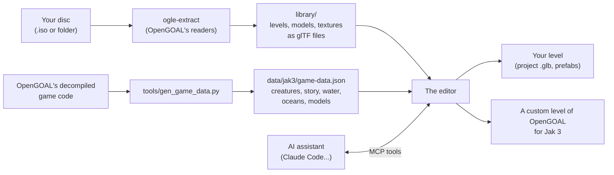

- **Extraction.** `ogle-extract` is made of the data readers of
  [OpenGOAL](https://github.com/open-goal/jak-project)'s decompiler. It reads the levels of your
  disc and writes each one as a [glTF](https://www.khronos.org/gltf/) file (`.glb`), the standard
  that Blender and most 3D tools open: its shell cut in pieces, its decor (one mesh per prototype,
  shared by all its copies), its collision and its actors (objects, with the data the game gives
  them). The models of the actors and the textures go next to it. This happens once.
- **Game data.** Some knowledge is not in the level files: which actors are creatures, which parts
  of a level appear or vanish as the story goes, which model an object draws, where the ocean is.
  `tools/gen_game_data.py` reads it from OpenGOAL's decompiled game code and writes
  `data/jak3/game-data.json`, which comes with the editor (it holds names and rules, no data of
  the game).
- **Editing.** A level opens as a scene of elements you can select, move, rotate, scale, copy and
  delete; every change can be undone. What you build is saved as a project: a `.glb` file too.
- **The catalog** gathers what can be put in a level: every object of the game, every other model
  and the decor of every level, found from the extracted files and the game data.
- **The assistant** drives the same editor through the Model Context Protocol (MCP): its tools are
  the editor's own actions (open, place, move, look, save), so everything it does can be seen and
  undone in the window.

## 1. Extract your game

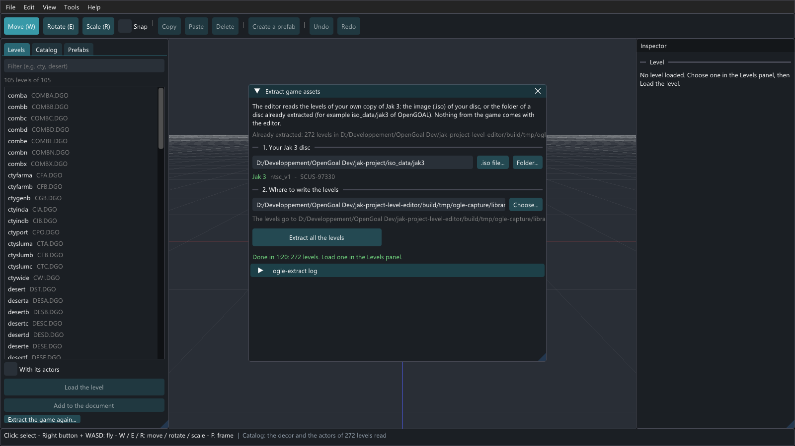

**File > Extract game assets** opens this window. Point to your Jak 3 disc (1), an `.iso` file or
the folder of a disc already copied: the editor recognizes the game, its version and its serial
number (here Jak 3, NTSC, SCUS-97330), and says so when the disc is another game. Choose where the
levels go (2), `library/` in the editor's folder by default, and click **Extract all the levels**.
The 272 levels of the disc took 1 minute 20 seconds.

The disc can be anywhere: nothing has to be copied to a particular folder, but the dialog opens on
`iso_data/` in the editor's own folder by default (`iso_data/jak3`, or however you like: it is
ignored by git), ready if that is where you put yours.

## 2. Open a level

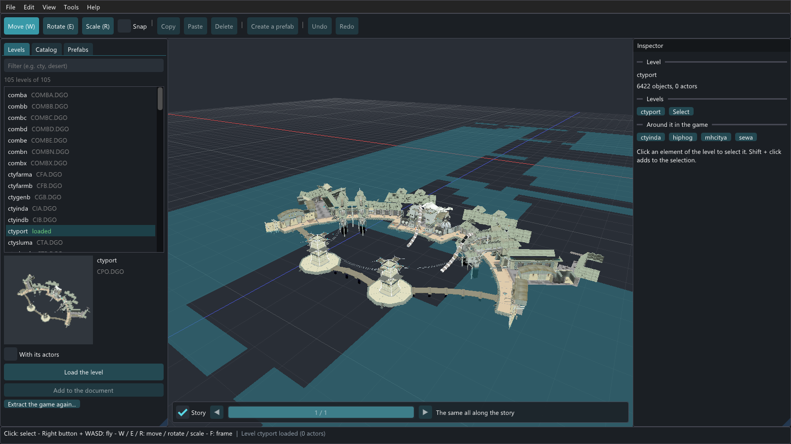

The window has three parts:

- on the left, the **Levels** panel: the levels of the game (the 105 real levels only: the pieces
  the game loads for a mission or a cutscene are left out), a picture of the one chosen and
  **Load the level**;
- in the middle, the **3D view**: fly with the right mouse button and WASD (ZQSD on AZERTY), frame
  the level with Home;
- on the right, the **inspector**: what is loaded, or what is selected.

Here is the port of Haven City (`ctyport`): 6,422 elements drawn with the colors of their lights,
and the ocean where its map covers. Levels open **without their creatures** (enemies, characters,
mechs): the editor is for places and objects; with **With its actors** unchecked, as here, a level
opens with its decor alone. The levels the game shows with a level come with it, and can be hidden
in the inspector; **Around it in the game** lists its neighbors (`ctyinda`, `hiphog`...).

## 3. See it along the story

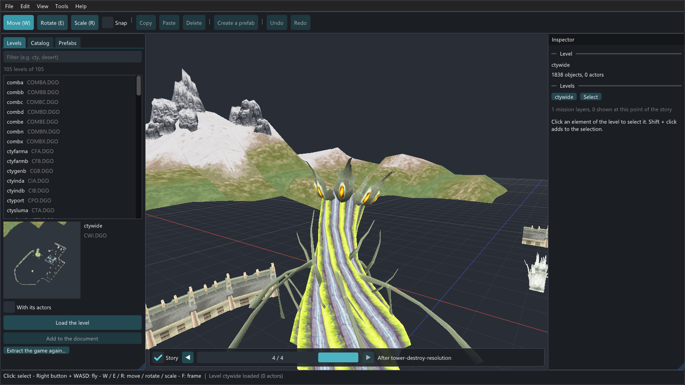

A level changes as the story goes: the Metal Head tower that rises over Haven City has its cap
blasted when the mission to destroy it ends. The **story bar**, at the bottom of the view, shows
the level at a point of the game. Its slider goes through the **states of the level**, not through
the 410 steps of the story: the start of the game, then each step that changes this level. The
city's walls and the tower (`ctywide`) have four: here the fourth, just after
`tower-destroy-resolution`, the cap of the tower torn open; before it, the cap stands closed with
its eyes. With several levels, a list next to **Story** chooses the level: each one is at its own
point of the story. Uncheck **Story** to see every state of the level at once.

The editor knows this from the game data: the missions in the order of the game, and what each one
shows or hides.

## 4. Select and edit

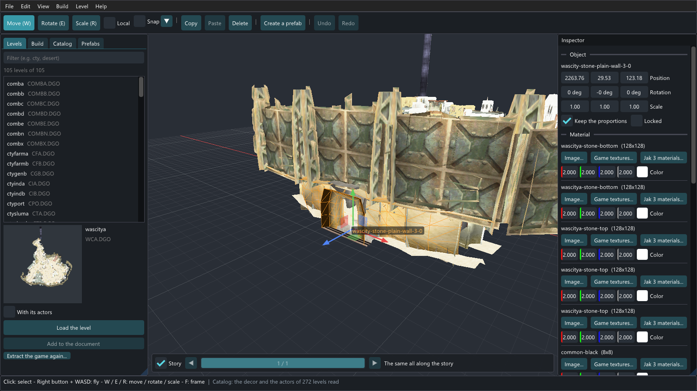

**Click** an element to select it: here a piece of the wall of Spargus (outlined in orange), its
gate and spikes. Each element is its own: the level's shell is cut in pieces, and the copies of a
decor prototype are selected one at a time. **Shift or Ctrl + click** adds to the selection, a
**drag** in an empty spot selects everything in a rectangle.

The **gizmo** moves the selection (**W**: drag an arrow or a square) or rotates it (**E**: drag a
ring); the inspector gives the exact position, rotation and scale. **Copy** (Ctrl+C), **Paste**
(Ctrl+V), **Duplicate** (Ctrl+D), **Delete** (Del), **Undo** (Ctrl+Z) and **Redo** (Ctrl+Y) do
what they say. The large pieces of ground are locked, so that clicks go to what stands on them.

## 5. Stretch, grow, shrink

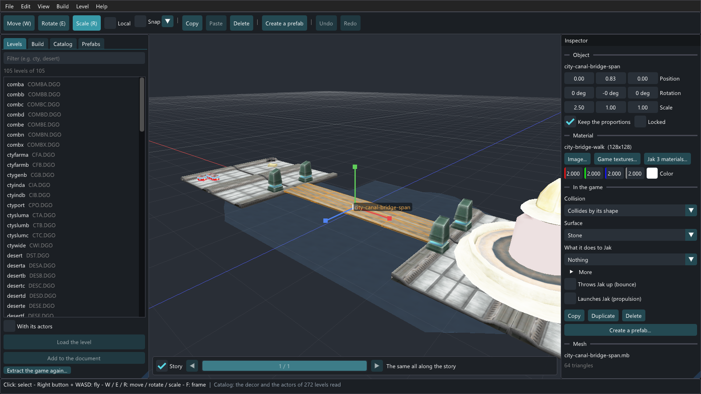

**Scale (R)** turns the gizmo into squares: drag the square at the end of an axis to stretch the
selection along it, or the square in the middle to make it bigger or smaller. The axes are the
element's own. Here a canal bridge of the city, 16 m long, stretched 2.5 times to span 40 m over
water; the inspector shows its scale (2.50, 1.00, 1.00). With **Keep the proportions** checked,
changing one value changes the three.

The game keeps the scale of decor (pieces, prototypes, models) but gives most of its objects their
own size, whatever the level says: the inspector warns when an object is scaled.

## 6. The catalog

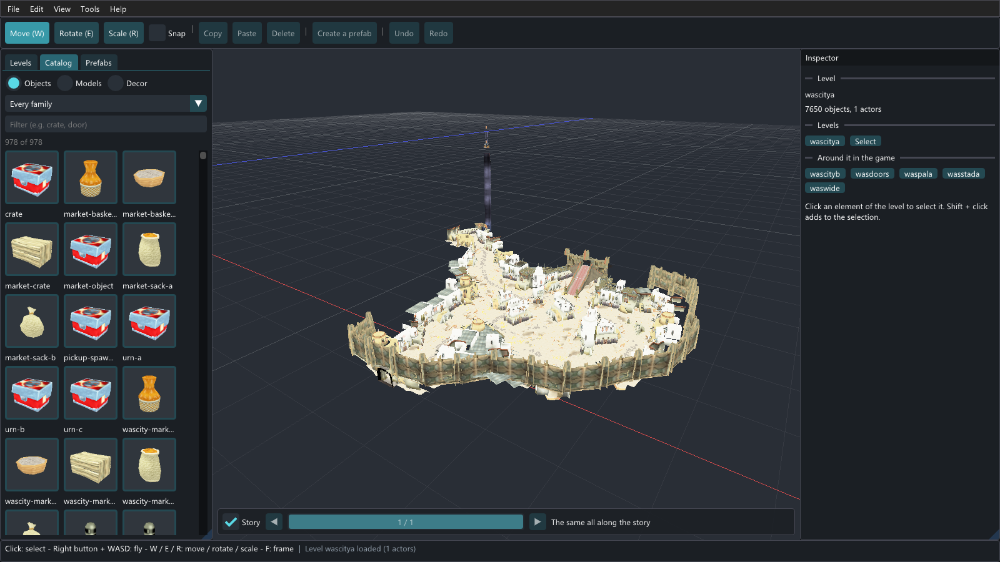

The **Catalog** panel lists what can be put in a level, placed like a prefab: click an element,
then click in the view (R turns it, Esc stops), or drag it into the view. It has four kinds.

**Objects** (541), by family and with a filter: what makes up a place, the props that only stand
there (flags, windmills, a parked hellcat), the doors and airlocks, water, dark eco and lava, and
the particle effects of the levels (451: lights, neon signs, steam). **Interactive** (206): the
objects that do something, crates, platforms and elevators, bouncers and board vents, buttons,
breakable walls and fences, hazards. Never the living (enemies, characters, animals) nor the
collectibles (orbs, health, ammo): a level's decor is built here, its creatures are the game's.

A new object takes the data of an object of its type found in the game's levels (the data of a
crate...), without what ties that one to its level.

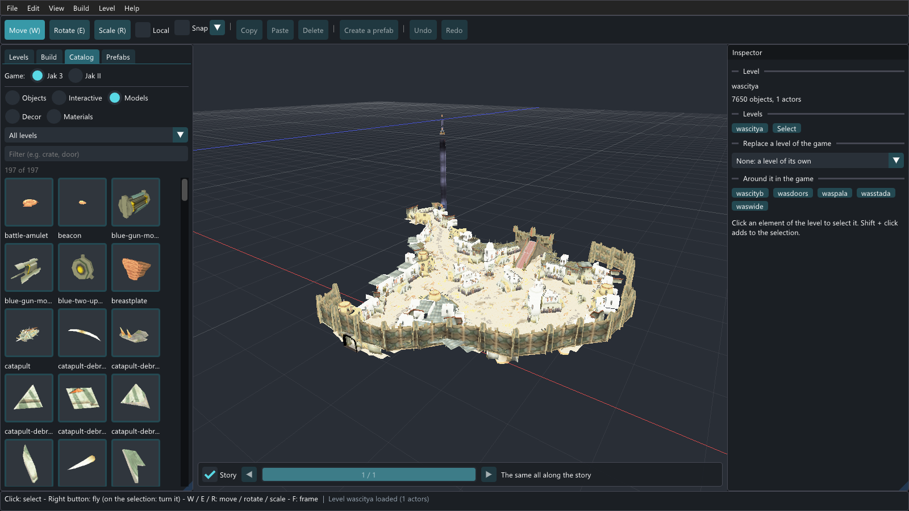

**Models** (218): every other model of the game but the characters and the collectibles, placed as
decor: parts of objects, debris, props, the statues of the museum.

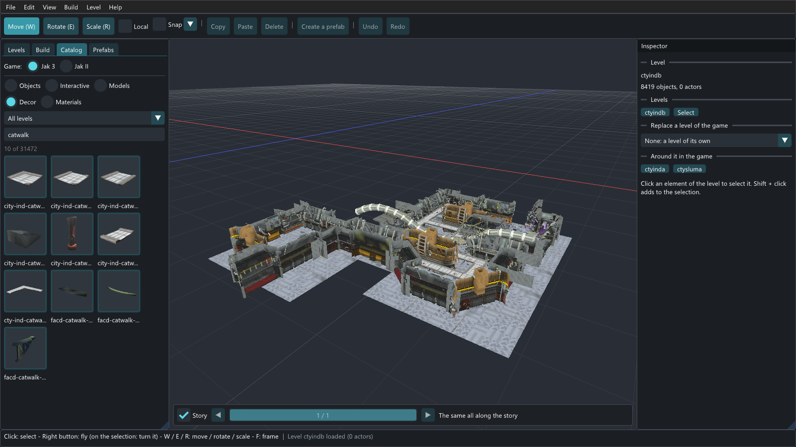

**Decor**: the decor of the levels, to reuse anywhere: their prototypes (a pillar, an arch, a lamp
post) and the pieces of their shell (a wall, a bridge). **All levels** searches the 31,077 parts of
the game's levels by name: `catwalk` finds the 10 catwalks of the industrial zone and the factory.
Choose a level instead to browse its whole decor.

The first time a library is shown, the editor reads what the catalog needs of every level in the
background (a few seconds) and keeps it: the next times, the catalog is complete at once.

## 7. Prefabs

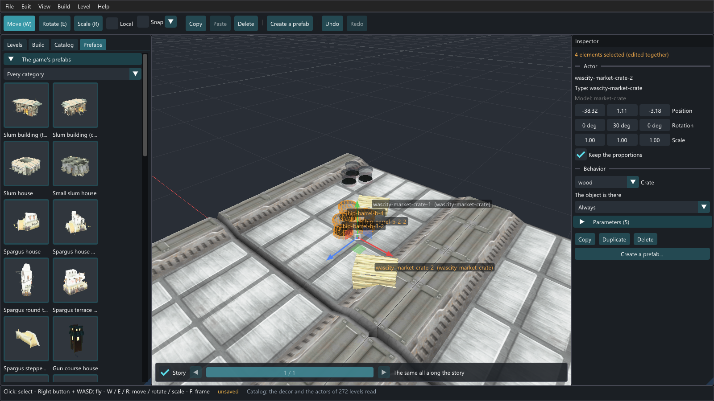

A prefab is a group of elements saved together, to place again anywhere. Select the elements (here
three barrels of the Hip Hog and a market crate of Spargus), click **Create a prefab** and give it a
name: it appears in the **Prefabs** panel, with a picture. Click it, then click in the view to place
copies: here a copy was placed in front of the original group, and is selected. A prefab sits on
the surface it is placed on, and its objects get names of their own (`wascity-market-crate-2`), as
the game needs.

## 8. Build a new level

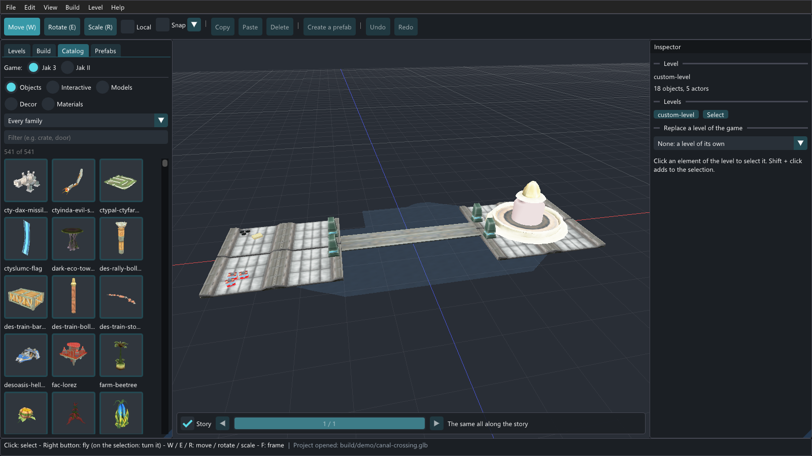

**File > New level** (Ctrl+N) starts an empty level. This one was built only from the catalog: two
decks made of eight catwalk modules of the industrial zone (Decor), the water of Spargus' palace
between them (Objects, Water), the canal bridge of the previous picture stretched across it, ground
lamps of the city, crates, barrels and a market crate, and the fountain of the slums. There is no ground at first: an element placed in the void goes to height 0, and later
ones can be dropped onto the surfaces below.

## 9. Let an assistant build it

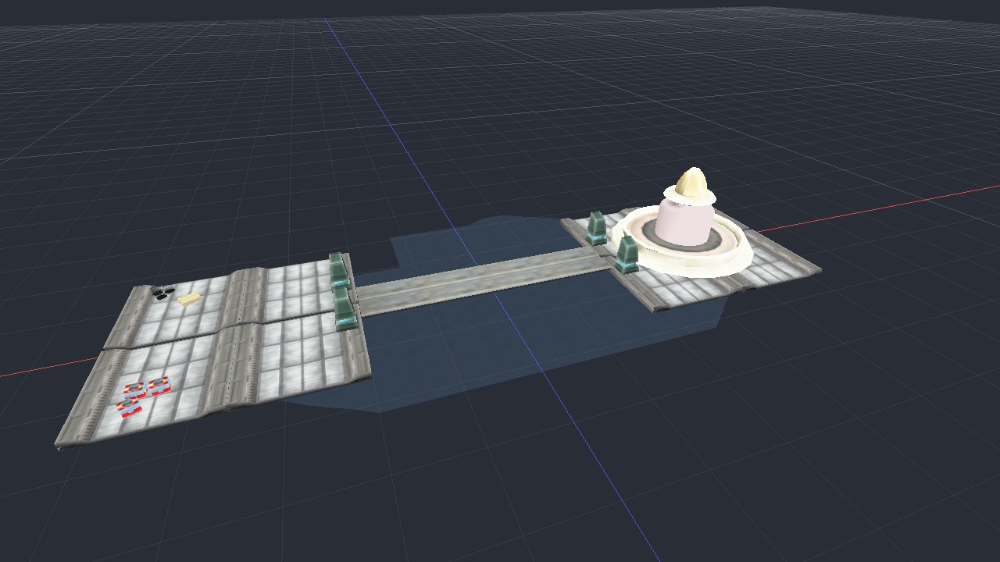

The level of the previous picture was not built by hand: a script built it through the editor's
remote control, with the very tools the MCP server gives an assistant such as Claude Code. That is
what an assistant does when you ask it for *"a small crossing: two decks of the industrial zone and
a bridge over the water of Spargus' palace"*: it looks for parts, places them, and checks its work
with a picture of the view (above: what `capture_view` returns). The calls look like this:

```json
{"tool": "new_level",       "args": {}}
{"tool": "list_decor",      "args": {"filter": "catwalk"}}
{"tool": "place",           "args": {"kind": "decor", "name": "city-ind-catwalk-main-01", "position": [-44, 0, -8]}}
{"tool": "place",           "args": {"kind": "object", "name": "water-anim-waspala-thronesec", "position": [0, -1.5, 0]}}
{"tool": "place",           "args": {"kind": "decor", "name": "city-canal-bridge-span", "position": [0, 0.83, 0]}}
{"tool": "transform_nodes", "args": {"ids": [11], "scale_by": [2.5, 1, 1]}}
{"tool": "place",           "args": {"kind": "decor", "name": "city-groundlamp-01", "position": [-22, 1.08, 5]}}
{"tool": "capture_view",    "args": {"width": 1280, "height": 720}}
{"tool": "save_project",    "args": {"path": "build/demo/canal-crossing.glb"}}
```

With an assistant, every call happens in the editor window you see, and can be undone. The whole
sequence is in [`tools/build_demo_level.py`](../../tools/build_demo_level.py), which builds this
level again (`python tools/build_demo_level.py`); how to connect Claude Code is in
[the README](../../README.md#5-building-levels-with-an-assistant-mcp).

## 10. A whole district, by an assistant

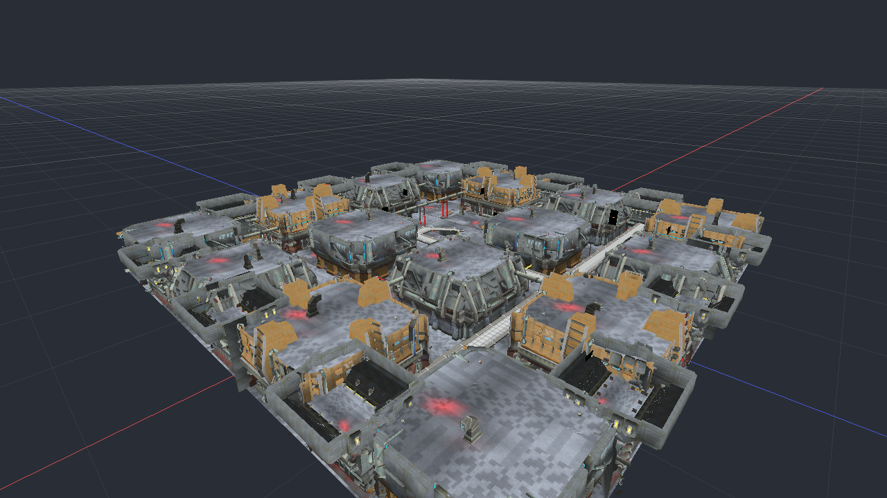

The demo level is small. **Ironworks** is a district of Haven City in the style of the industrial
zone, and as large: 448 by 448 meters, 16,606 elements, built in about 140 seconds through the
editor's MCP server by [`tools/build_industrial_district.py`](../../tools/build_industrial_district.py),
a small MCP client that calls the tools Claude Code gets (`place_many` places hundreds of elements
in one call). The pictures are what `capture_view` returned to it.

It builds the way the game's designers built the zone: from its modules, placed as the game places
them. Each block is a ring of four *facade columns*, a ground facade, the upper facade standing on
it and everything the game hangs on them (pipes, lamps, windows, stains, red lights), read from
the zone's own facades of the same kind; three kinds of blocks, grey, orange with
towers and with mansard roofs, each side from a different facade. The blocks get flat roofs and,
on the orange ones, the game's corner joints; the streets end against wall buildings at the edge of
the district. Nothing is left open, even where the game's camera never goes: the roofs, the tops of
the street ends, the corners, under the ground.

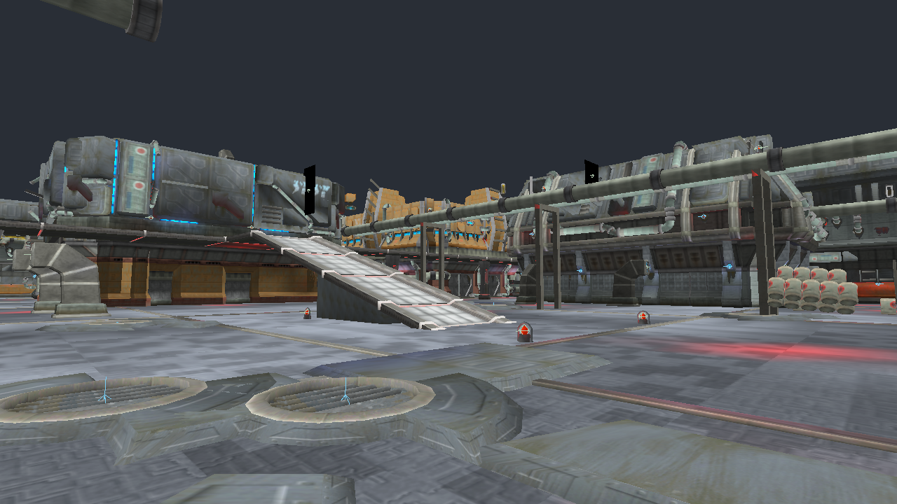

In the middle, a yard: floor vents, the bent vent pipes of the city, warning lights, the zone's
catwalk ramp coming down from the catwalks of two streets, a pipe bridge on metal pillars, crates
of the city. Where a piece of the game is missing from the zone in Jak 3, the script takes it from
another level: the neon signs come from the slums. Their light, and the glows of the vents and
warning lights, are particle effects of the game, which the editor shows as markers: the signs
are black.

## 11. Nav meshes: where the creatures walk

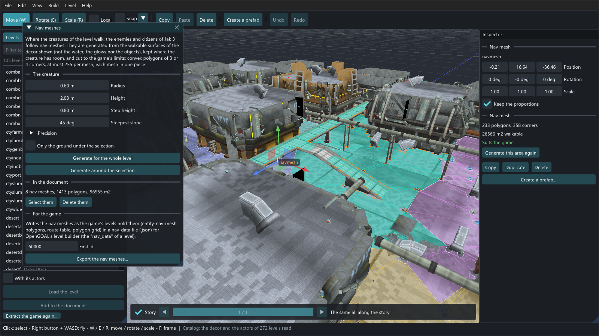

The enemies and citizens of Jak 3 walk on nav meshes: flat polygons over the ground,
on which the game finds their way. **Level > Nav meshes** generates them from the walkable surfaces
of the level, for a creature of the size you give (radius, height, step, slope): Recast (from
recastnavigation) builds the polygons, and the editor fits them to what the game reads, convex
polygons of 3 or 4 corners, at most 255 per mesh, each mesh in one piece, with the route table and
the polygon grid the game uses. Here, the district's: the streets, the yard, the ramp and the
catwalks, one color per mesh; the inspector says the selected one suits the game.

**Only the ground under the selection** keeps the pieces of ground the selected elements stand on:
creatures do not walk on roofs, ledges or in closed rooms. The script above keeps the ground
connected to a few street points (the `from` of `generate_navmesh`): 8 nav meshes, 1,413 polygons,
96,955 m2, and 153 pieces of ground away from the streets left out, the insides of the blocks among
them. **Export the nav meshes...** writes them as the game's levels hold them, for
a custom level builder.

## 12. Several levels, side by side

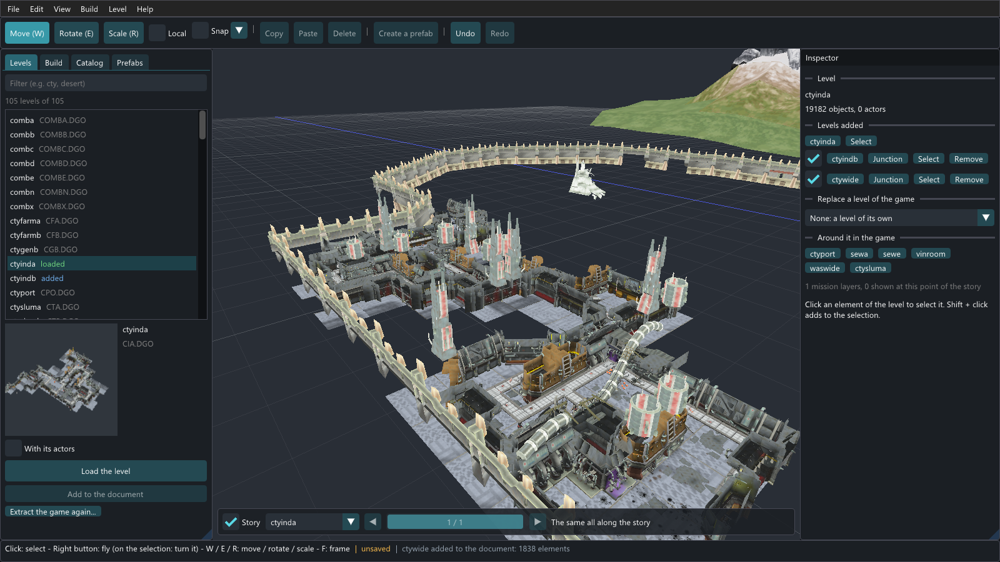

In the game, levels follow one another: Haven City alone is some twenty of them, loaded two or
three at a time as the player goes. The extracted levels keep the game's coordinates, so levels
that are side by side in the game meet in the editor too. With `ctyinda` open, **Add to the
document** (Levels panel) brings `ctyindb` at its place, and the streets of the industrial zone run
from one level into the other; `ctywide` brings the city walls and the mountains around them. Here
the document holds 19,182 elements of three levels.

The inspector lists the **levels**: show or hide each one added, frame it, frame the **Junction**
where it meets the level opened, or remove it. **Around it in the game** gives the levels the game
displays with those of the document, read from its continue points: a click adds one. That is what
working on a transition between two levels needs, and it works from a new level too: **File > New
level**, add the levels of the zone to join, and build next to them at the right place in the
game's world. An assistant does the same with `add_level`, `get_level_info` (neighbors, continue
points, bounds) and `set_camera` with `{"frame": {"junction": ["ctyinda", "ctyindb"]}}`.

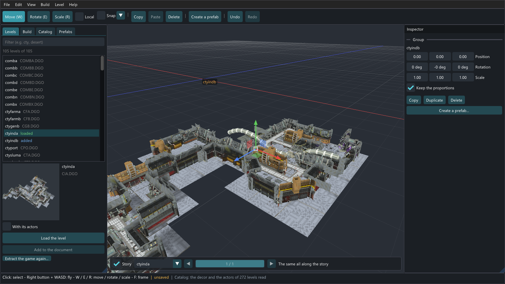

**Select**, next to a level in the inspector (or **Edit > Select its level**, Ctrl+L, from any of
its elements), selects the whole level: the gizmo stands in its middle, and moving or turning it
moves the level with its decor, collision and actors, to shift a level or make room between two.

## 13. What objects do

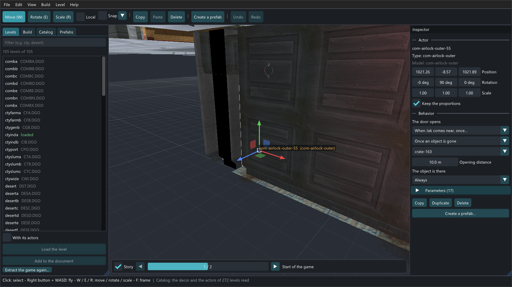

An object of the game is a type, whose code is the game's, and the data of this one object, which
that code reads. Select an actor: the inspector's **Behavior** says what it does in simple terms.
Here an airlock of the industrial zone opens when Jak comes near, once a crate of the level is gone
(broken), from 10 m. A door can also stay locked, stay open, or open after a step of the story or
once a floor switch is pressed; a board vent or a jump pad throws Jak up always, never or once a
condition holds, as high as you say; an elevator leaves once ridden, at the speed you give; any
object can be there only once a condition holds.

**Parameters**, under it, lists everything the code of its type reads from the object (read from the
game's decompiled code), with its kind: distances in meters, option bits by their names, another
actor chosen by name, what a crate holds.

The game writes some of these behaviors as small scripts in the object's data, which OpenGOAL's level
builder cannot write: the export writes them as **code of the level** instead, a file of GOAL code
(`<name>-obs.gc`) with a type of the level for each object whose behavior is set, deriving the game's
own type. That code was compiled by OpenGOAL's compiler against Jak 3's code.

The decor can act too: with a piece of decor selected, the inspector's **In the game** sets how it
collides (not at all, invisible, deadly, its surface...), and whether it throws Jak up (a bounce) or
sends Jak away along an arc (a propulsion), as the game's board vents and Metal Head puffers do
([`docs/behaviors.md`](../behaviors.md) is the study behind it).

## 14. Export it for the game

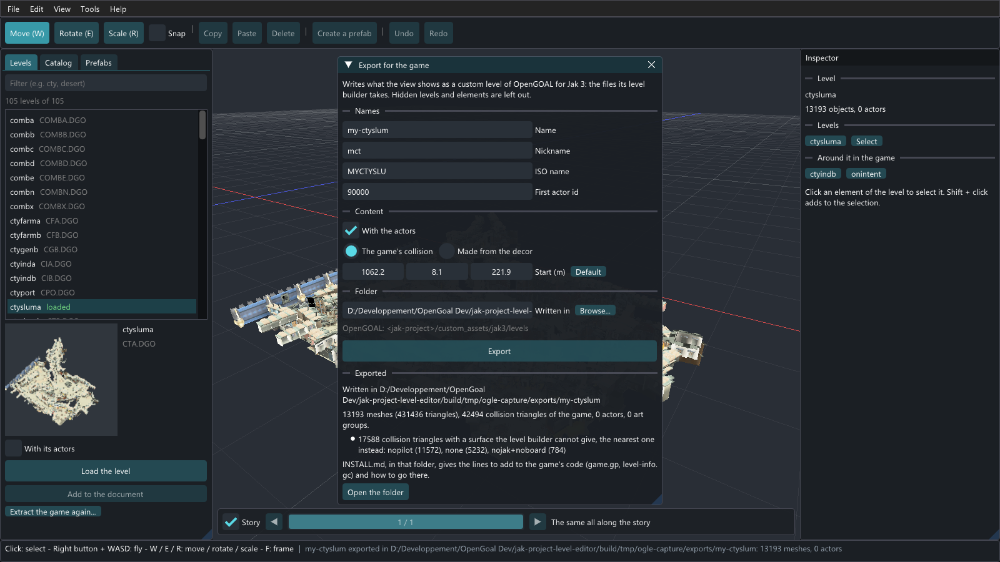

**Level > Export for the game...** writes what the view shows as a **custom level of OpenGOAL** for
Jak 3: the `.glb`, `.jsonc` and `.gd` files its level builder takes, the level's code (the behaviors
of its objects), the level's definition for the game's code and an `INSTALL.md` with the lines to
add. Here the slums of Haven City (`ctysluma`):
13,193 meshes and 42,494 triangles of the game's collision. The collision surfaces are written as
the builder takes them: the surfaces it cannot give exactly take the nearest, and the report says
each change and how many elements it concerns. The types the game only keeps as placeholders are
left out, and an actor's kill mask too (the new level has its own story).

The level keeps its place in the game's world: exported with the levels added to it, a transition
between two levels or a new level next to the game's comes out where it was built.

## 15. Save, and find help

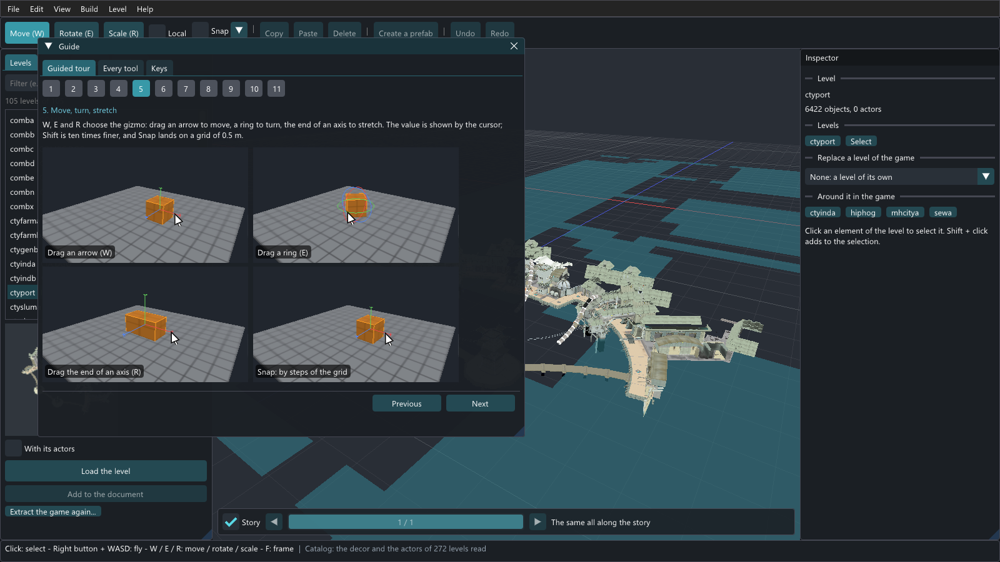

**File > Save** (Ctrl+S) writes your level as a project, a `.glb` file (Blender opens it too), with
backups next to it; **File > Open project** (Ctrl+O) opens it again. **Help > Guided tour** (F1),
which opens by itself the first time, walks through this tour in eleven steps, each with a short
animation of the tool, played with the editor's own shapes, and a button that shows where it is;
**Every tool** has the animation, the keys and a concrete example of each tool, and hovering a tool
shows the same as a tooltip.

## 16. Build with shapes and the materials of Jak 3

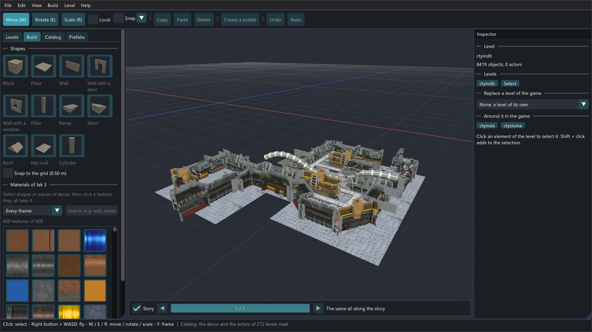

What the game's decor has not, you build: the **Build** panel has blocks, floors, walls (with a
door or a window), pillars, ramps, stairs, roofs and cylinders, each with its picture. Click one,
click in the view, again and again; walls of 4 m snapped on the grid of 0.5 m meet edge to edge.
Under them, **Materials of Jak 3**: the 600 textures the game's levels use again and again, by
theme. Select what you built (or any piece of decor), click a texture, and it all takes it: a house
of shapes in the sandstone of Spargus, a wall in the metal of the industrial zone.

The **Prefabs** panel adds the game's own assemblies, made from your levels: houses of the slums
and of Spargus, buildings, bridges, platforms, vents, tanks; and the **Decor** of the catalog, with
Jak II extracted too, offers its structures, converted for Jak 3 when they are placed.

## 17. Replace a level of the game

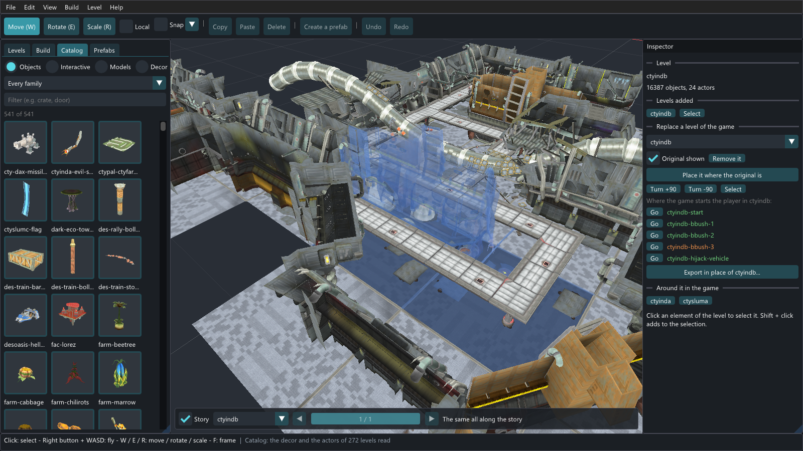

Made from `ctyindb`, `ctyindbis` can take its place in the game. **Level > Replace a level of the
game**, choose `ctyindb` and show the original: it is added as a see-through blue ghost, never
selected nor exported. Where your level kept the original's surfaces, they are drawn as they are;
where you changed them, the original shows in blue around your own: here a factory block taken
down, and tanks of the port in its place. **Place it where the original is**, **Turn +90** or
**-90**, or **Select** it whole and move it with the gizmo, to insert it naturally between the levels
around it; the inspector lists where the game starts the player there, green with ground under it,
orange without. **Export in place of ctyindb...** writes it so that the game loads it instead of
`ctyindb`, with its continue points, music and missions (`INSTALL.md` says the one line to change).
Its regions go with it: the places where the game loads the slums and the industrial zone next door
as Jak walks by.

## 18. See it as the game draws it

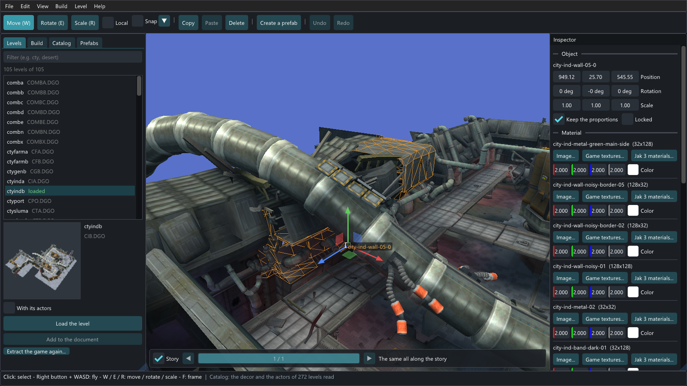

**View > Game view** (G) hands the level to the game's own renderer, OpenGOAL's: the decor is made
into what the level builder makes of an export, and drawn with the game's camera, fog and lighting.
The game lights each vertex with 8 palettes its artists baked (the ambient light, the sun from four
directions, the level's lamps) and mixes them by the hour: the **Hour** slider goes from the dawn to
the moonlit night, and the level's lamps light up after dusk. The editor's tools stay over it at the
game's depth (the selection's outline goes behind the pipe), and an edit shows at once: only the
part of the level it touched is made again.

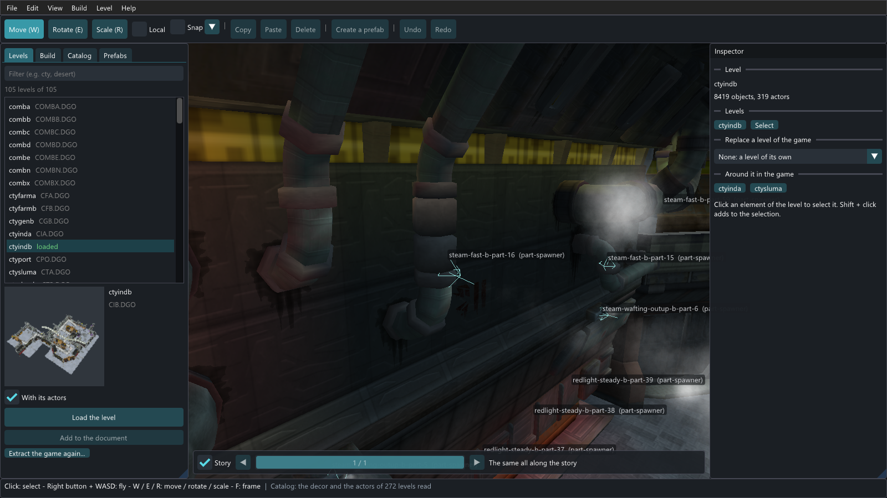

The effects of the level run in both views (**View > Effects**): the steam of the vents, the sparks,
the lights and neon signs, made as the game makes them from its own definitions and textures. The
catalog shows each effect by its particles, and plays it in its tooltip.

## Making these screenshots again

The editor makes these pictures itself, in a hidden window. From the repository root, after
building the editor and extracting Jak 3 (add `--library <folder>` when your levels are not in
`library/`):

```bash
E=build/bin/open-goal-level-editor
$E --screenshot "<your Jak 3 disc: .iso or folder>" docs/captures/02-extraction.png extract --lang en
$E --screenshot ctyport docs/captures/01-overview.png levels --lang en
$E --screenshot ctywide docs/captures/05-story.png levels --lang en \
   --camera 250,420,800,36.25,-9.16 --story tower-destroy-resolution
$E --screenshot wascitya docs/captures/03-selection.png select --lang en
$E --screenshot wascitya docs/captures/06-catalog.png catalog --lang en
$E --screenshot wascitya docs/captures/09-models.png models --lang en
$E --screenshot ctyindb docs/captures/08-decor-search.png decor-all --lang en
$E --screenshot ctyport docs/captures/12-help.png guide --lang en
$E --screenshot ctyindb docs/captures/20-build.png build --lang en
$E --screenshot ctyindb docs/captures/22-game-view.png select --lang en --game 12
$E --screenshot ctyindb docs/captures/23-effects.png actors --lang en --game 12 \
   --camera 1131.75,37.85,589.0,225,-14

# the demo level, built through the remote control, and the assistant's view of it
python tools/build_demo_level.py --view docs/captures/11-assistant-view.png
D=build/demo/canal-crossing.glb
$E --screenshot $D docs/captures/07-scale.png scale --lang en
$E --screenshot $D docs/captures/04-prefabs.png prefab --lang en \
   --select hip-barrel-b,hip-barrel-b-2,hip-barrel-b-3,wascity-market-crate-1
$E --screenshot $D docs/captures/10-new-level.png project --lang en --camera -18,52,84,-12.1,-31.2

# the district, built through the MCP server, its pictures from capture_view, and its nav meshes
python tools/build_industrial_district.py --views build/demo
cp build/demo/district-aerial.png docs/captures/13-district.png
cp build/demo/district-yard.png docs/captures/14-district-yard.png
$E --screenshot build/demo/ironworks.glb docs/captures/15-navmesh.png navmesh --lang en \
   --camera 120,110,90,37.57,-31.88

# several levels side by side, one selected whole
$E --screenshot ctyinda docs/captures/16-levels.png levels --lang en --add ctyindb,ctywide \
   --camera 1330,330,330,140.77,-26.11
$E --screenshot ctyinda docs/captures/17-level-selected.png select --lang en --add ctyindb --select ctyindb

# the export for the game
$E --screenshot ctysluma docs/captures/18-export.png export --lang en

# the behavior of an airlock: a project of ctyinda with its actors, its airlock set through the
# remote control (set_actor: open when, once crate-163 is gone, from 10 m), saved as behaviors.glb
$E --screenshot build/demo/behaviors.glb docs/captures/19-behavior.png select --lang en --select com-airlock-outer-55

# a level replacing ctyindb, built through the remote control, the original shown
python tools/build_replace_demo.py
$E --screenshot build/demo/ctyindbis.glb docs/captures/21-replace.png project --lang en \
   --camera 1125,135,725,40,-42
```

The setups (the word after the file name):

| Setup | What the picture shows |
|---|---|
| `levels` | the level given loaded, the Levels panel |
| `select` | the level given, one of its decor elements selected (near the middle of the level), the gizmo on it; a level added named by `--select`: selected whole |
| `scale` | the element stretched, the scale gizmo: a catwalk of the level given, or the first stretched element of a project |
| `prefab` | a prefab made of a few elements and a copy placed next to them, the Prefabs panel |
| `catalog`, `models` | the level given loaded, the objects or the models of the Catalog panel |
| `decor`, `decor-all` | the decor of the level given in the Catalog panel, or the decor of every level searched for `catwalk` |
| `project` | a project (`.glb`) opened, the objects of the Catalog panel |
| `navmesh` | the level or project given, its nav meshes drawn (made for the whole level when it has none), the largest selected, the Nav meshes window |
| `export` | the level given exported for the game to a temporary folder: the export window and its report |
| `extract` | the extraction window, extracting the disc given to a temporary folder deleted afterwards |
| `guide`, `tools`, `help` | the level given, the guide: the guided tour at its fifth step, every tool, or the keys |
| `build` | the level given, the Build panel: the shapes and the materials of Jak 3 |
| `effects` | the level given, the particle effects of the Catalog panel (`--select`: searched) |
| `actors` | the level given loaded with its actors: its effects running |

The options: `--size WxH` (1600x900 by default), `--camera x,y,z,yaw,pitch` (position in meters, angles in degrees), `--story off|<step>|<node>` (the point of the story shown),
`--select a,b,...` (the elements `select`, `scale` and `prefab` use, by name), `--add a,b,...`
(levels added to the one loaded) and `--game <hour>` (the game view at that hour). A capture never
changes the editor's preferences, and the prefab of `prefab` is written to a temporary folder.

The screenshots show levels of Jak 3 extracted from a copy of the game. Jak 3 belongs to Sony
Interactive Entertainment and was developed by Naughty Dog; the editor is built on the work of the
OpenGOAL team, with which it is not affiliated (see [`LICENSE`](../../LICENSE)).
