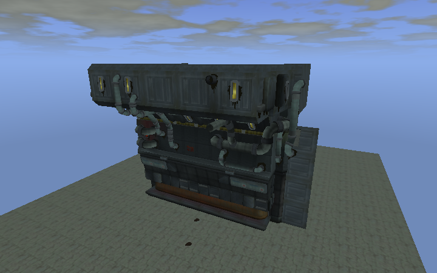
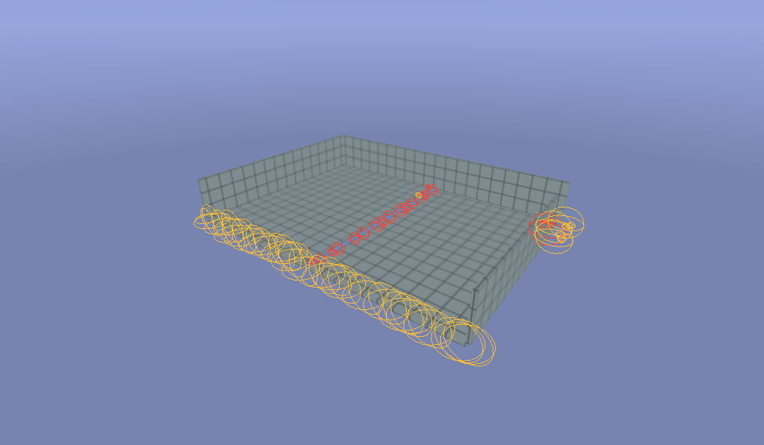
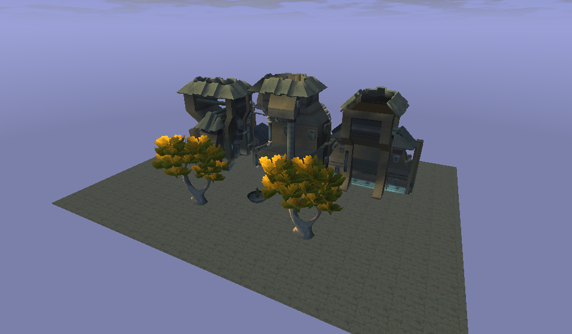

# Building Jak 3 levels with the editor: a guide for AI agents

This guide is for an AI agent (Claude Code or any other client of the
[Model Context Protocol](https://modelcontextprotocol.io)) that builds or changes levels of Jak 3 in
the OpenGOAL Level Editor, and for the person who sets it up. It explains what the editor's tools
do, the ideas behind them (what a level, a facade, a prefab or a hole in the decor is) and the
rules that make a level look right in the game, with complete examples.

You do not need to know level editors to follow it: the notions a level needs are explained
when they first appear. The user's guide of the editor itself is the [README](../README.md).


## Contents

1. [How it works](#1-how-it-works)
2. [Setting it up](#2-setting-it-up)
3. [What you need to know about a level](#3-what-you-need-to-know-about-a-level)
4. [The four rules](#4-the-four-rules)
5. [Recipes](#5-recipes)
6. [Every tool](#6-every-tool)
7. [When something goes wrong](#7-when-something-goes-wrong)

## 1. How it works

```text
 you (the agent)  --MCP, stdio-->  jak-level-editor-mcp  --TCP 127.0.0.1:47821-->  the editor window
```

- `jak-level-editor-mcp` is the MCP server. It speaks the protocol on its standard input
  and output and forwards every tool call to **the editor running on the user's computer**. When
  no editor runs, it starts one (it takes a few seconds the first time).
- Everything you do happens **in the window the user sees**: the user watches you build, and can
  take over at any moment. Every change is one step of the editor's history: the user (or you,
  with `undo`) can take it back.
- The editor only listens on the computer itself (127.0.0.1): nothing is reachable from the
  network.

The server tells your client its rules when it starts (its `instructions`): they are the
[four rules](#4-the-four-rules) of this guide in short.

## 2. Setting it up

1. Build the editor and its MCP server (`npx vite build`, then `cargo build --release -p
   jak-level-editor -p jak-level-editor-mcp`: both land in `target/release/`) and extract the game
   ([README, Extract your game](../README.md#extract-your-game)): without the extracted levels,
   there is nothing to build with. The MCP server starts the editor found next to it.
2. **Claude Code**: the repository has a `.mcp.json`. Start Claude Code in the repository's folder
   and accept the server `open-goal-level-editor`. From another folder, add it once:

   ```bash
   # Windows, the repository in D:\levels\open-goal-level-builder
   claude mcp add open-goal-level-editor -- "D:/levels/open-goal-level-builder/target/release/jak-level-editor-mcp.exe"
   # Linux, the repository in ~/open-goal-level-builder
   claude mcp add open-goal-level-editor -- ~/open-goal-level-builder/target/release/jak-level-editor-mcp
   ```

3. **Another client**: run `<repository>/target/release/jak-level-editor-mcp` as a stdio server.
4. Check: ask the assistant to call `get_status` (*"call get_status of the level editor"*). Its
   answer gives the library and the document, for example
   `{"levels": 272, "document": {"open": true, "level": "ctysluma", "elements": 13193, ...}, ...}`. The
   editor's status bar says **Assistant connected**. If a tool of this guide is missing from the
   list your client shows, the editor is older than the guide: build it again and restart the
   client.

The repository also has a skill for Claude Code, `.claude/skills/level-building-mcp/`, which
reminds an agent of these rules whenever it builds.

## 3. What you need to know about a level

### Coordinates

- Positions are in **meters**, `[x, y, z]`, **Y is up**. A Jak 3 level is a few hundred meters
  across; Jak is a little under 2 m tall: look from 1.6 m above the ground to see what the player
  sees around him.
- All the levels of the game share **one world**: each level is where the game puts it (the
  slums of Haven City are around x = 0..400, z = 800..1300). Two levels side by side in the game
  meet in the editor too. A new level (`new_level`) starts empty, around `[0, 0, 0]`.
- Angles are in degrees: `yaw_deg` turns around the vertical axis.

Example: to put a crate on the ground under the point `[120, 50, 900]`, either `raycast` from there
straight down to find the ground, or `place` with `on_ground: true`, which drops it on the first
surface below the position.

### The document

What the editor has open is the **document**: one level of the game (`open_level`), maybe other
levels added next to it (`add_level`), or a new empty level (`new_level`). It is made of
**elements** (nodes), each with an **id** (a number):

| Kind | What it is | Example |
|---|---|---|
| `render` | a piece of **decor**: something drawn, that does nothing by itself | a wall, a pipe, a roof, a lamp post |
| `actor` | an **object** of the game: its code makes it do something | a door, a crate, an elevator, a steam vent |
| `group` | an element that holds others | a whole level added, a prototype of decor and its copies |
| `navmesh` | where the game's creatures walk | |

The **ground** of a level is **locked**: clicks and searches skip it (`include_locked` finds it),
so that you work on what stands on it.

### Prefabs, groups and assemblies

- A **prefab** is a set of elements saved together to be placed again anywhere: a house, a market
  stall, a fountain. The user's prefabs are in `library/prefabricated/`; the **game's prefabs** are
  whole structures taken from the levels (houses of the slums, towers of Spargus, bridges...).
  `list_prefabs` lists both; `place` with `kind: "prefab"` puts one.
- A prefab placed becomes a **group**: its elements stay together (`list_groups`, `select` with
  `group`). You can make groups of your own (`group`). Each element in a group says so (`group` in
  its description).
- An **assembly** is a structure the editor finds by itself in the level: the elements touching
  each other, without the ground (`list_assemblies`). A house of the game with its facades, roof
  and windows is an assembly: the way to take a whole building out of a level.

### Facades: what the player sees, and what he must not

The game's buildings are made to be seen **from where the player can go**. Most of them are only
**a front** (a facade): a wall full of windows, signs and pipes, with nothing behind, or a few
panels open at the back. In the game this never shows, because the player can never get behind.
Placed in a new level where the player can walk around, the same facade shows **its back**: the
void, the inside of its panels, pieces floating. That is the most common mistake of a level built
from the game's pieces. [Rule 3](#rule-3-facades-are-not-buildings) is about it.

| From the street: what it was made for | From behind: what the player must never see |
|---|---|
|  |  |

### The void and the holes

Behind the decor there is **nothing**: the game draws the sky above the horizon, and below it, where
the decor should be, the screen's background. A gap between two pieces (a floor that does not reach
a wall, two slabs 50 cm apart, a wall that stops short of the corner) lets the player see that
void: a **visual bug**, ugly and obvious in the game. [Rule 1](#rule-1-no-holes) is about it.

### Light, hour and weather

The game lights its levels with colors baked into every corner of their triangles (each corner
has 8 colors, the game's *palettes*: one for the ambient light, four for the sun coming from four
directions, three for the level's own lamps), mixed according to the hour and the weather. What you
place **takes the light of the level around it** automatically. The **game rendering** draws the
level with the game's own renderer: what the level will look like in the game. Set its hour and
weather with `set_view`, and see it with `capture_view`.

## 4. The four rules

### Rule 1: no holes

Pieces must **touch or overlap** (by 5 to 10 cm): floors reach the walls, walls reach the ground
and each other, nothing floats in the air. Snap sizes and positions to round values (0.5 m) so
that pieces meet exactly.

**Check it, always**, after building: `find_gaps` looks from the ground every few meters, at the
height of Jak's eyes, all around and downward. A ray that meets nothing is a view into the void.

```json
{"tool": "find_gaps", "args": {"box": [[-20, -1, -14], [20, 6, 14]]}}
```

```json
{"gaps": 19, "edges": 30, "viewpoints": 108, "rays": 31104,
 "spots": [{"kind": "gap", "at": [20.06, 0.53, -11.17], "seen_from": [-18.5, 2.1, -3.5],
            "direction": [0.98, -0.04, -0.195], "rays": 77}, "..."]}
```

- `kind: "gap"`: a hole between pieces (surfaces on both sides of it, the void right behind it).
  **Fix every one.**
- `kind: "edge"`: an open edge, where the ground ends in the void (seen directly, or through a
  passage between pieces: then `at` is where that ground ends): close it with a wall, a building, a
  railing, unless the player can never get near it.
- `seen_from` and `direction`: where the player would see it from. Look there:
  `set_camera` with `position: seen_from` and `look_at: at`, then `capture_view`.
- `rays`: how many rays went through: the larger, the more visible.

To fix a gap: move or stretch a piece to cover it (`transform_nodes` with `scale_by`), or place a
shape over it (`place` with `kind: "shape"`, a `floor` or a `wall` in the `style` of the level).
Run `find_gaps` again until none is left that matters.



### Rule 2: prefabs hold structures, not crumbs

A prefab is **a structure**: a building, a bridge, a fountain. Small loose pieces (bolts, debris,
stains, papers, tiny props) clutter it and make it look careless once placed elsewhere.
`create_prefab` leaves out the elements smaller than **0.5 m** by default (`min_size`) and answers
their names (`left_out`). Keep that default; give a smaller `min_size` only for a prefab of small
things (a shelf of bottles), and check what was left out.

```json
{"tool": "create_prefab", "args": {"ids": [512, 513, 514], "name": "slums-house-corner"}}
```

```json
{"name": "slums-house-corner", "left_out": ["city-trash-01.mb-3", "city-bolt-02.mb-7"]}
```

The objects of the game (actors: a door, a crate) are always kept, whatever their size.

### Rule 3: facades are not buildings

When a building comes from the game (a prefab of the game, an assembly, decor parts), it is most
often a front only. Decide **where the player will see it from** before placing it:

- Put it where **only its front can be seen**: against a wall or a cliff, at the edge of the level,
  between other buildings, back to back with another facade.
- **Never in the middle of a place the player can walk around**: its back would show.
- Check from every place the player can reach: `set_camera` behind and beside it, at 1.6 m above
  the ground, then `capture_view`. If its back shows, move it, turn it, or hide its back behind
  other pieces (another building, a wall in the level's style: `place` a `wall` shape with
  `style`), touching it so that no hole is left (rule 1).

Example: a shop front of the industrial zone (the left picture of
[the notions above](#facades-what-the-player-sees-and-what-he-must-not)) goes at the end of a
street, its back against the level's outer wall; a building of Main Town, closed all round, can
stand in the middle of a square.

### Rule 4: look before you report

Never say a level is done without looking at it. At least:

1. `set_view` with `game_view: true` (the game's renderer) and a plain hour (`hour: 12`,
   `weather: "clear"`), then the hour and weather the user wants.
2. `capture_view` from **the player's height**: `set_camera` 1.6 m above the ground, in the
   streets, in front of and behind what you built.
3. `capture_view` from above, to see that nothing floats and nothing is missing.
4. Describe what you see to the user, problems included.

## 5. Recipes

Each recipe gives the calls in order, with their arguments. Answers are shortened.

### Look at a level before changing it

```text
get_status                                   -> what is open, the camera, the selection
open_level {"name": "ctysluma", "actors": true}
get_level_info {"name": "ctysluma"}          -> its neighbors, its continue points (where the game
                                                starts the player: good places to look from)
find_nodes {"near": [210, 12, 1010], "radius": 25}
raycast {"origin": [210, 60, 1010], "direction": [0, -1, 0]}   -> the ground: its height
set_camera {"position": [230, 14, 1040], "look_at": [210, 10, 1010]}
capture_view {"game_hour": 12}
```

### Build a small street from prefabs

The example the first picture of this guide comes from: a street of Jak II's Main Town on a
pavement in the style of Haven's slums, a fountain and two trees. The buildings are the user's own
prefabs made from Jak II's Main Town (`main-town-building-a`, `-c`, `-d`: Jak II extracted, prefabs
made with `create_prefab`); use any prefab `list_prefabs` gives. They are whole buildings, closed all
round: they can stand where the player walks around them (rule 3).

```text
new_level
place {"kind": "shape", "name": "ground", "style": "ctysluma", "position": [0, 0, 0],
       "size": [160, 0.5, 120], "bumps": 0}                  -> the pavement, 0.5 m thick, flat
                                                                (bumps: how much a ground goes up and down)
list_prefabs                                                 -> the user's and the game's
place {"kind": "prefab", "name": "main-town-building-a", "position": [-45, 0.5, -20], "on_ground": true}
place {"kind": "prefab", "name": "main-town-building-c", "position": [-3, 0.5, -20], "on_ground": true}
place {"kind": "prefab", "name": "main-town-building-d", "position": [39, 0.5, -20], "on_ground": true}
list_groups                                                  -> {"groups": [{"group": 1, "name":
                                                                "main-town-building-a", "prefab": true,
                                                                "ids": [12, 13, ...]}, ...]}
place {"kind": "prefab", "name": "small-fountain", "position": [0, 0.5, 18], "on_ground": true}
place {"kind": "prefab", "name": "haven-tree", "position": [-25, 0.5, 30], "on_ground": true}
place {"kind": "prefab", "name": "haven-tree", "position": [25, 0.5, 30], "on_ground": true}
find_gaps {"box": [[-80, -1, -60], [80, 10, 60]]}           (rule 1)
set_view {"game_view": true, "hour": 16, "weather": "few_clouds"}
set_camera {"position": [8, 2.1, 48], "look_at": [-4, 10, -10]}
capture_view                                                 (rule 4)
```



Here `find_gaps` finds the edges of the pavement (the street ends in the void on every side): a
real level would close them with buildings, walls or the edge of the game's world.

### Take a building out of a level as a prefab

```text
open_level {"name": "wascitya", "actors": false}
list_assemblies {"min_elements": 40}          -> whole structures, the largest first:
                                                 {"assemblies": [{"ids": [4210, 4211, ..., 4302],
                                                  "box": [[2391, 18, -120], [2428, 41, -84]], ...}, ...]}
select {"assembly": 4210}                     -> shows it to the user
set_camera {"frame": [4210], "yaw_deg": 30, "pitch_deg": -25}
capture_view                                  -> check it is the whole house, nothing else
create_prefab {"ids": [4210, 4211, ..., 4302], "name": "spargus-house"}
                                              -> {"name": "spargus-house", "left_out": [...]}
```

### Fix a hole

```text
find_gaps {"ids": [...what you built...]}
  -> {"kind": "gap", "at": [20.06, 0.53, -11.17], "seen_from": [-18.5, 2.1, -3.5], ...}
set_camera {"position": [-18.5, 2.1, -3.5], "look_at": [20.06, 0.53, -11.17]}
capture_view                                  -> see it
find_nodes {"near": [20.06, 0.53, -11.17], "radius": 4}   -> the pieces around it
transform_nodes {"ids": [the wall], "scale_by": [1.05, 1, 1]}   or   place a floor/wall shape over it
find_gaps {"ids": [...]}                      -> again, until it is gone
```

### Set the mood

```text
set_view {"game_view": true, "hour": 18.5, "weather": "few_clouds"}   -> a sunset
set_view {"hour": 22, "weather": "clear"}                              -> night, lamps on, stars
set_view {"hour": 15, "weather": "storm_rain"}                         -> rain and lightning
capture_view
```

The weathers are the game's: `clear`, `few_clouds` (the game's start), `haze`, `smog`, `overcast`,
`overcast_fog`, `rain`, `storm`, `storm_rain`, `storm_fog`; or the two numbers the game itself
uses: `cloud` (0 a clear sky, 0.5 overcast, 1 a storm) and `fog`, a scale whose middle is a clear
air (0 hazy, 0.5 clear, 1 rainy under clouds, smoggy under a clear sky); plus `rain` (0 to 1), the
rain drawn falling, apart from them. They change the
sun's light, the ambient light, the fog and the sky (clouds, sun, moon, stars) of the game
rendering; `level_lights` turns the level's lamps on or off at night.

### Make an object do something

```text
find_nodes {"etype": "com-airlock-outer"}   -> a door: its id
find_nodes {"etype": "crate"}               -> a crate: its name
set_actor {"id": 655, "behavior": {"open": "when", "when": {"when": "gone", "arg": "crate-163"}, "distance": 10}}
```

The door then opens when Jak comes within 10 m, once crate-163 is broken. The export writes it as
the level's own code.

### Draw natural ground

```text
terrain {"mode": "generate", "position": [0, 0, 0], "area": [96, 96], "hills": 14, "style": "desertb"}
  -> {"id": 88}
terrain {"id": 88, "mode": "dig", "position": [-40, 0, -10], "to": [40, 0, 15], "size": 10, "amount": 3}
terrain {"id": 88, "mode": "flatten", "position": [20, 6, -25], "size": 22, "height": 6}
```

### Save and export (only when the user asks)

```text
save_project {"name": "main-town-street"}     -> library/projects/main-town-street/
export_level {"name": "mtstreet", "nickname": "mts"}
                                              -> library/export/main-town-street/: the folder takes
                                                 the project's name, the level in the game "mtstreet";
                                                 its README.md says how to add it to the game
```

## 6. Every tool

**Status and levels**

| Tool | What it does |
|---|---|
| `get_status` | the library, the document (its levels, bounds, unsaved changes), the story view, the camera, the selection, the view (game rendering, hour, weather) |
| `list_levels` | the levels that can be opened (`filter`, `near`: a level's neighbors, `game: "jak2"`: Jak II's) |
| `open_level`, `new_level` | open a level (`actors: false`: its decor alone; `game: "jak2"`: a level of Jak II as decor of Jak 3) or start an empty one |
| `add_level`, `remove_level`, `merge_level` | add a level next to the one open, at its place in the world; take it out; make it part of the document's own level |
| `get_level_info` | a level's neighbors, continue points, role and bounds |
| `replace_level` | make the document a replacement of a level of the game (the original shown in blue, aligned, turned) |
| `set_story` | show the levels at a point of the story |

**Finding things**

| Tool | What it does |
|---|---|
| `find_nodes` | elements by name, type (`etype`), kind, near a point, in a box, in a group; their id, position, size, box, group |
| `get_node` | everything about one element (an actor's data and what it can do) |
| `raycast` | the first surface along a ray: the ground under a point, a wall in front |
| `list_assemblies` | the whole structures of the decor (a house, a bridge) |
| `list_groups` | the groups: the prefabs placed and the groups made, with their elements and box |

**Choosing what to place**

| Tool | What it does |
|---|---|
| `list_prefabs` | the user's prefabs and the game's (`library/prefabricated/`) |
| `list_catalog` | the objects of the game: `group` `objects` (props, doors, water), `effects` (smoke, fire, lights, sparks, water: `effect_kind`), `interactive` (crates, platforms, buttons) |
| `list_models`, `list_decor` | the models of the game (placed as decor), the decor parts of the levels |
| `list_textures` | textures for `set_material` |

**Building**

| Tool | What it does |
|---|---|
| `place`, `place_many` | put a `prefab`, an `object`, a `model`, a `decor` part or a new `shape` (box, floor, wall, doorway, window, pillar, ramp, stairs, roof, roof-hip, cylinder, ground) at a position, turned, scaled, `on_ground`; `place_many` up to 2,000 at once, one undo |
| `transform_nodes`, `duplicate_nodes`, `delete_nodes` | move, turn, scale; copy; delete |
| `set_shape`, `set_material` | a shape's size, bends, corners; a texture for elements |
| `terrain` | natural ground: paint, raise, dig, smooth, flatten, walls, generated hills, in a level's style |
| `group`, `ungroup` | name a group of elements, or undo one |
| `create_prefab` | save elements as a prefab (`min_size`: [rule 2](#rule-2-prefabs-hold-structures-not-crumbs)) |
| `match_lighting` | bring a structure of Jak II to the brightness of the level |
| `set_actor` | what an object does (doors, bouncers, elevators, crates, presence) and its parameters |
| `set_decor` | what the game does with decor: collision, ground material, bounce, launch |
| `restore_effects` | put back the level's particle effects |
| `set_visibility`, `select` | hide or show; show elements, a level, an assembly or a group to the user |

**Checking**

| Tool | What it does |
|---|---|
| `find_gaps` | the holes through which the player would see the void ([rule 1](#rule-1-no-holes)) |
| `set_camera` | look from a position at a point, or frame elements |
| `set_view` | the game rendering, the hour, the weather, the rain, the lightning, the lamps, the effects |
| `capture_view` | a picture of the view (`game_hour`: the game rendering at that hour; `only`: some elements alone) |

**Saving and exporting**

| Tool | What it does |
|---|---|
| `save_project`, `open_project` | save the document in `library/projects/<name>/`, open one |
| `export_level` | write the level for OpenGOAL's level builder (`library/export/<project>/`) |
| `generate_navmesh`, `export_navmesh` | where the game's creatures walk |
| `undo`, `redo` | take back, do again |

The complete description of each argument is what your client receives from `tools/list`.

## 7. When something goes wrong

| Problem | What to do |
|---|---|
| `the editor did not start` | the editor is not built, or the library is missing: build it, start it once by hand |
| A call waits for a long time | opening a level, listing the decor or prefabs the first time reads the levels (seconds to a minute): it answers when ready |
| `no document` | `open_level` or `new_level` first |
| An element's id is not found | ids change when elements are deleted and undone; find them again with `find_nodes` or `list_groups` |
| A tool of this guide is missing | the editor is older than the guide: build it again, then restart your client |
| A building shows its back | move it or turn it so that its back faces a wall or the edge of the level, or hide its back with other pieces ([rule 3](#rule-3-facades-are-not-buildings)) |
| `find_gaps` finds edges everywhere | the region given is larger than the level: give the box the player can really walk, or close those edges |
| A piece is too dark or too bright | it took the light of the level around it; a structure of Jak II: `match_lighting` |
