# Jak Level Editor: user guide

This guide teaches the editor from the start: what a level is made of, how to open one, select and
move its pieces, place the game's objects and buildings, build your own, see it lit as the game
lights it, and export it for the game. You do not need to have used a level editor before: each
idea is explained the first time it appears, with an example, and each tool is shown in a picture.
**F1** in the editor opens the same tutorials, step by step, with animations.

## Contents

1. [The ideas in five minutes](#1-the-ideas-in-five-minutes)
2. [Install](#2-install)
3. [First steps](#3-first-steps)
4. [Selecting and moving things](#4-selecting-and-moving-things)
5. [Groups](#5-groups)
6. [The catalog: everything you can place](#6-the-catalog-everything-you-can-place)
7. [Prefabs](#7-prefabs)
8. [Building your own pieces](#8-building-your-own-pieces)
9. [Seeing it as the game does: sky, hour, weather](#9-seeing-it-as-the-game-does-sky-hour-weather)
10. [Levels side by side, and the story](#10-levels-side-by-side-and-the-story)
11. [What objects do](#11-what-objects-do)
12. [Where creatures walk: nav meshes](#12-where-creatures-walk-nav-meshes)
13. [Saving](#13-saving)
14. [Playing it in the game: try it, export it](#14-playing-it-in-the-game-try-it-export-it)
15. [Building with an AI assistant](#15-building-with-an-ai-assistant)
16. [Keys and mouse](#16-keys-and-mouse)
17. [Files and folders](#17-files-and-folders)
- [Appendix: what the decor can do in the game](#appendix-what-the-decor-can-do-in-the-game)

## 1. The ideas in five minutes

**The game** you edit is **Jak 3**: the editor reads its levels and exports them for it. Jak II's
levels can be opened too, to bring their buildings into Jak 3's ([Jak II's
buildings](#jak-iis-buildings)). The editor is made to edit Jak and Daxter and Jak II one day: its
**Game** menu lists them, marked **Work in progress** (*Travaux en cours* in French), and they
cannot be chosen yet. The examples of this guide are Jak 3's.

**A level** is a part of the game's world that the game loads as one piece: a district of Haven
City (`ctyinda`, the industrial zone), the slums (`ctysluma`), Spargus (`wascitya`), a part of the
desert... Jak 3's disc holds 272 level files, among them the 105 places you can open (the others are
cutscenes and additions that missions bring to a place). They all live in **one world**: each level
is at its place, so two levels side by side in the game also meet in the editor. The name next to
each level in the list (`CIA.DGO`) is the file of the disc it comes from: you can ignore it.

The **document** is what the editor has open: one level, maybe other levels added next to it, or a
new empty level of your own.

A level is made of **elements**. There are two main kinds:

| | What it is | Examples | What it does in the game |
|---|---|---|---|
| **Decor** | something drawn: the level's scenery | a wall, a roof, a pipe, a lamp post, the ground | nothing by itself: Jak walks on it, bumps into it |
| **Objects** (the game and the inspector call them *actors*) | something with its own code | a door, a crate, an elevator, a steam vent, a jump pad | they move, open, break, throw Jak up |

The creatures (enemies, characters, animals) are left out: the editor builds places, not
missions. (In the inspector, a piece of decor is labelled *Object* and an object of the game
*Actor*.)

**Collision** is the invisible shape Jak stands on and bumps into. It usually follows the decor:
without it, Jak would fall through the floor or walk through walls.

**The light** of a level is painted into its decor by the game's artists: every corner of every
piece carries its colors for the sun from four directions, the ambient light and the lamps. The
game mixes them according to the **hour of the day** and the **weather**. The editor's **game
rendering** draws the level exactly so: what you see is what the game will show.

**A prefab** is a set of elements saved together to be placed again anywhere: a
house, a fountain, a market stall. The editor also makes **the game's prefabs**: whole buildings,
towers and bridges taken from the game's levels.

**A facade** is how most buildings of the game are made: only a front, the side the player sees,
with nothing behind. In the game the player never gets behind. In a level of your own he might: put
facades where their back can never be seen (against a wall, at the edge of the level, back to back
with another facade), and walk around them in the view to check.

**The void** is what is behind everything: nothing. A gap between two pieces lets the player see
it, a visual bug: make pieces touch or overlap a little, and look around what you build from the
height of Jak's eyes.

**Exporting** writes your level in the files OpenGOAL's level builder reads: you copy them into
jak-project, build, and play ([14](#14-playing-it-in-the-game-try-it-export-it)). **F5** tries
it in the game you installed first, in a few seconds. In the game, the
**continue points** are the places where it puts Jak when he arrives in a level or starts again
after a fall.

## 2. Install

### What you need

- Windows 10/11 or Linux, 64-bit, a graphics card with WebGL2 (any card of the last ten years).
- On Windows, **WebView2**, the web view the interface is drawn in: part of Windows 11, and of
  Windows 10 once Edge is up to date (else the
  [Evergreen runtime](https://developer.microsoft.com/microsoft-edge/webview2/)).
- **Jak 3 installed with OpenGOAL**, from your own copy of the game: with the
  [OpenGOAL Launcher](https://github.com/open-goal/launcher), or an
  [OpenGOAL release](https://github.com/open-goal/jak-project/releases) whose extractor installed
  your disc. The editor reads the levels with OpenGOAL's own extractor.
- About 4 GB of disk for the extracted levels, and 4 GB of free memory while they are extracted.
- Optional: **Jak II** installed with OpenGOAL too, for its buildings (Haven City as it was, the
  palace).
- **Jak and Daxter**'s levels are *Work in progress*: not extracted yet.

### Download it

Each [release](https://github.com/whozghiar/jak-level-editor/releases) has, for Windows
(`windows-x64`) and Linux (`linux-x64`):

- an **installer**: `..._x64-setup.exe` (Windows, for your user alone, no administrator rights) or
  the `.msi` (for all users); the `.deb` or the `.AppImage` on Linux;
- a **portable** zip, `jak-level-editor-portable-<platform>.zip`: unzip it anywhere and run
  `jak-level-editor` (`.exe` on Windows); nothing is installed;
- `jak-level-editor-mcp-<platform>.zip`, the MCP server for an AI assistant (optional, see
  [15](#15-building-with-an-ai-assistant)): put it next to the editor's program.

The releases are numbered
`vX.Y.Z` (v1.0.0, then v1.0.1 for fixes, v1.1.0 for new features, v2.0.0 for a change that breaks
something): GitHub builds the editor on Windows and Linux and makes a draft release with these
files, published by hand ([RELEASING.md](../RELEASING.md)). There is no macOS version.

With the [OpenGOAL Launcher](https://github.com/whozghiar/open-goal-launcher), you download
nothing by hand: its **Settings > Level Editor** installs a release (its portable zip), its header
shows when a newer one is out, and its **Level Editor** button opens the editor.

To build the editor yourself instead (to work on it, or a version not released yet), see
[Build it yourself](architecture.md#10-build-it-yourself-and-test-it) in the architecture.

### Your library

The first time, the editor asks where to keep your **library**: the folder that holds the extracted
game (`jak3/`, `jak2/`), your projects (`projects/`), your levels exported for the game (`exports/`)
and your prefabs (`prefabricated/`). It offers `Documents/Jak Level Editor` (in the OpenGOAL
Launcher: `jak-level-editor/` of its installation folder, a library of its own; the editor built and
started from this folder: `library/` here, which git ignores); **Choose another folder...** takes
any other, **Confirm** uses it.

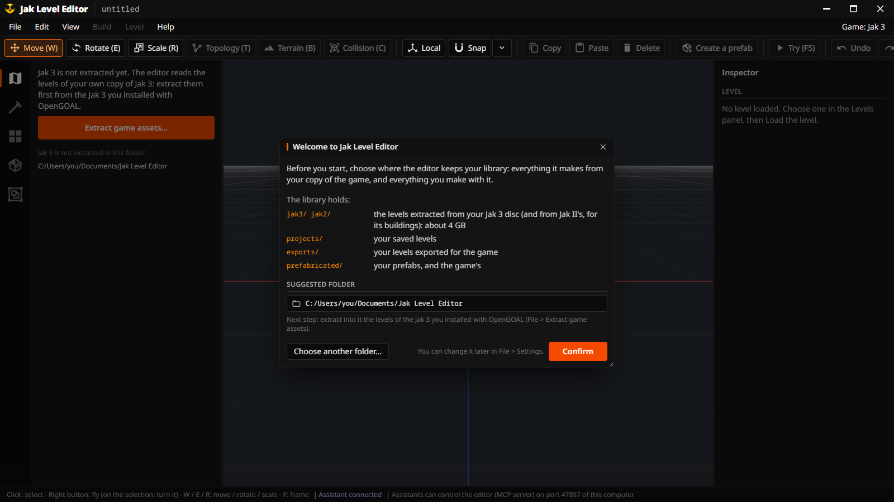

**File > Settings...** shows it and changes it later: the editor then uses the new folder, and
neither moves nor deletes anything in the old one (extract the game again there, or copy the old
folder's content by hand). The same window has the language, the **Games installed** (the folder
of each game you installed with OpenGOAL: its levels are extracted from it, and tried in it), and
whether an AI assistant may control the editor ([15](#15-building-with-an-ai-assistant)).

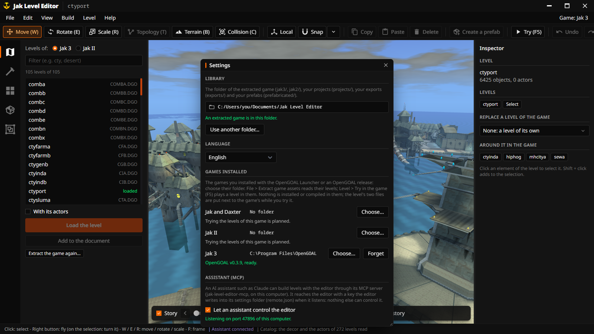

### Extract your game

Then it asks for your game: **File > Extract game assets... > Jak 3** (when the folder holds no
extracted game yet, the window opens by itself).

1. **The game installed**: the game (Jak 3 or Jak II; Jak and Daxter is marked *Work in
   progress*), and the folder it is installed in. Started by the OpenGOAL Launcher, the editor knows
   it; on its own, **Choose...** takes the Launcher's installation folder
   (`.../OpenGoal - Jak (PC)`) or an OpenGOAL release's (File > Settings keeps it). The line under
   it says what was found, for example *OpenGOAL v0.3.9: 272 levels (disc SCES-52460)*, or what is
   missing.
2. **Where to write the levels**: your library.
3. **Extract all the levels**: about half a minute for the 272 levels of Jak 3 on an SSD (two
   minutes on a hard disk). OpenGOAL's own extractor reads them by batches (two at a time) in the
   editor's settings folder (`extract/<game>/`); the editor writes each level into the library as
   it comes, its models with all their animations. Nothing is written in the game's installation.


Jak II, installed with OpenGOAL too, is extracted the same way (**File > Extract game assets... >
Jak II**, to `library/jak2/`): its buildings and decor go into your Jak 3 levels today, and Jak II's own level
editing, planned, will read the same files without extracting again. The extracted files come from
your game: keep them on your computer, do not share them.

## 3. First steps

### The window

```text
+------------------------------------------------------------------------------+
| Jak Level Editor | the level *                                       _ [] X |
| File  Edit  View  Build  Level  Help                             Game: Jak 3 |
| [Move] [Rotate] [Scale] [Topology] [Terrain] [Local] [Snap] [Copy] ... [Redo]|
+----+---------------+---------------------------------------+-----------------+
| Lv |               |                                       | Inspector       |
| Bd |  the panel    |              the 3D view              | (what is        |
| Ct |  of the icon  |                                       |  selected, or   |
| Pf |  chosen       |                                       |  the level)     |
| Gr |               | [x] Story  < =====o========= >        |                 |
+----+---------------+---------------------------------------+-----------------+
| what the mouse does here | the last message              the work going on   |
+------------------------------------------------------------------------------+
```

- The **title bar** names the level open (an orange dot: unsaved changes).
- The **Game** menu, at the right of the menu bar, names the game whose levels you edit and export:
  Jak 3. Jak and Daxter and Jak II are listed, marked **Work in progress**: planned, not available
  yet.

  

- The **bar of icons** on the left opens the panels, the steps of the work: **Levels** (the map) to
  open one, **Build** (the hammer) to make shapes, **Catalog** and **Prefabs** to place things,
  **Groups** to find the groups you made. Hover an icon for its name; drag a panel's edge to widen
  it.
- The **inspector** (right) shows what is selected and lets you change it precisely; with nothing
  selected, it shows the level.
- The **status bar** says what the mouse does where it is, the last thing that happened (click it:
  the log) and the work going on (reading the levels, an export).
- The **windows** (the export, the sky and the hour, the terrain brush, the guide...) float over the
  editor: drag their title to move them, their cross closes them.

### The guide

**F1** (Help > Tutorials) opens the guide: named tutorials, from *Getting started* (from your disc to
the game, step by step), *First start* (the library and the extraction) and *Add your level to the
game by hand* to one per tool, each with a short animation and a button that shows where it is; *Every
tool* and *Keys* (with where things are) in its other tabs. It opens by itself the first time.
Hovering any tool also shows what it does, its keys and an example.


### Open a level

In **Levels**, choose a level (type `cty` for Haven City's districts, `des` for the desert), then
**Load the level** (or double-click it). **With its actors** brings its objects too (doors, crates);
unchecked, you get its decor alone.


What comes with a level: its decor, its objects, its water (pools, fountains, dark eco, lava drawn
as such), the ocean where the level has one, and the levels the game always shows with it. The
ocean stops where the levels around stand in the game (behind the port, Haven City's ground): no
water where the game has none.

### Move around

| To | Do |
|---|---|
| Fly | hold the **right button**, then **W A S D** (Z Q S D on an AZERTY keyboard) to go forward, left, back, right, and **Q / E** (A / E on AZERTY) or **C / Space** down and up. These keys fly only while the right button is held: without it, W, E and R choose the move, rotate and scale tools |
| Go faster / slower | **Shift** / **Ctrl** while flying; the **wheel** while flying sets the speed |
| Move forward | the **wheel** |
| Slide the view | hold the **middle button** |
| Turn around a point | **Alt + left button** |
| Frame | **F**: the selection; **Home**: the whole level |

### A new level

**File > New level** (Ctrl+N) starts an empty level, with no ground at first. Build it from the
catalog, the prefabs and the shapes: a floor first (a **Ground** shape, or the terrain brush), then
the rest on it.

## 4. Selecting and moving things

### Select

- **Click** an element to select it. Each piece of decor is its own element: clicking a pipe
  selects that pipe, not every copy of it.
- **Before you click, the cursor tells you** what it points at: the element is outlined, and after a
  moment a label gives its name and, when it is part of one, its prefab or group with how many
  elements it has.
- **Shift + click** or **Ctrl + click** adds an element to the selection (or takes it out).
- **Click again at the same place** to reach what is behind or under: the second click selects
  the next element under the cursor.
- The **ground** is locked, so that clicks go to what stands on it (View > Select the ground
  unlocks it). Only the ground: the walls the game made one with it, roofs, ceilings, bridges,
  debris and water surfaces are selected like the rest (how the editor tells them apart:
  [reference](architecture.md#ground-and-decor)).


### Select many at once

- **Drag a box** from an empty spot: what it would select is **outlined while you drag**, and the
  label next to the cursor counts it. **Shift** while dragging adds it to the selection, **Ctrl**
  takes it out.
- **Double-click** an element, or **hold the left button still on it** (a ring fills around the
  cursor): its **whole prefab or group** is selected. An element in no group gives its **assembly**:
  the whole structure it is part of (a house with its facades, roof and windows).
- **Ctrl+G** selects the assembly, **Ctrl+L** the whole level. Do not mix them up with
  **Ctrl+Shift+G** (make a group, [5](#5-groups)) and **G** alone (the game rendering on or off).

| A box being drawn: 156 elements, outlined | The button held on a prefab: in a moment, all of it |
|---|---|
|  |  |

Example: you placed a house made of 155 pieces; click it once and you get one window frame;
double-click it, and you have the whole house, ready to move.

### Move, turn, stretch

The **gizmo** is the handle that appears on the selection: **red** is the X axis, **green** the
vertical (up), **blue** the Z axis. Drag an arrow to move along that axis, a small square between
two arrows to slide on the ground (or another flat direction), a ring to turn around an axis; with
Scale, the square at the end of an axis stretches along it.

- **W** move, **E** rotate, **R** scale. While dragging, the value is written next to the cursor;
  **Shift** is ten times finer, **Ctrl** snaps. A move, along any arrow or square (or the selection
  dragged itself), leaves the selection **see-through where it was**, with the way from there (red
  along X, blue along Z, green up) and how far it went: **Moved x +2.50 y +0.00 z +1.50 m**.
- **Snap** (toolbar) moves by 0.5 m, turns by 15 degrees, scales by 0.1: walls placed side by side
  meet exactly. The arrow next to it changes the steps.
- **Local** moves along the element's own axes (a catwalk set diagonally slides along its length).
- **Drag the selection itself**: press on an element of the selection (not on the gizmo) and move
  the mouse: left and right slide it across the view, up and down raise or lower it (**Ctrl**:
  forward and back instead), Shift finer. A click on an element of a selection of several keeps
  them all selected; click it again to take it alone.
- **Hold the right button on the selection** and move the mouse to turn it on every axis.
- The inspector gives the exact position, rotation and scale.

| Moving a selected prefab with the mouse: see-through where it was, how far it went | A catwalk of the industrial zone stretched with the scale gizmo |
|---|---|
|  |  |

Example: a platform that Jak cannot quite reach: select it, **W**, drag its green arrow up by 2 m,
and the player needs a double jump.

### Copy, delete, undo

**Ctrl+C / Ctrl+V** copy and paste (the copies appear where the originals were, selected: move
them), **Ctrl+D** duplicates, **Del** deletes, **Ctrl+Z / Ctrl+Y** undo and redo. Everything can be
undone. **Edit > History...** lists every step done: click one to go back to just after it (the
steps after it stay, greyed, until you change something).

### Arrange and repeat

**Edit > Arrange** puts the selection in order, in one step to undo:

| Entry | What it does |
|---|---|
| Drop onto the ground | each element goes down until it rests on what is under it: nothing floats |
| Same height as the first | all at the height of the first element clicked |
| In a line, evenly spaced | from the first clicked to the farthest, the others evenly spaced between them (3 or more) |
| Facing the way of the first | all turned the way the first clicked is |

**Edit > Repeat the selection...** makes copies of the selection **in a row** (along X or Z, a
spacing in meters, 0: touching), **in a circle** (the selection on a circle of the radius given,
each copy turned with it) or **scattered** around it (on the ground, each turned and sized a little
differently; **Other places** draws again). The copies show in the view while the window is open
and change with its numbers; **Keep** makes them one step to undo, **Cancel** takes them away.

| Repeat: a pillar of the slums in a row of 6, 6 m apart, shown before it is kept | The history: the last step undone, greyed |
|---|---|
| 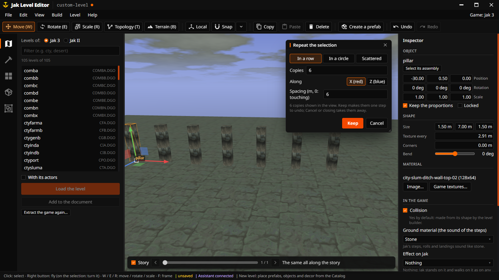 | 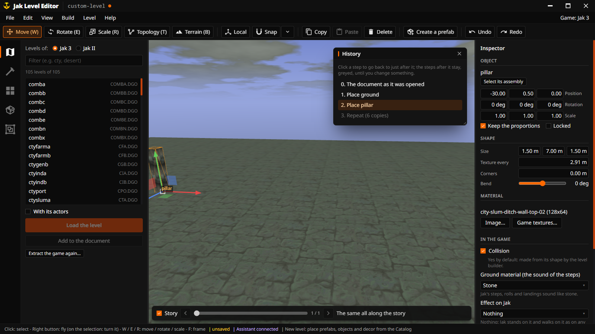 |

Example: one lamp post, Repeat in a row of 8 along X, 6 m apart, **Keep**: a lit street. A rock,
Repeat scattered with 20 copies within 15 m: a rocky field.

## 5. Groups

A **group** keeps elements together under a name. Every prefab you place is one (named after the
prefab); you can make your own.

- **Make one**: select the elements, then **Ctrl+Shift+G** (Edit > Group the selection...), and
  name it.
- **Use it**: a double click (or the button held) on any of its elements selects it all; it moves,
  turns and copies as one. Copying a group makes a new group.
- **The Groups panel** lists them ([P] a prefab placed, [G] a group of yours): click to select,
  double-click to frame, right-click to rename or **Ungroup**.
- The inspector shows the group of the selection, with **Select it all** and **Ungroup**.

| The Groups panel, a group selected | Naming a new group |
|---|---|
|  |  |

Example: a little square made of a fountain and two trees, grouped as "Little square", copied to
the other end of the street in two clicks.

## 6. The catalog: everything you can place

The **Catalog** panel lists what you can put in a level. Click an entry, then click in the view to
place it (or drag it into the view). Hovering an entry shows what it is.

- **Objects**: what makes up a place: props that just stand there (flags, windmills, a parked
  hellcat), doors and airlocks, water, dark eco and lava.
- **Interactive**: the objects that do something: crates, platforms and elevators, jump pads and
  board vents, buttons, breakable walls and fences, hazards. Their behavior is set in the
  inspector ([11](#11-what-objects-do)), and its **Preview** shows them moving in place (a door
  opening, a fence breaking).
- **Effects**: the game's **visual effects** in a category of their own, sorted by kind: **fire and
  flames**, **smoke, steam and dust**, **lights and glows**, **sparks and electricity**, **water**
  (drips, splashes, falls), and the others (explosions, trails). Each runs in the view as the game
  makes it.
- **Models**: the other 3D models of the game, the ones that are not part of a level's scenery
  (a broken piece of a robot, a barrel, a sign), placed as decor: they do nothing. Your own models,
  made in Blender, come first, under **My models**
  ([Your own models](#your-own-models-from-blender)).
- **Decor**: the pieces of the levels' scenery itself (a pillar, an arch, a catwalk of the
  industrial zone), searched by name across every level, or by level.
- **Materials**: every texture of the levels: select shapes or pieces, click a texture, they take
  it.

| Interactive objects | The visual effects and their kinds |
|---|---|
|  |  |

| The decor of every level searched for "catwalk" | Materials |
|---|---|
|  |  |

Placing: a click puts it where the cursor points, on what is under it. **Keep the left button
down** and move the mouse to move it before it lands: left and right across the view, up and down
to raise or lower it (**Ctrl**: forward and back), Shift finer; it lands when you let go. Once
placed it **stays selected**, the gizmo on it (all of a prefab), so you can adjust it at once; hold
**Shift** when you let go to go on placing copies. **R** or **Ctrl + wheel** turns it, the right
button held turns it every way, **Esc** stops.

Example: steam over a vent of your industrial yard: Catalog > Effects > *Smoke, steam and dust*,
click `ctyindb-steam-drift`, click on the vent.

Never offered: the creatures, the collectibles (orbs, gems, ammo) and the technical objects
(cameras, triggers).

## 7. Prefabs

### Place one

The **Prefabs** panel has **the game's prefabs** (top) and **yours** (bottom). Click one, then click
in the view; it sits on the surface it is placed on.

**The game's prefabs** are whole structures found in the game's levels, by game, level and
category: houses and buildings of the slums, Spargus and Haven, towers, temple gates and walls,
bridges, platforms, machines of the factories, palms and rocks of the desert, statues, and Jak II's
(Haven City's buildings, its palace) when Jak II is extracted. They are made from your levels the
first time you show them.


### Make one

1. Select what goes together. For a building of the game, click one of its walls and press
   **Ctrl+G**: its whole assembly is selected.
2. **Create a prefab** (toolbar, inspector or Edit menu) and name it.
3. **Leave out the pieces smaller than 0.5 m** is checked: a prefab is a structure, and loose
   bolts, debris, stains and tiny props would only clutter it. When some would be left out, the
   window says how many. The objects of the game (a door, a crate) are always kept.

It is saved in `library/prefabricated/` and appears under **My prefabs**.

| A tower of Spargus selected whole by its assembly (Ctrl+G) | Making it a prefab: the small pieces left out |
|---|---|
|  |  |

A building of the game is often a facade: place its prefab where its back cannot be seen
([the ideas](#1-the-ideas-in-five-minutes)).

## 8. Building your own pieces

### Shapes

The **Build** panel makes what the game does not have: a block, a floor, a wall, a **wall with a
door**, a **wall with a window**, a pillar, a ramp, stairs, roofs, a cylinder, a **ground** (a floor
whose top goes up and down). Click one, then click in the view. In the inspector: its **size** in
meters, how often its texture repeats (**Texture every**: a larger wall repeats its texture instead
of stretching it), **Bend** (a wall bent 90 degrees is a quarter of a round tower, stairs bent 180 a
spiral staircase) and rounded **Corners**.

**In the style of a level**: choose a level, and **Place a floor** or **Place a wall** gives a
floor or a wall that looks like it (its textures, their size, its light, how uneven its ground is).

| The Build panel and its shapes | In the style of the port: what the panel measured of its floors and walls, a yard of its cobbles, a bent wall, a round pillar, a spiral staircase |
|---|---|
|  |  |

### Structures that grow: walls, floors, houses

Many buildings of the game are only a front: seen from behind they are flat as a sheet of paper,
because the game was made for the angles the player can reach. The prefabs taken from the levels
have the same problem. The editor's **structures** are solid instead, made of the chosen level's own
pieces, and they grow when you resize them, the way the modular kits of game studios do: more bays
and more pieces, never a stretched texture.

Below the style, **Structures like this level's**: **Make** a **Wall**, a **Floor** or a **House**,
choose how it looks, then **Place a solid wall**, **Place a solid floor** or **Place a house** and
click in the view (its box follows the mouse, **R** turns it).

| Structure | What it is made of |
|---|---|
| Wall | the level's buildings' texture on both faces and on top; pillars and a plinth standing out of both faces, bands between its floors, a coping; on each floor of each bay the level's own relief, a panel repeated as many times as it fits (the industrial zone's bulges and joints, Spargus' panels, the slums' beams), wear, pipes, lamps; windows in some bays if asked |
| Floor | a slab of the level's ground, closed on its sides and underneath; a curb around it, the seams of its paving, the level's dirt patches and vents in its cells |
| House | the walls, the level's windows and door, a pipe, wear and a roof of its plates (below) |

**Resize it** in the inspector (its **Length**, **Height**, **Thickness**, a house's **Width**,
**Depth** and **Floors**) or with the scale tool (**R**): when you let go it is made again at its new
size, with more or fewer of its pieces. Its first bays keep their details: a longer wall only gets
new bays. **Another look** draws other details with the same rules.

A level whose pieces have no telling name gives the panels its walls are dressed with, known by
their shape (the Precursor core's plates, the throne room's wall blocks): solid ones, never a lit
window, a lamp or a sign. A level with no relief at all gets a raised panel on each floor of each
bay, on both faces.

| Walls and floors of the industrial zone, the slums, Spargus and Haven City | A wall seen from behind: as finished as its front |
|---|---|
| 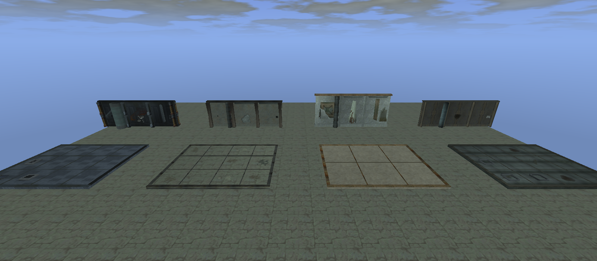 | 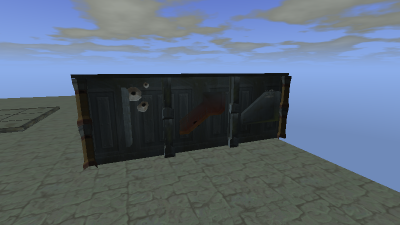 |

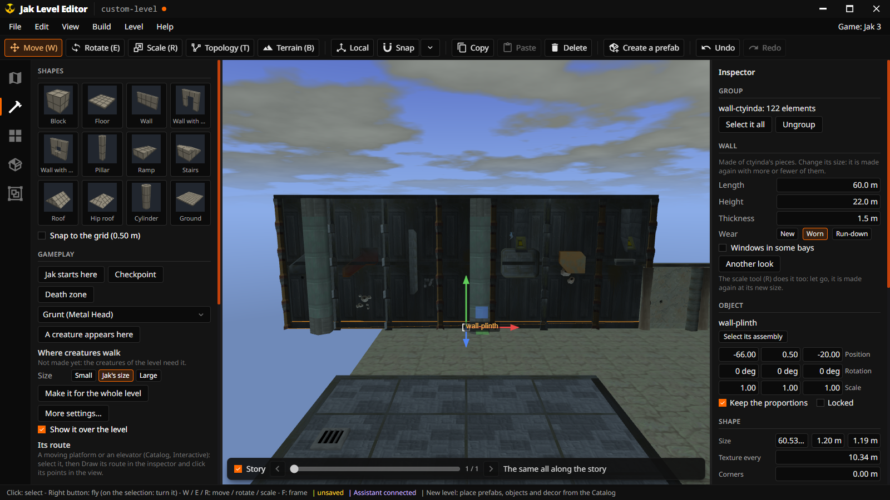

**Make a set of prefabs** saves nine structures of the level with your prefabs (walls of two and
four bays, a high wall, a wall with windows, floors of 16 m and 32 m, houses of one, two and three
floors), named after the level. Placed from the Prefabs panel, they grow the same way.

#### A house like a level's

**Make: House** builds a whole house with the chosen level's own pieces. Choose its **floors** (1 to
4), its **roof** (like the level, two slopes, four slopes, flat) and its **wear** (new, worn,
run-down), click **Place a house**, then click in the view: its door faces you at first.

| What the house takes from the level | Where it comes from |
|---|---|
| Walls | the texture and light of the level's buildings (their facades), with a plinth, a band between the floors and pillars at the corners (relief) |
| Windows, door | the level's own window frames, glass, door and door frame, in openings their size |
| Pipe | the level's pipes and rings, down one side from the roof to the ground |
| Wear | the level's stains, streaks, bullet holes, scorch marks and broken plaster, between the openings |
| Roof | the level's roof texture under rows of its own plates, overlapping like tiles; flat with a low wall in Spargus, whose roofs are |
| Details | the level's chimney, awning over the door, lamp beside it, sign at the corner |

The game's buildings are large (a floor of the slums is about 11 m high): the house is sized from
the level's windows and doors. It is one group (a double click selects it all) and one step to
undo; each house placed is a little different. A level without windows of its own (the industrial
zone) borrows Haven City's, keeping its own walls.

| The same button in three levels: Spargus, the slums, Haven City | A house of the slums placed in the slums |
|---|---|
| 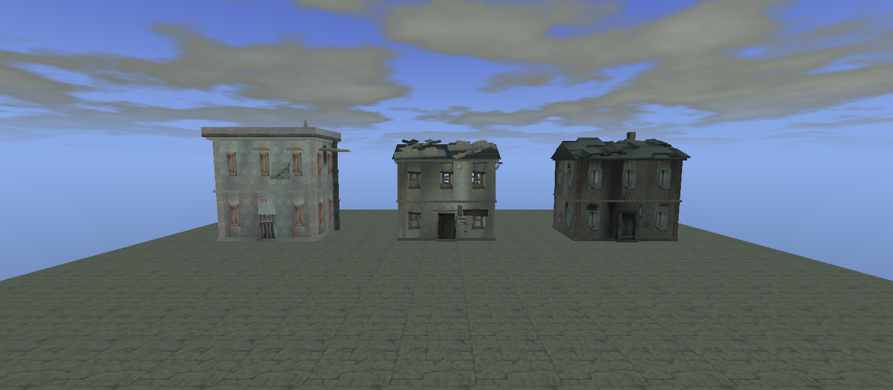 | 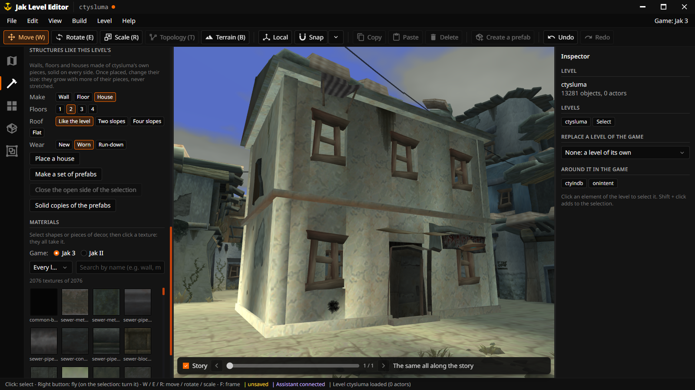 |

### Gameplay: start, checkpoints, creatures, death zones

The Build panel's **Gameplay** places what makes a level playable:

| Button | In the editor | In the game |
|---|---|---|
| Jak starts here | a blue flag (one per level: placing another moves it) | Jak appears there, facing the way of the flag |
| Checkpoint | a green flag | once Jak passes by it, he comes back there when he dies or falls |
| Death zone | a red box (stretch it in the inspector) | not drawn: Jak touching it falls to his death and comes back at his last checkpoint |
| A creature appears here | an orange flag, the creature chosen in the list beside it (a grunt, a guard, a flitter, a roboguard: those the game lets a level place) | the creature appears there when the level is loaded and walks the nav mesh under it |

Put the death zone under the level, below every edge Jak can fall from. The flags and the red are
the editor's only. The export writes them: the start and the checkpoints become the level's continue
points (a level of its own: a level replacing one of the game's keeps the game's), each checkpoint
with a little code that makes it Jak's when he passes by. A creature needs ground it can walk on
under its flag (**Where creatures walk**, below): the export links it to that nav mesh, or leaves it
out and says so in its notes.

**In this level** lists the start, the checkpoints, the creatures, the death zones and the moving
objects with a route: a click selects one and shows it in the view. A creature with no ground in
color under its flag says **no ground** there, before any export.

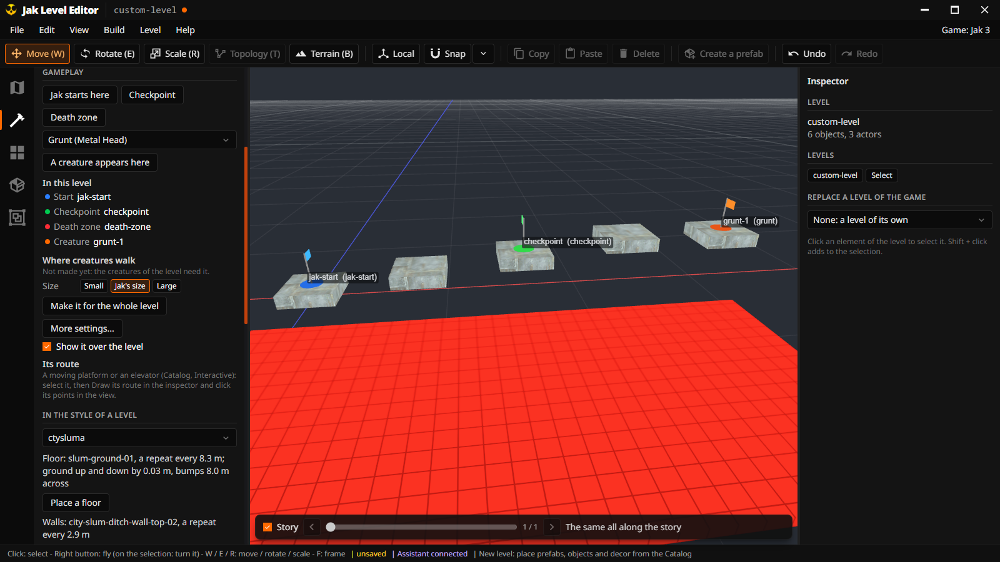

**Routes of moving objects.** A moving platform or an elevator (Catalog, Interactive) goes along a
route. Select it, then in the inspector **Draw its route** and click in the view, point after
point: the route starts where it is and shows in yellow (**Esc** stops; each point is one step to
undo). In the game it goes along it and back; moved, it takes its route with it; **Clear the route**
takes it away.

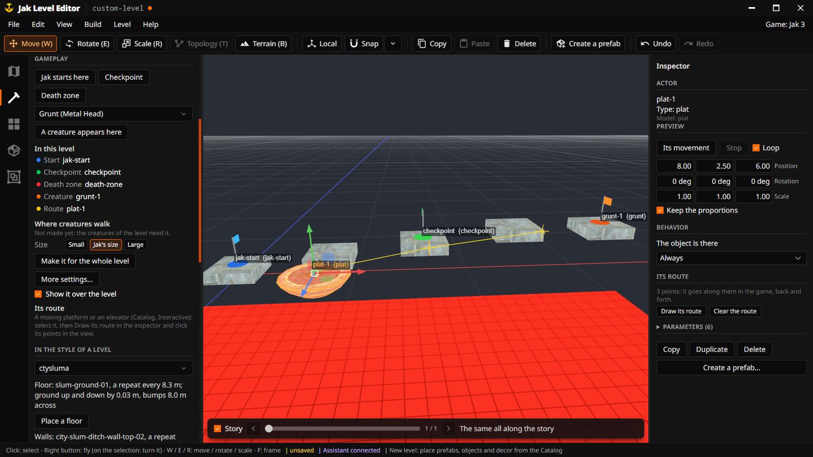

**Where creatures walk.** Under Gameplay, choose the size of the creatures (**Small**, **Jak's
size**, **Large**) and **Make it for the whole level**: the ground they can walk on shows in color
over the level, around the walls and the crates (see [Where creatures walk](#12-where-creatures-walk-nav-meshes)).
Death zones and decor Jak goes through are left out.

The guide (**F1**) has the whole example as a tutorial with its animations: **Make a level
playable**, a jumping course over the roofs of the slums.

### The terrain brush

**Terrain (B)** draws natural ground freehand, in its own small window: a square follows the mouse,
and what it would do shows see-through under it before you click. Hold the left button to **paint**
ground, raise **walls** or **erase** ground and walls: the whole stroke shows see-through while you
hold the button, and is done when you let go (**Esc** while holding: nothing done). **Smooth** and
**flatten** change the ground as you go. Hold the **right button** and move the mouse **up** to
raise the ground there, **down** to dig it: the new shape and its height show until you let go
(moved sideways, the right button looks around as usual). **Generate hills** makes hilly ground at
once. The brush changes the terrain under the square; the ground takes the textures of a level's
style automatically (the desert's sand and rock, the slums' cobbles).

**Free brush** or **Magnet brush** (**M**): both follow the cursor. The free brush lays its ground at the
height where the stroke starts; the magnet brush keeps the level of the ground already laid beside
the square: the terrain you are painting (made larger at its level), else the top of the decor
next to it (a platform, a quay: 2 cm under it; not small props), named next to the square. The
preview shows the ground at that level before you click and while you hold the button. The right
button never lays ground while erasing: it raises or digs what is there.

| The terrain brush in the style of the desert over hills it generated, a riverbed dug, a hill raised: its square and its window | The right button held and the mouse moved up: the hill it raises, before it is let go |
|---|---|
|  |  |

| The magnet brush next to a terrain laid 3 m up: the square at its level | Held from there: the terrain made larger at its level, shown before it is let go |
|---|---|
|  |  |

### The shape of one piece: topology

**Topology (T)** shows the shape of one element as the game stores it: its **points** (the corners
of its triangles) and its **faces** (the triangles). Move points with the gizmo; pick faces and
**Extrude** them (pull them out, with walls joining them to the rest: a step out of a floor),
**Subdivide** (cut each in four, to shape it more finely), **Flip** (turn them over), **Delete**.


### See what an object does: the preview

The inspector's **Preview** plays an object's animation where it stands (a door opening), its
movement (an elevator), or shows it **breaking** (a fence of the factory thrown apart). The pieces
fly as the game throws them (its `joint-exploder`, in `engine/anim/joint-exploder.gc`): 5 to 15 m/s
up and up to 20 m/s sideways, falling at 70 m/s², turning 8.4 degrees a frame, bouncing off the
ground, and shrinking to nothing in 2 seconds.


### Jak II's buildings

Choose **Jak II** at the top of the Catalog or the Levels panel (not extracted yet, the panel says
so and offers **Extract Jak II...**): its models,
its decor (Haven City as it was), its prefabs, or a whole level of Jak II opened as a level of Jak 3
(with its collision). What could go wrong is checked when it comes in (textures renamed
`jak2-<name>`, light compared with the level's: **Match the lighting** in the inspector).


### Your own models: from Blender

Model a market stall in Blender, bring it in once, then place it in any level as often as you like:

1. In Blender: **File > Export > glTF 2.0**, format **glTF Binary (.glb)**. Model in meters (1 unit
   is 1 meter; Jak is about 1.6 m tall), standing on the ground at the origin. Give its materials an
   image (Base Color) or a plain color; apply its modifiers when exporting.
2. **Drop the `.glb` on the editor's window**, or **File > Import a model** (`.glb`, or `.gltf` with
   the files it names). It is copied into the library's `models/` folder and follows the cursor:
   click where it goes.
3. From then on it is in the Catalog's **Models**, under **My models**. Importing a file of the same
   name again replaces it (edited in Blender); what was already placed stays as it was.

Select it: the inspector's **Imported model** section says what was checked when it came in.

| Check | What it tells |
|---|---|
| Mesh | its triangles; the pieces with an image but no UV map (they show one color: unwrap them) |
| Size | in meters: a model 100 times too big was made in centimeters |
| Images | how many, the largest (over 1024 pixels the level gets heavy) |
| Colors without an image | made into small images of that color: the game draws a material without an image as a checkerboard |
| Parts | Blender's objects, placed as one piece |
| Animations | made with an armature: the **Preview** plays them; in the game the model stays still (decor) |
| Collision | by its shape, or by **the box around it** when its shape is more than the game gathers around Jak |

A model of your own always collides, unlike the game's small details: by its shape, or, when it is
too detailed (the game gathers about 460 triangles around Jak, and he falls through the floor past
that), by the box around it: 12 triangles, solid all around, not drawn. **In the game > Its
collision** changes it, on any piece of decor.

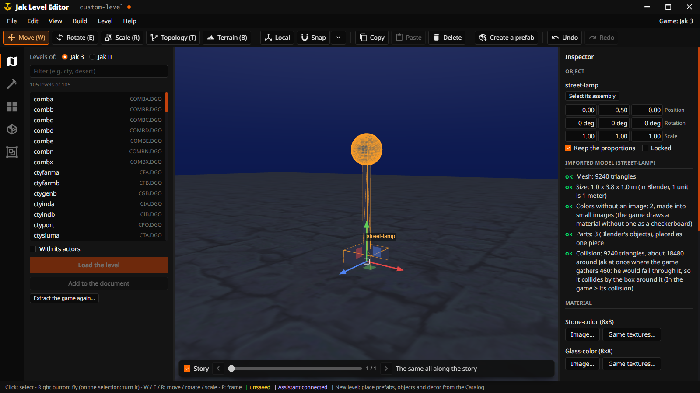

### The light of what you place

What you place, paste or move **takes the light of the level around it**: each of its corners
borrows the light of the level's nearby surfaces facing the same way, the ground and the walls made
in the editor included. A piece from a dark cave placed in a sunny street does not stay dark, and a
piece lit by the lamps of an indoor level (Onin's tent) placed on the ground of a new level gets the
light of that ground. What you place is never its own surroundings: a prefab placed alone keeps
the light its pieces had, rather than taking that of one of its own parts. A new level is lit as
Haven City is: the sun of the hour, the lamps on at night.

## 9. Seeing it as the game does: sky, hour, weather

**The game rendering** (View > Game rendering, **G**), on from the start, draws the level with the
game's own renderer: its light at the hour and in the weather you choose, its fog, its sky. **G**
switches to the editor's own view, where every light is on (handy in dark corners).

**View > Sky, hour and weather...** opens a small window of its own:

- **The sky**: half a turn around where the camera looks (the whole turn makes you lose your
  bearings), with its horizon and the four directions: the sun or the moon, the clouds, the stars.
- **The hour**: a slider, and **Dawn**, **Noon**, **Dusk**, **Night**. **Time passes** lets it run.
- **The weather**, as the game has them: clear sky, a few clouds (the game's start), haze, smog,
  overcast, overcast and foggy, rain, storm, storm with rain, storm and foggy; or your own with the
  **Clouds**, **Fog / rain** and **Rain** sliders. **Lightning in a storm** flashes the sky and the
  level.
- **What it changes**: the sun dims and the light greys under clouds, the fog closes in with haze
  or rain, the lamps of the level light up at night, some effects only show at some hours, and all
  of them fade in the fog far away. The window sums it up (*the sun is up, its light 0.92; the fog
  closes in at 1000 m; the lamps are off*).

| Noon, clear sky | Dusk, a few clouds: the lamps on |
|---|---|
|  |  |

| Storm with rain | Night: the stars, the lamps of the houses lit |
|---|---|
|  |  |

The **effects** (steam, sparks, smoke, fire, lights) run in the view (View > Effects), and the
**ocean** moves, its waves catching the sun.


## 10. Levels side by side, and the story

**Several levels.** With a level open, choose another in Levels and **Add to the document**: it
comes at its place in the world. To work on the junction between two levels, or to build a new
level next to the game's. The inspector lists them (show, hide, frame, remove; **Junction** frames
the place where two levels meet) and the levels **around it in the game** (click one to add it).
**Select** next to a level selects it whole, to move it.

| The industrial zone with the next district and the city walls added | A level selected whole |
|---|---|
|  |  |

**The story.** Some levels change during the game: Haven City's Metal Head tower is blasted, the
forest's statue falls. The bar under the view shows the level at a point of the story: drag its
slider, or click its arrows to go to the previous or next change; the text next to it names the
last step of the story done (the game's own name for it, such as `tower-destroy-resolution`: the
tower's destruction). **Story** unchecked shows every state at once.


## 11. What objects do

Select an object: the inspector's **Behavior** says what it does, and you can change it.

| Object | You choose |
|---|---|
| Doors and airlocks | when it opens: when Jak comes near, never (locked), always, or when Jak comes near **once a condition holds**; from how far |
| Jump pads, board vents | when they throw Jak up, how high |
| Elevators | when they leave, how fast |
| Crates | which crate (wood, iron, steel...) |
| Every object | whether it is there at all (always, never, once a condition holds) |

A **condition** is: after a step of the story, once a switch is pressed, or once an object is gone
(a crate broken, an enemy killed). **Parameters** lists every setting the object's code reads, with
its default.


Example: a door that opens only once the crate in front of it is broken, so the player has to find
a way to break it first.

**The decor** can do things too (inspector, **In the game**): collide or not, sound like stone or
metal under Jak's feet, hurt or burn him, **bounce** him up, **launch** him along an arc.
[the appendix](#appendix-what-the-decor-can-do-in-the-game) explains what the game allows.

### The collision, face by face

The **In the game** settings work piece by piece. The **Collision** tool (**C**, or the toolbar)
works on the collision itself, face by face, as the game stores it, like the collision dock of
OpenRAC's editor for Ratchet & Clank. Example: the street under Jak's start in the industrial zone
made ice, and a box added for him to climb on.

1. **See it.** Open a level and press **C**: its collision is drawn over it, a color per surface,
   and the **Collision** window opens. **Colors** chooses what the colors tell: the **material**
   (the sound of the steps; ice slides), the **effect on Jak** (hurts, burns, kills) or the
   **kind** (ground, wall, obstacle). The legend lists the surfaces and their faces. **View >
   Collision** shows it without the tool.
2. **Pick faces.** A click picks the face under the cursor; **Shift + click** adds one or takes it
   out; a **double click** takes the faces of its surface touching it (a whole floor); a **drag**
   draws a box (every face whose middle is in it, seen or not). A surface of the legend takes all
   its faces, and **Faces under the pieces selected** takes those under the pieces you selected
   before the tool.
3. **Change them.** Choose a surface (material, effect, kind, and More options) and **Give it to
   the faces picked**; **Delete** them (**Del**): Jak goes through there; **Move** them: they are
   drawn where they go while you set the distances, then **Move them**.
4. **Add some.** A click leaves a yellow cross where it landed: **A floor** or **A box** adds one
   there, of the surface chosen (a floor over a hole, an invisible wall at a cliff's edge).
   **Collision from the shape of the pieces selected** gives pieces faces of their shape to change
   one by one (their own collision becomes none).
5. **Check.** **Where Jak may fall through** marks in red the floors with more triangles around
   Jak than the game gathers at once (460).

Every change is one step of **Undo**, and is saved with the project. The export writes the faces
with their surfaces: the levels' with **The game's collision** (the export's choice, the default),
the ones the tool added always.

| Colored by kind: ground green, walls blue, the street picked | The street made ice, a box of metal added |
|---|---|
| 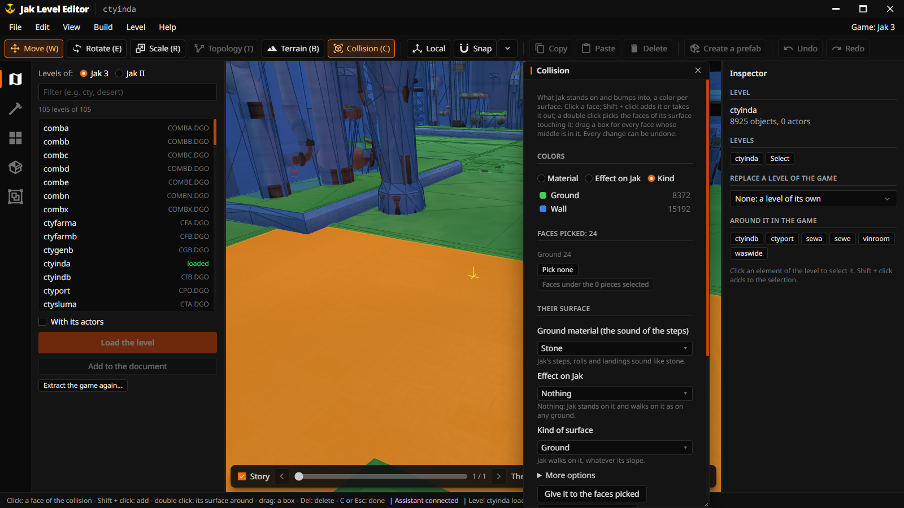 | 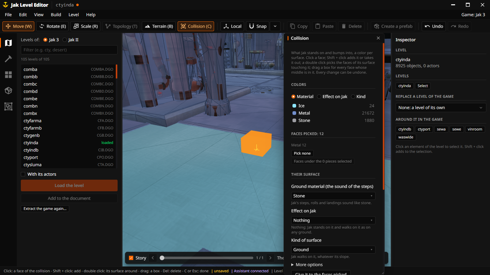 |

## 12. Where creatures walk: nav meshes

The game's creatures walk on **nav meshes**: flat shapes laid over the ground that tell them where
they can go. You need them under each creature you place (Build panel, Gameplay, **A creature
appears here**); you can skip this part otherwise. The quickest way: the Build panel's
**Where creatures walk** (a creature's size, then **Make it for the whole level**). **Level > Nav meshes**
makes them from the level's walkable surfaces, for a creature of the size you set, for the whole
level or around the selection; they are drawn over the level, one color each, and saved with the
project and the export. On a level of the game, the walkable surfaces are those of its collision,
as the export gives it to the game, not every roof drawn: a roof Jak could never reach in the game
has no collision, and a creature placed there would fall through it. Only its ground counts (a
flat top the game marks as a wall, a deadly, burning or sliding surface does not), and only where
the level's decor is still shown (a piece deleted or hidden takes its collision with it, as in the
export).

| The nav meshes of the slums | Made in one click around three crates (Jak's size) |
|---|---|
|  | 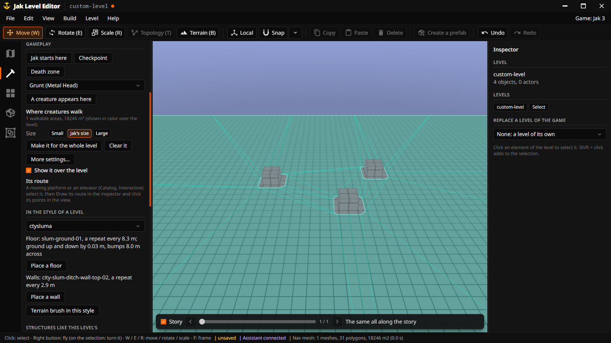 |

## 13. Saving

**File > Save** (Ctrl+S) saves your work as a **project**, only when you ask, in its own folder:
`library/projects/<name>/<name>.glb` (a standard 3D file Blender opens too) and its nav meshes.
**File > Open project** (Ctrl+O) and **Recent projects** open it again. Nothing is saved behind
your back.

## 14. Playing it in the game: try it, export it

### Try it in the game (F5)

**F5**, the toolbar's **Try**, or **Level > Try in the game** plays the level in the game you
installed, Jak at its start (the **Jak starts here** flag of the Build panel's Gameplay, else a
point of the level). Nothing of the game is installed, decompiled or compiled for it.

The editor needs to know where the game is:

- **From the OpenGOAL Launcher**, it is the game the Launcher installed (Jak 3 installed with the
  Launcher's active version): nothing to set.
- **On its own**, choose the folder in **File > Settings**, *Games installed*, one per game:
  the Launcher's installation folder (`.../OpenGoal - Jak (PC)`), the folder of an OpenGOAL release
  you unzipped and extracted the game with, or a jak-project you built. The line under it says
  `OpenGOAL v0.3.9, ready.`, or what is missing (the game not compiled, `goalc` missing...).

Until then the button stays grey, its tooltip saying why. Only Jak 3's levels can be tried for now.

What a try does, in the status bar as it goes:

1. **Exports** the level as `jle-test` into the editor's settings folder (`game-test/jak3/work/`).
2. **Builds** it with your game's own `goalc` (OpenGOAL's compiler, which builds custom levels):
   a few seconds, reading from your game's disc files only the DGOs that hold its objects.
3. **Compiles its code** (the behaviors you set) with your game's `goalc`. The first try of a
   session takes about 20 seconds more: `goalc` learns the game's engine once, into the editor's
   folder, and stays open for the next tries.
4. **Puts two files next to the game's**: `out/jak3/iso/JLT.DGO` and `out/jak3/fr3/jle-test.fr3`,
   new names that replace nothing of the game.
5. **Starts the game** (`gk`), declares the level to it and brings Jak there.

Press F5 again after a change: the game of the last try closes and the new one opens. Closing the
editor closes that game and takes the two files out again.

> [!IMPORTANT]
> Close any other OpenGOAL game first: the compiler talks to Jak 3 through the port 8114, which
> only one game can hold. While another holds it, a try refuses to start rather than send its
> commands to that game.

When a try fails, its message is in the log; `goalc.log` and `gk.log` in `game-test/jak3/` of the
editor's settings folder (`%APPDATA%/OpenGOAL/jak-level-editor/` on its own) hold what the compiler
and the game said.

### Export it

**Level > Export for the game...** writes the level as a **custom level of OpenGOAL**, in
`library/exports/<project>/`, laid out like jak-project, with a `README.md` that gives the exact lines
to add and how to build and go there.


Its window, field by field:

- **Name**: your level's name in the game, 3 to 10 lower-case letters, digits or `-` (`my-ctyslum`).
- **Nickname**: 3 letters, the name of its file (`mct`). **ISO name**: the same in capitals, 8 at
  most. **First actor id**: the number its objects start from (leave it).
- **In place of**: a level of the game it replaces (below), or none.
- **With the actors** (its objects), and the **collision**: **The game's collision** (the default:
  the game's own collision where its decor is still in place, a collision made from the shape of
  what you placed or moved) or **Made from the decor** (everything from the shape: heavier).
- **Start**: where the player starts (a continue point of the level by default; the **Jak starts
  here** flag of the Build panel's Gameplay, when there is one, wins).
- **Folder**: where it is written.
- The **behaviors** you set are written as the level's own code.
- The **report** says what changed and where the collision might be too dense for the game. It
  also lists the objects left out because the game would die of them: those whose code gets their
  own level of the game by its name (the volcano's breaking ground needs `volcanoa` loaded); replace
  that level to keep them. The battles too (their creatures come from the game's own tables, whose
  models the level does not have): place creatures with **A creature appears here** instead.
- The **code** the objects need goes into the level's DGO in an order the game can load: a type's
  parent first, even from the code of another level loaded beside it in the game (the city's
  squads under Spargus' cars).

**Replace a level of the game**: a level made from one of the game's (say `ctyindb`) can take its
place, so that the game loads yours wherever it loaded the original, with its continue points,
music and missions. **Level > Replace a level of the game...**: choose it, **show the original** (a
blue ghost to compare), **Place it where the original is**, check where the game starts the player
(green: ground under it), and **Export in place of ...**.


**Keep it in the game.** A try is for testing: to keep the level in your game, or to share it,
export it and add it to the game's sources by hand: **Help > Guide**, the tutorial **Add your level to
the game by hand** (the export window's **Add it by hand...** opens it), walks through it, and the
export's `README.md` gives the exact lines for your level:

1. Get **jak-project** (OpenGOAL's source code) from
   [open-goal/jak-project](https://github.com/open-goal/jak-project) and build it, as its own README
   explains, with your Jak 3 extracted and decompiled in it. You get `goalc` (the compiler of the
   game's language) and `gk` (the game). The export and the level's code make up for what its level
   builder does not write.
2. Copy the export's two folders, `custom_assets` and `goal_src`, into the jak-project folder (they
   merge with the folders of the same names).
3. Add the lines the export's `README.md` gives to `goal_src/jak3/game.gp` and
   `goal_src/jak3/engine/level/level-info.gc` (for a replacement: one word to change instead).
4. Start `goalc`, type `(mi)` and wait for *Successfully built all*.
5. Start the game in your level: start `gk -g jak3 -- -boot -fakeiso -debug`, then in `goalc`
   type `(lt)` and `(start 'play (get-continue-by-name *game-info* "my-ctyslum-start"))`. Jak
   appears in your level.

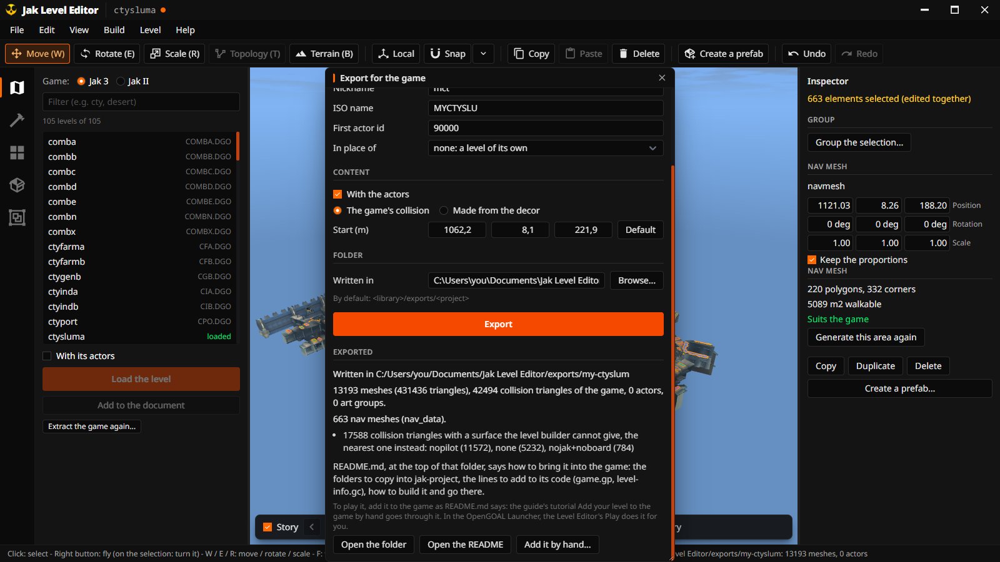

## 15. Building with an AI assistant

An AI assistant (Claude, or any program that speaks MCP) can build in the editor for you: you
describe the level, it opens it, places the decor and the prefabs, looks at the
result and shows it to you, in your window, every change undoable. It needs your permission:
**File > Settings > Assistant (MCP)**, **Let an assistant control the editor**.

**[The MCP tutorial](mcp.md)** explains how to set it up, what to ask, and what it can do.


## 16. Keys and mouse

| Key | Action |
|---|---|
| W, E, R | Move, rotate, scale |
| T, B, C | Topology tool, terrain brush, collision tool (again or Esc: done) |
| Click, Shift / Ctrl + click | Select, add to (or take out of) the selection |
| Double click, left button held still | Select the whole prefab or group (else the assembly) |
| Drag from an empty spot | Box selection (Shift: add, Ctrl: take out) |
| Drag from a selected element | Move the selection (Ctrl: forward / back, Shift: finer) |
| Click again at the same place | The next element under the cursor |
| Right button held on the selection | Turn it every way |
| Ctrl+G, Ctrl+L | Select the assembly, the whole level |
| Ctrl+Shift+G | Group the selection |
| Ctrl+C, Ctrl+V, Ctrl+D, Del | Copy, paste, duplicate, delete |
| Ctrl+Z, Ctrl+Y | Undo, redo |
| F, Home | Frame the selection, the level |
| G | Game rendering on / off |
| While placing: left button held, R / Ctrl + wheel, Shift on release | Move it before it lands; turn it; keep placing copies |
| Esc | Stop placing, then clear the selection |
| Ctrl+N, Ctrl+O, Ctrl+S, Ctrl+Shift+S | New level, open, save, save as |
| F1 | The guide |
| F5 | Try the level in the game |

## 17. Files and folders

```text
library/                 the library: everything made from your game (git ignores it; installed,
                         the folder chosen at the first start, see File > Settings)
  jak3/                  the extracted levels of Jak 3 (jak2/: Jak II's)
  prefabricated/         the prefabs: yours, and the game's in prefabricated/game/
  projects/<name>/       your saved projects
  exports/<project>/     the levels exported for the game (older exports: export/<project>/)
data/                    what the editor knows of the game: names and rules, no asset
lang/                    the interface texts (en.json, fr.json)
crates/                  the engine (core/), the engine in a Tauri app (tauri-plugin/), the MCP server (mcp/)
ui/                      the interface: menus, panels, windows, the 3D view (Svelte, WebGL2)
src/, src-tauri/         the editor as a program of its own: its page and its Tauri app
docs/                    this documentation: guides, architecture, workflows, screenshots
tools/                   scripts that regenerate data/ and the screenshots
.agents/skills/          the knowledge base for AI agents working on the editor (a submodule)
```

Only `library/prefabricated/.gitkeep` of `library/` is in git: prefabs, projects and exports hold
the game's data and stay on your computer.

Your preferences (the library, the games installed, the language, the recent projects, whether an assistant
may control the editor), the pictures of the panels and what the catalog read of the levels are
kept in `%APPDATA%/OpenGOAL/jak-level-editor` on Windows (`~/.local/share/OpenGOAL/jak-level-editor`
on Linux). The first time, the editor takes the preferences of its previous version
(`OpenGOAL/open-goal-level-editor`). The OpenGOAL Launcher's editor keeps its own, in the
launcher's settings folder (`%APPDATA%/OpenGOAL-Launcher/jak-level-editor` on Windows).

## Appendix: what the decor can do in the game


What a piece of decor (a wall, a slab, a vent grate, a shape made in the editor, a structure of
Jak II) can do in the game once a level is exported: how it collides, whether it throws Jak up,
whether it sends Jak away, whether it can break or bend. This page is the study of the game's code
these settings come from, and what the editor makes of it.

The paths are those of a [jak-project](https://github.com/open-goal/jak-project) checkout:
`goal_src/jak3/...` is the game's decompiled code, `goalc/build_level/...` OpenGOAL's level
builder, `goalc/build_actor/...` its actor builder. Line numbers are those of the checkout studied
and move with its versions. Distances are in game units in the code: 4096 per meter.

### What the editor offers

Select a piece of decor: the inspector's **In the game** section
(`ui/components/inspector/DecorBehavior.svelte`) sets it, for every selected piece at once, undone
like any change. It is kept in the node's extras (`og_decor`, `crates/core/src/io/decor_behaviors.rs`),
saved with the project and in prefabs, and written by **Level > Export for the game**
(`crates/core/src/io/game_export/`). The MCP tool
`set_decor` sets the same.

| Behavior | How it is made | Code generated |
|---|---|---|
| **Collision**: by its shape, by the box around it (a detailed model), none (walked through), invisible (an invisible wall); its material, what it does to Jak, its mode and its flags | the level builder's own glTF extras on the piece; the box, an invisible mesh of 12 triangles in its place | none |
| **Bounce**: Jak landing on its top is thrown up *height* meters, on foot, in a dive and on the jetboard | a `bouncer` of the game without a model, as the board vents of the Industrial Zone are, on top of the piece | a type of the level deriving `bouncer` |
| **Propulsion**: Jak stepping on its top is thrown along an arc to a point *distance* meters away, *height* above, turned *yaw* degrees from the piece's facing, in *time* seconds | the game's directed launch (`'launch-dir`), sent as the Metal Head puffers send it | a small `process-drawable` type of the level |
| Breaking, squashing, dipping, swaying | not offered for the decor: they need a model of its own that the game draws as an actor (see [Breakable](#breakable) and [Deformation](#deformation)) | |

### Collision through the level builder

The builder reads these extras in `goalc/build_level/common/gltf_mesh_extract.cpp`; extras on a
material override those on its node (505-513).

| Extra | Effect |
|---|---|
| `set_invisible` (node or material) | not drawn: skipped by the tfrag pass (106-118) and the tie pass (262-273). **Its collision is still built**: the collision pass (489-568) never checks it |
| `set_collision` | must be 1, or none of the keys below are read (442-446) |
| `ignore` | no collision for that node or primitive (450-453, 515-517) |
| `collide_material`, `collide_event`, `collide_mode` | Jak 1's numbering, checked against each maximum (456-476); a missing key reads as 0 |
| `nolineofsight`, `noedge`, `nocamera`, `noentity` | flags (464-484) |

Two settings of the level's `.jsonc` matter too: `automatic_wall_detection` (on by default, with
`automatic_wall_angle` 30 degrees) makes the steep faces walls after the extras are applied, so it
wins over `collide_mode` (593-606; `goalc/build_level/jak3/build_level.cpp:27-29`);
`double_sided_collide` doubles every face (582-589).

The surfaces are converted to Jak 3's by `jak3_pat`
(`goalc/build_level/collide/common/collide_common.h:668-792`, called from
`goalc/build_level/collide/jak3/collide.cpp:142-155`). Only what Jak 1 has gets through:

- **Materials 0 to 22**: stone, ice, quicksand, waterbottom, tar, sand, wood, grass, pcmetal, snow,
  deepsnow, hotcoals, lava, crwood, gravel, dirt, metal, straw, tube, swamp, stopproj, rotate,
  neutral. Jak 3's crmetal, carpet, grmetal, shmetal, hdwood, squish, mhshroom, forest, mhswamp and
  dmaker cannot be reached.
- **Events 0 to 6**: none, deadly, endlessfall, burn, deadlyup, burnup, melt. Slide, lip, lipramp,
  shock, shockup, hide, rail, slippery, drag, waterfloor, hang, fry and slime cannot.
- **Modes**: ground, wall, obstacle (no halfpipe).
- **Flags**: the four above. nojak, noboard, nopilot, noproj and noendlessfall cannot be set.

So, for a piece of decor:

| Wanted | Extras the editor writes |
|---|---|
| seen, walked through (cables, light shafts, foliage) | `set_collision: 1, ignore: 1` |
| not seen, solid (an invisible wall) | `set_collision: 1, set_invisible: 1` |
| faces of the collision edited one by one (the Collision tool) | the levels' collision meshes, a surface per triangle (`og_tri_pat_views`), and the tool's own (`og_collision: "made"`), written by surface as `<level>-collision-<material>-<event>-<mode>` (`crates/core/src/editor/collision_tool.rs`) |
| solid by the box around it (a detailed model: a statue, a model of your own) | the piece `set_collision: 1, ignore: 1`; a mesh `<piece>-collision-box` (its own bounds where it stands) `set_collision: 1, set_invisible: 1, double_sided: 1` with the piece's surface and event (`box_around`, `crates/core/src/io/game_export/write.rs`) |
| deadly, endless fall, burns, melts | `collide_event` 1, 2, 3, 6 (4 and 5: deadly and burn throwing Jak up) |
| its surface (the sound and dust of the steps; ice slides) | `collide_material`, in the builder's numbering (`builder_material`, `crates/core/src/io/decor_behaviors.rs`) |

How Jak 3 reacts (`react-to-pat!`, `goal_src/jak3/engine/collide/collide-shape.gc:737-894`): deadly
is an `'attack` of 2 damage that shoves Jak 3 m up (777-792), burn the same in the burn mode
(793-808), deadlyup and burnup throw Jak up (`target-attack-up`, 809-822), melt and endlessfall are
an `'attack-invinc` (823-834, 859-873). Ice and gravel give their slippery surfaces, quicksand its
own, tube a surface Jak cannot walk on (741-760).

**There is no bouncing surface in Jak 3**, and the slide and slippery events cannot be reached
through the builder: a bounce has to be an object.

#### How much collision the game takes

Before it moves Jak, the game gathers the collision around him in a cache
(`engine/collide/collide-cache-h.gc`: `(tris collide-cache-tri 461 :inline)`), from a box built
around his collision shape (`fill-cache-for-shape`, `engine/collide/collide-shape.gc:1859`): his
root sphere, of 2.2 m radius, 1.2 m above his feet (`root-radius`, `engine/target/target-util.gc:402`),
widened by his speed and 1 m (`fill-cache-integrate-and-collide`, `logic-target.gc:2549`). The
background's triangles past the 460th are dropped (`collide-cache.gc:69`, and the same test in the
code that reads the level's collide hash, `game/mips2c/jak3_functions/collide_hash.cpp`, which
prints `print-exceeded-max-cache-tris` in debug mode): Jak then falls through the floor there.

The game's collision is made for it: `ctyindb`'s has 23,928 triangles, at most 156 in that box on
any of its floors. Its decor has 451,162: made into collision by the builder (and doubled by
`double_sided_collide`), more than 461 are in the box on 18.9 % of the floors (median 188, up to
2,862 near the pipes). So the editor keeps the game's collision where the decor is the game's,
gives the pieces placed or moved a collision from their shape only when they are 4 m across or
more (or when told to), and its export report says the places still over the limit.

### Bounce

Every bouncer of the game derives from `bouncer` (`goal_src/jak3/engine/common-obs/bouncer.gc`,
loaded with the game's common code):

| Types | Model | Collision | Throws Jak |
|---|---|---|---|
| `industrial-board-vent`, `industrialb-board-vent`, `port-board-vent` (`levels/city/industrial/ctyinda-obs.gc:65-94`, `ctyindb-obs.gc:10-39`, `levels/city/port/ctyport-scenes.gc:1662-1691`) | **none**: `init-skel!` does nothing | a sphere, prim-id 8, 2.5 m around a point 1 m up, not solid | on the board only |
| `jump-pad` (abstract, `levels/sewer/jump-pad.gc:10`), `for-jump-pad`, `sew-jump-pad` | its own, a fan joint | a solid mesh (prim-id 2) and a sphere (prim-id 8) | on the board only |
| `tpl-bouncer` (`levels/temple/temple-obs.gc:36-224`), `vol-bouncer` (`levels/volcano/volcano-obs.gc:1145`) | its own | a solid mesh, prim-id 1 | on foot, in a dive, on the board |
| `wascity-awning-a`, `-b` (`levels/wascity/waswide-obs.gc:674-775`) | its own | a solid mesh, prim-id 1 | on foot, in a dive, on the board |

How `bouncer` works:

- `init-from-entity!` (240-250) calls `init-collision!`, then `process-drawable-from-entity!`, then
  `init-skel!`, and reads two lumps: `spring-height` (a float, 45056 = 11 m by default) and
  `behavior-type` (1: the alternate jump's camera, 180-183).
- A subtype overrides both: the base `init-skel!` is `(break!)` (212-216), and the base
  `init-collision!` makes a mesh prim with prim-id 0, which no handler ever matches (218-238).
- What touches it is told by the prim-id's bits (`prims-touching?`,
  `engine/collide/collide-touch.gc:369-396`): `'bonk` with mask 1 (37-48), sent by Jak landing on a
  **solid** prim (vertical speed change, contact normal with y above 0.75:
  `engine/target/target-handler.gc:1723-1785`); `'attack` in a dive with mask 1, on the board with
  mask 9 (90-118); `'touch` on a solid prim with bit 1 squashes it (`smush`), bit 4 forbids the
  double jump (49-89).
- It throws Jak with `(send-event proc 'jump spring-height spring-height mods)`: `target-jump` on
  foot (`target-handler.gc:1786-1793`), only in `target-board-stance` on the board
  (`engine/target/board/board-states.gc:577-585`).
- It works without a model: every state checks `(nonzero? (-> self draw))` (121, 150, 165, 186).

The board vents are exactly a bouncer without a model. Jak touches prims that are not solid too:
his post-update calls `find-overlapping-shapes` every frame (`engine/target/logic-target.gc:2699-2704`),
and the `'touched` it finds is forwarded as `'touch` (`target-handler.gc:1005, 1041`); his
collide-with includes `crate`. The vent types themselves live in the DGOs of the Industrial Zone
and the port, not loaded with a custom level: the editor derives `bouncer` itself.

**What the editor generates** (`bounce_code`, `crates/core/src/io/decor_behaviors.rs`): for each piece set to
bounce, a type `<level>-<piece>-bounce` deriving `bouncer`, whose `init-skel!` does nothing and
whose `init-collision!` makes one sphere (prim-id 9: dive and board; collide-as `crate`,
collide-with `jak player-list`, overlap only) of the piece's half width (1 to 20 m), 0.5 m above
its top. Its `idle` state adds what the board vents lack, a bounce on foot: on `'touch`, when Jak
is above it (less than 0.3 m below its top) and not going up, it sends `'jump` with the
`spring-height` of its lump (the height set, in game units) and goes to `fire`; the rest goes to
the bouncer's own handler (the dive and the board). The actor is written in the level's `.jsonc` at
the middle of the piece's top; the piece keeps the collision the builder makes from its shape.

### Propulsion

What the game has:

- **Board vents**: they draw nothing and spawn no particle. They throw Jak only on `'attack
  'board`, which the board sends on any touch (`engine/target/board/target-board.gc:718-781`). The
  steam comes from separate particle groups (`group-ctyinda-red-floor-vent`,
  `levels/city/industrial/ctyinda-part.gc:1020`); the grate is decor.
- **`launcher`** (`engine/common-obs/generic-obs.gc:2066-2671`): no model, a sphere of 3 m; active
  only while Jak has a blue eco power-up (2521, 2579), and it sends Jak 1's `'launch` parameters
  (2550, 2594) where Jak 3 reads `'launch` as height, height, surface and velocity
  (`target-handler.gc:1202-1210`). A leftover that cannot be used. Lumps: `spring-height` (40 m by
  default), `mode`, `alt-vector`.
- **`glider-thermal`** (`levels/glider/glider-ring.gc:244, 687-721`): particles, spawned by
  the glider task's manager, lifting the glider only (1213-1227).
- **`warp-gate`, `air-train`** (`engine/common-obs/warp-gate.gc:457-770, 1056-1175`): teleporters
  with their own models. **`precur-jump-plate`** (`levels/precursor/precura-obs.gc:208-350`): a
  turning platform with its own model.
- **The directed launch**, `'launch-dir`: a displacement to the landing point, a flight time (300 =
  1 second) and a gravity (for example -327680). It puts Jak in `target-launch-dir`
  (`target-handler.gc:1211-1217`, `engine/target/target-launch.gc:10`), and is ignored on the
  board. `mhcity-puffer` sends it from a purely geometric test
  (`levels/mhcity/mhcity-obs2.gc:160-206`).

**What the editor generates** (`launch_code`): for each piece set to propel, a type
`<level>-<piece>-launch` deriving `process-drawable`, with no model and no collision, holding the
landing point (in the world: the middle of the piece's top, plus *distance* along its facing turned
by *yaw*, plus *height*). Each frame, when Jak is within the piece's half width of its middle
(horizontally) and within 1.5 m of its top's height, it sends `'launch-dir` with the way from Jak
to the landing point, the time set (in 300ths of a second) and the gravity -327680 (as its bits,
-929038336, as the puffers send it). The board ignores it, as in the game.

### Breakable

| Types | Break on | Then |
|---|---|---|
| `fac-break-fence-a`, `-b`, `-c` (`levels/factory/factoryc-obs2.gc:185-600`) | `'impact-impulse` above 16384 (vehicles) | a `joint-exploder` on a second skeleton (`-explode`), particles |
| `krimson-wall-break` (`levels/city/common/krimson-wall.gc:98-260`) | `'break` (scripted) | a streamed animation, explosions |
| `tpl-break-alcove` (`temple-obs.gc:2009-2172`) | `'attack` with Dark Jak's dark-smack (2069) | its animation, particles, its `on-exit` script |
| `tpl-stone-break` (`levels/temple/templex-obs.gc:96`) | `'ridden` (116) | falls; 20 mesh prims |
| `vol-break-ground` (`levels/volcano/volcano-obs2.gc:246`) | ridden for 0.1 s (295) | hides a tie of the background with `prototypes-game-visible-set!` (357-366, `engine/draw/drawable.gc:377-395`) and plays its own model |
| `cav-break-bridge` (`levels/mine/prebot-extras.gc:10-206`) | `'attack` | falls, `joint-exploder` |
| `for-break-bridge-board-a` to `-d` (`levels/forest/forest-bridges.gc:90-170`) | `'trigger`, or `'attack` by an uppercut, a dive or the board | `joint-exploder`, dust; completes a subtask |
| `wascity-cactus` (`waswide-obs.gc:272-560`) | `'attack`: light hits shake its joints and take 0.1 of its 1.0 health; knockbacks or Dark Jak break it | `joint-exploder`, `drop-pickup` |
| `des-cactus-a`, `-b` (`levels/desert/des-cactus.gc:10-300`) | damage of 2 or more against its health; `'impact-impulse` above 204800 | `joint-exploder` |

How the pieces fly (`joint-exploder.gc`, its tuning by default, `new joint-exploder-tuning` with 0):
each joint listed is given a speed of -20 to 20 m/s along the ground (81920 units) and 5 to 15 m/s up
(20480 to 61440) and a random axis it turns about by `rot-speed` 8.4 degrees **a frame**
(`init-joint-list`); each frame it falls by `gravity` -286720 (70 m/s²) and moves
(`integrate-and-kill`); off the level's collision it bounces, the speed reflected, 0.75 of it kept
along the ground (`hit-xz-reaction`) and 0.7 up (`hit-y-reaction`), turning half as fast
(`do-collision-response`); the model shrinks to nothing in `duration` (2 s), its height in three
quarters of it (`joint-exploder-shatter`). Tuning 1 throws the pieces away from a point (Jak, 4 m up:
the fences); objects change the numbers (the cacti of the desert: 4 s, 40 m/s², 10 to 30 m/s up).
The inspector's Preview throws the pieces with tuning 0, off the bottom of the model
(`exploded`, `crates/core/src/editor/preview.rs`).

The tools of the common code: `joint-exploder` (`engine/anim/joint-exploder.gc:37-51, 730-769`: a
skeleton group, an animation, a list of joints), `debris-spawn` (`engine/common-obs/debris.gc:478`:
needs its parent's joints, and its art groups live in level DGOs), `group-crate-explode` and
`group-crate-steel-explode` (`engine/common-obs/crates.gc:245, 258`: particles only).

**The decor the builder makes cannot break**: it is merged into one tfrag and tie with no
visibility per prototype (`goalc/build_level/common/Tie.cpp:37-38`), and its collision is the
level's static collide hash. Nothing of it can be hidden while the game runs.

The way, for a later version: export the piece as an actor of its own with `build_actor`
(`goalc/build_actor/jak3/build_actor.cpp:578-654`). Without a skin it gets the joints align,
prejoint and main and a default `<name>-idle` animation; with a skin, real joints and the glTF's
animations. `:gen-mesh #t` (`-m`) makes its collision meshes from the same extras
(`goalc/build_actor/common/MercExtract.cpp:381-478`), at most 255 vertices per mesh. It is listed in the level's
`custom_models` (`goalc/build_level/jak3/build_level.cpp:234-239`), its `-ag.go` goes into the DGO,
and `def-actor` declares it (`engine/data/art-h.gc:489-514`); `levels/test-zone/test-zone-obs.gc`
is the working example (a mesh prim and `initialize-skeleton *test-actor-sg*`). The level's code
can then make it breakable: a solid mesh prim; on `'attack` (once per attack id, as
`wascity-cactus` does), take health; at the end, hide it, clear its collide-as and collide-with,
`part-tracker-spawn group-crate-explode` and `process-entity-status! ... dead`. Breaking into pieces
needs a skinned model, one bone per piece, for `joint-exploder`.

### Deformation

Everything that bends needs a skeleton of its own:

- **The awnings and the temple and volcano bouncers**: their own animation; `smush` seeks the
  `idle` animation between frames 6 and 2 by Jak's horizontal distance (`bouncer.gc:146-171`),
  `fire` plays from frame 6 to the end (186-194).
- **`base-plat`, `plat`** (`engine/common-obs/base-plat.gc:46-110`): a `'bonk` dips the whole
  platform 0.2 m, a rigid movement that needs a mesh prim and an art group.
- **`rigid-body-platform`** (`engine/common-obs/rigid-body-plat.gc:44-389`, in the VOCA DGO, not the
  common code): a body floating at the ocean's or a `water-actor`'s height, tilted by Jak's weight
  (`'ridden`) and `'bonk`s; it sinks without water.
- **`vol-balance-plat`** (`volcano-obs.gc:571-800`): a body hanging from a chain of joints (4 to
  12), with two collision meshes.
- **`tpl-banner`** (`levels/temple/temple-obs2.gc:1930-1975`), **`wascity-flag-a`** to **`-d`**
  (`waswide-obs.gc:73-170`): a looping animation, no collision, no reaction to Jak.
- Joints turned by hits: the cactus of Spargus (290-317), the sway of `des-plant`
  (`des-cactus.gc:37-95`).

For a piece of decor: a squash needs an actor of its own with a skin and an `idle` animation; a dip
or a tilt an actor of its own with a collision mesh (no skin); a sway a skin and a looping
animation. The route is the one of [Breakable](#breakable).

### Summary

| Behavior | The game's types | A model of its own? | For a piece of decor | Parameters |
|---|---|---|---|---|
| collision | the builder's extras | no | **offered**: extras on the piece | material 0-22, event 0-6, mode 0-2, 4 flags |
| deadly, endless fall, burn, melt | `collide_event` 1, 2, 3, 6 | no | **offered** | |
| bounce on the board | the board vents | no | **offered**: a `bouncer` subtype, a sphere (prim-id 9) | `spring-height` (11 m by default), `behavior-type` |
| bounce on foot | `tpl-bouncer`, `vol-bouncer`, the awnings | yes, for the game's types | **offered**: the same subtype, which jumps Jak on `'touch` from above | `spring-height` |
| directed launch | `'launch-dir` (`mhcity-puffer`) | no | **offered**: a trigger without a model | the way (game units), the time (300 = 1 s), the gravity |
| breakable | fences, bridges, cacti | yes | an actor of its own (`build_actor`) and generated code | health, particles; pieces need a skin |
| squash | the awnings | yes | an actor of its own, skinned, with an `idle` animation | its frames 2 to 6 |
| dip, tilt | `plat`, `rigid-body-platform`, `vol-balance-plat` | yes (a collision mesh) | an actor of its own | a dip of 819.2 (0.2 m); `player-weight` 6.6 m |
| sway | `tpl-banner`, `wascity-flag` | yes | an actor of its own, skinned, with a looping animation | |

### What was checked

- The engine's tests (`the_decors_behaviors`, `crates/core/src/io/game_export/tests.rs`) export a
  level with a slab of deadly ice, a cable Jak goes through, a pad that bounces and a ramp that
  launches, and check the extras, the actors (their place, their `spring-height`) and the code the
  export writes.
- The study above was made by reading jak-project's code (read only; nothing of it was changed).
- **Not checked yet**: the generated bounce and propulsion code compiled by OpenGOAL's compiler and
  played in the game. The behaviors of the game's own objects (doors, board vents, elevators) were
  compiled against Jak 3's code before; these two new types follow the same path but have not been.
